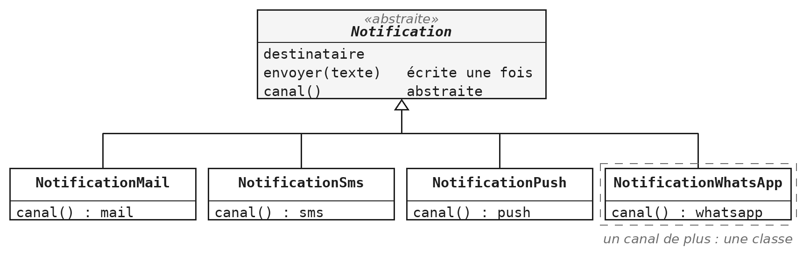
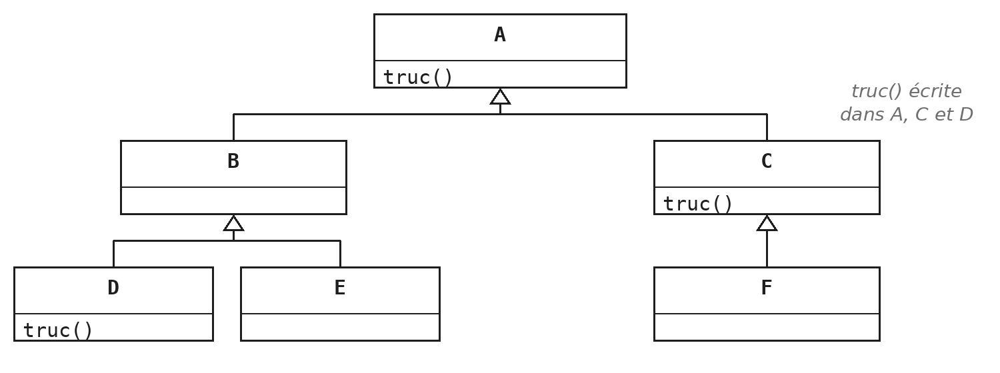
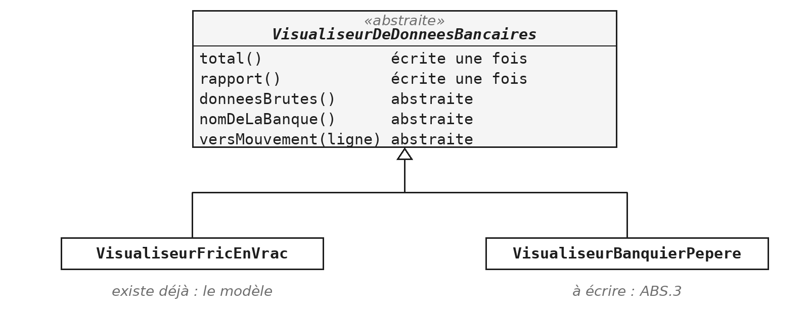

Ce module répond à une question de conception : que faire quand plusieurs classes font la même chose, à un détail près ? La réponse tient en une phrase : ce qui est commun monte, ce qui varie descend.

L'outil pour y parvenir est la classe abstraite, et le mécanisme qui la rend utile est le polymorphisme. Les deux ont été annoncés au module `POO`, avec les quatre principes de la programmation orientée objet. C'est aussi la matière de la quatrième question de l'examen, et l'endroit où se concentre l'erreur la plus fréquente : recopier la même méthode dans trois sous-classes.

> **À la fin de ce module, vous saurez**
> - écrire une sous-classe en Java, appeler le constructeur de sa mère et redéfinir une méthode ;
> - déclarer une classe abstraite et une méthode abstraite, et dire à quoi elles servent ;
> - décider, méthode par méthode, ce qui monte dans la classe mère et ce qui descend ;
> - traiter des objets de classes différentes à travers leur type commun, sans test de type ;
> - écrire un traitement complet dans la classe mère, et ne laisser aux sous-classes que les détails ;
> - construire une hiérarchie à deux étages, puis la concevoir seul à partir d'un énoncé.

## 1. L'héritage en Java

Vous avez vu l'héritage en C#. Cette section le retrouve en Java, sur des classes ordinaires : la syntaxe, l'appel au constructeur de la classe mère, la redéfinition d'une méthode et la visibilité. Rien d'abstrait avant ABS §3.

### Le point de départ : un compte bancaire

Les exemples de cette section partent d'une classe ordinaire, un compte bancaire :

```java
public class CompteBancaire {

    private double solde;
    protected long numero;

    public CompteBancaire(long numero) {
        this.numero = numero;
    }

    public void deposer(double montant) {
        solde += montant;
    }

    public double getSolde() {
        return solde;
    }
}
```

Un compte a un numéro et un solde. On y dépose de l'argent, et on peut consulter le solde. Rien d'autre : c'est la classe mère des exemples qui suivent. Remarquez déjà le `private` du solde et le `protected` du numéro : la dernière sous-section, « Ce que la fille voit de la mère », y revient.

### Une classe qui en reprend une autre

Le mot-clé `extends` place une classe sous une autre. La sous-classe reçoit les champs et les méthodes de sa classe mère, sans les réécrire, et ajoute ce qui lui est propre :

```java
public class CompteEpargne extends CompteBancaire {

    private final double taux;

    public void crediterInterets() {
        deposer(getSolde() * taux);
    }
}
```

L'héritage exprime une relation : un compte d'épargne *est* un compte bancaire. Tout ce que `CompteBancaire` sait faire, `CompteEpargne` le sait aussi, sans qu'une seule ligne soit recopiée. La sous-classe appelle `deposer` et `getSolde` sans les avoir écrites, puisqu'elle en a hérité.

Une classe ne peut étendre qu'une seule classe. C'est une différence importante avec les interfaces, que le module `ITF` aborde.

### Appeler le constructeur de la classe mère

Un objet `CompteEpargne` contient aussi la partie `CompteBancaire`, avec ses champs. Quelqu'un doit les initialiser, et ce quelqu'un est le constructeur de la classe mère :

```java
public class CompteEpargne extends CompteBancaire {

    public CompteEpargne(long numero, double taux) {
        super(numero);
        this.taux = taux;
    }
}
```

L'appel s'écrit `super(...)`, et doit être la première instruction du constructeur. La classe mère initialise sa part, la classe fille la sienne. Si vous n'écrivez pas cet appel, le compilateur ajoute `super()` tout seul, et se plaint quand la classe mère n'a pas de constructeur sans argument. Si la classe mère a un constructeur sans argument, cela ne posera pas de problème (voir `POO §2`).

### Redéfinir une méthode

Une sous-classe peut redéfinir une méthode héritée, en la réécrivant avec la même signature :

```java
public class CompteEpargne extends CompteBancaire {

    @Override
    public void deposer(double montant) {
        super.deposer(montant);
        journaliser(montant);
    }
}
```

L'annotation `@Override` demande au compilateur de vérifier qu'il s'agit bien d'une redéfinition. Une faute de frappe dans le nom, un paramètre oublié, et le compilateur refuse. Sans l'annotation, le programme compilerait, créerait une nouvelle méthode à côté de l'ancienne, et appellerait la méthode de la mère, en silence. L'annotation est facultative pour le langage ; elle ne l'est pas dans votre code.

L'appel `super.deposer(montant)` ajoute un comportement sans jeter celui de la mère. Sans lui, la version de la fille remplacerait purement et simplement l'autre.

### Ce que la fille voit de la mère

Hériter ne donne pas tous les droits :

```java
public class CompteBancaire {

    private double solde;        // invisible dans CompteEpargne
    protected long numero;       // visible dans CompteEpargne
}
```

- **Un champ `private` de la mère reste invisible dans la fille**, même si l'objet le contient bel et bien.
- **Le modificateur `protected`** ouvre le membre aux sous-classes, et aussi au package. C'est le bon choix pour un détail de fonctionnement partagé avec les filles, mais qui ne regarde pas le reste du programme. Le module `PKG` le présente en détail (voir `PKG.5`).
- **Un accesseur `public`** reste une solution, quand l'information regarde tout le monde.

Le réflexe de tout passer en `protected` pour se simplifier la vie coûte cher : chaque champ ouvert est un champ que les sous-classes peuvent corrompre, et qu'on ne peut plus renommer sans impacter les sous-classes qui y font référence.

### De C# à Java

Les concepts sont les mêmes, l'écriture change :

| En C# | En Java |
|---|---|
| `class Fille : Mere` | `class Fille extends Mere` |
| `: base(...)` | `super(...)`, première instruction du constructeur |
| `override` | `@Override`, facultative mais à toujours écrire |
| `is` | `instanceof` |
| `abstract` | `abstract` |

Deux différences méritent l'attention. En C#, `override` est obligatoire et fait partie de la déclaration ; en Java, `@Override` est une annotation facultative, ce qui veut dire qu'on peut redéfinir sans la mettre, et donc se tromper sans être prévenu. En C#, l'appel au constructeur de base s'écrit dans l'en-tête ; en Java, il s'écrit dans le corps, en première instruction.

### A une personne, ou est une personne ?

Au module `TAB`, le vendeur de l'exercice `TAB.4` *avait* une `Person` : c'était un champ. L'héritage permet l'autre modèle, où le vendeur *est* une personne :

::: cote-a-cote
```java
// a une personne : un role
class Vendor {
    private Person personne;
    private Sale[] ventes;
}
```
```java
// est une personne : l'heritage
class Vendor extends Person {
    private Sale[] ventes;
}
```
:::

Les deux se défendent. L'héritage est le plus direct : le vendeur reçoit le nom, le prénom et tout ce que la personne sait faire, sans rien redéclarer. Il convient tant que le vendeur restera vendeur, toute sa vie dans le programme.

Le modèle par rôle est plus souple. La même personne peut être vendeur et cliente à la fois, ou cesser d'être vendeur sans disparaître. Avec l'héritage, c'est impossible : un objet ne change jamais de classe, et une classe Java n'a qu'une seule mère.

La question à se poser est donc moins « est-ce vrai dans la vie ? » que « ce rôle peut-il changer, ou se cumuler ? ». Si oui, le champ ; si non, l'héritage.

## 2. Le même code, trois fois

Cette section pose le problème que la classe abstraite résout. Ce problème est la duplication entre classes sœurs, et c'est l'erreur la plus fréquente à l'examen.

### Un exemple : prévenir un utilisateur

Une application doit prévenir ses utilisateurs, et elle a plusieurs moyens de le faire : un mail, un SMS, une notification sur le téléphone. Trois canaux, un même geste : envoyer un texte. La première idée, la plus naturelle, est d'écrire une classe par canal :

```java
public class NotificationMail {
    public void envoyer(String texte) {
        System.out.println("mail : " + texte);
    }
}
```

`NotificationSms` et `NotificationPush` sont identiques, au mot `mail` près. Rien dans ce code n'est faux : il compile, il fonctionne, et chaque classe est courte et lisible. Le défaut n'apparaît qu'au moment où la demande change.

### Deux défauts, dont un invisible

Le premier défaut se voit : la méthode d'envoi est écrite trois fois. Ajoutez une règle (refuser les messages vides, horodater l'envoi, compter les notifications), et il faut l'implémenter dans chaque classe. Le jour où l'une est oubliée, le programme se comporte différemment selon le canal, et personne ne saura dire pourquoi. C'est l'objet de `CC-CLS.3` du mémento Clean Code : la duplication entre sous-classes se traite en faisant remonter ce qui est commun, pas en le recopiant plus soigneusement.

Le second défaut ne se voit pas, et il est plus grave :

```java
NotificationMail[] canaux = { mail, sms, push };
// refus : sms et push ne sont pas des NotificationMail
```

Ces trois classes font la même chose, et le compilateur n'en sait rien. Il n'existe aucun type qui les désigne toutes les trois, donc aucun moyen d'écrire une boucle qui les traite ensemble. Le seul type commun est `Object`, qui ne sait rien envoyer du tout. Ajouter WhatsApp demandera de retoucher tous les endroits qui traitent les canaux un par un.

> **Démonstration** - `Demo_ABS` : laisser l'outil supprimer la duplication
> La démonstration part des trois notifications, et joue d'abord les deux tentatives impossibles : le tableau, puis la modification en trois endroits. Elle montre ensuite le geste inverse de la recopie : faire remonter. IntelliJ extrait la classe mère sans qu'une ligne soit tapée ; reste à décider ce qui ne peut pas remonter, le nom du canal, qui devient abstrait. Le tableau compile alors.

### Le geste, pas le code

Repérer une duplication est une chose ; la supprimer sans rien casser en est une autre. IntelliJ le fait pour vous, avec deux outils de refactorisation :

- **Extract Superclass** (clic droit sur la classe, puis Refactor, Extract, Superclass) crée la classe mère et y déplace ce que vous désignez ;
- **Pull Members Up** fait remonter une méthode d'une classe existante vers sa mère.

L'intérêt n'est pas le temps gagné, qui est faible. C'est qu'un déplacement fait à la main oublie un import, renomme mal un champ ou laisse une copie derrière lui, alors que l'outil met à jour tout ce qui référence ce qu'il déplace (ce qui devient non négligeable dans un projet qui contient plusieurs centaines de classes, voire plus).

## 3. La classe abstraite

### Une classe qu'on ne peut pas instancier

La classe mère extraite à la section précédente pose une question : que voudrait dire `new Notification(...)` ? Une notification qui n'est ni un mail, ni un SMS, ni un push n'a pas de canal, donc rien à faire. Le mot-clé `abstract` transforme cette absurdité en erreur de compilation :

```java
public abstract class Notification { ... }
```

```java
Notification envoi;                  // d'accord
envoi = new Notification("Ada");     // refus a la compilation
envoi = new NotificationMail("Ada"); // d'accord
```

La classe existe, elle a des champs, des méthodes et un constructeur, mais elle ne produit aucun objet à elle seule. La distinction à retenir est celle entre déclarer et instancier : la variable `envoi` est de type `Notification`, ce qui est une promesse sur ce qu'elle sait faire, et non sur la classe exacte de l'objet qu'elle désigne.

### À quoi sert un type qu'on ne construit pas

Il sert de vocabulaire. On l'utilise comme type de variable, de paramètre, de valeur de retour, et surtout comme type d'élément d'un tableau (et plus tard d'une collection, voir le module `COL`) :

```java
Notification[] canaux = {
    new NotificationMail("Ada"),
    new NotificationSms("0470..."),
    new NotificationPush("ada42")
};
```

Écrire `Notification[]` dit au compilateur que tous les éléments savent envoyer, sans dire par quel canal. Une méthode qui reçoit une `Notification` accepte les trois sortes, et n'a pas à les distinguer. Ce tableau ne contient d'ailleurs aucune `Notification` au sens strict : seulement des objets de sous-classes. ABS §5 explique ce qui se passe quand on appelle une méthode dessus.

Le diagramme résume la hiérarchie obtenue : la classe mère abstraite, qui écrit l'envoi une seule fois et déclare le canal abstrait, et ses sous-classes concrètes, qui ne fournissent que leur canal. La quatrième, WhatsApp, s'ajoute sans rien modifier d'autre : une classe, et le tableau la traite comme les autres.



### Un constructeur, quand même

Une classe abstraite contient des champs, et ces champs doivent être initialisés. C'est le travail d'un constructeur, comme ailleurs ; la seule différence est que personne ne l'appelle par `new`, mais toujours par `super` depuis une sous-classe :

```java
public abstract class Notification {

    protected final String destinataire;

    protected Notification(String destinataire) {
        this.destinataire = destinataire;
    }
}
```

Pourquoi `protected` plutôt que `public`, puisque `new` est de toute façon interdit ? Parce que le modificateur est une déclaration d'intention : il dit à celui qui lit la classe que ce constructeur existe pour les sous-classes. C'est une des questions de `ABS.1`.

## 4. Ce qui monte, ce qui descend

C'est le cœur du module. Tout le reste en découle : la méthode abstraite, l'obligation faite aux sous-classes, et la façon de juger un découpage.

### La méthode abstraite

Une méthode abstraite se déclare par son en-tête, suivi d'un point-virgule. Elle n'a pas de corps, parce que la classe mère ne sait pas comment faire :

```java
public abstract class Notification {

    protected abstract String canal();

    public void envoyer(String texte) {
        System.out.println(canal() + " a " + destinataire + " : " + texte);
    }
}
```

La méthode `envoyer` est écrite une seule fois et appelle `canal()`, que chaque sous-classe fournit : c'est la règle de partage de la sous-section suivante, sur un premier exemple.

Déclarer une méthode abstraite, c'est nommer une obligation. La classe mère affirme que toute notification a un canal, et reconnaît dans le même mouvement qu'elle ne peut pas dire lequel. Une classe qui contient une méthode abstraite est elle-même abstraite ; l'inverse n'est pas vrai, une classe abstraite peut très bien n'avoir aucune méthode abstraite.

### La règle de partage

- Une méthode dont le code serait identique partout appartient à la classe mère.
- Une méthode dont le code diffère à chaque fois est abstraite.

```java
public abstract class Forme {

    // ce qui VARIE : chaque sous-classe le definit
    public abstract String nom();

    // ce qui est COMMUN : ecrit une seule fois
    public void affiche() {
        System.out.println("Je suis un " + nom());
    }
}
```

Regardez la méthode `affiche`. Elle est écrite une seule fois, dans la classe mère, et elle appelle `nom()`, qui n'existe nulle part. Cela compile, parce que le compilateur sait que toute sous-classe concrète en fournira une version. C'est le mécanisme qui porte ABS §6.

Le test pratique est simple. Si vos sous-classes contiennent plus d'une méthode, demandez-vous ce qui aurait dû monter.

### L'obligation faite aux sous-classes

C'est la contrepartie de la promesse faite par la classe mère :

```java
public class Cercle extends Forme {

    @Override
    public String nom() {
        return "cercle";
    }
}
```

Une sous-classe concrète a l'obligation de définir toutes les méthodes abstraites qu'elle hérite. Sinon, elle est abstraite à son tour, et doit le dire dans son en-tête ; ce n'est pas un accident de parcours, c'est exactement ce dont ABS §7 a besoin. Le compilateur ne laisse pas passer l'oubli.

Remarquez que `Cercle` ne contient qu'une méthode. Tout le reste (la position, la rotation, l'affichage) vit dans la classe mère, et n'est écrit qu'une fois.

### `@Override`, aussi pour une méthode abstraite

Pour Java, fournir le corps d'une méthode abstraite, c'est la redéfinir : l'annotation `@Override` s'écrit de la même façon. On pourrait la penser inutile ici, puisque le compilateur refuse déjà une classe concrète qui oublie une méthode abstraite. La différence est dans l'endroit où il le dit :

```java
public class Cercle extends Forme {

    @Override
    public String Nom() {          // refus : Nom() ne redefinit rien
        return "cercle";
    }
}
```

Sans `@Override`, la faute de frappe `Nom()` crée une nouvelle méthode, et l'erreur tombe sur la ligne de la classe : `Cercle` ne définirait pas `nom()`. Avec l'annotation, l'erreur tombe sur la méthode mal écrite. On trouve la faute là où elle est. Vous n'avez d'ailleurs pas à l'écrire vous-même : quand IntelliJ génère les méthodes à fournir (Code, puis Implement Methods), il ajoute `@Override` à chacune.

### Petit détour : le reste d'une division négative

Ce point n'a rien à voir avec les classes abstraites ; il est ici parce que `ABS.1` en a besoin, et qu'il piège tout le monde une fois.

```java
-90 % 360               // -90, et non 270

(-90 % 360 + 360) % 360 // 270
```

La rotation d'une forme doit toujours valoir entre 0 inclus et 360 exclu. Le réflexe est d'écrire un modulo, et il fonctionne pour `setRotation(370)`, qui donne bien 10. Il échoue pour `setRotation(-90)`, parce qu'en Java le reste de la division garde le signe du dividende. La correction tient en une expression : le premier modulo ramène la valeur dans l'intervalle, l'addition la rend positive, et le second modulo efface le tour de trop.

> **Exercices** - `ABS.1` Des formes géométriques
> Chaque méthode demande une décision : monte-t-elle ou descend-elle ? La mesure de la réussite est donnée par l'énoncé : chacune des trois sous-classes ne devrait contenir qu'une seule méthode. Si l'une en a deux, quelque chose n'est pas remonté. Voir `CC-CLS.3`.

## 5. Le polymorphisme

### Un tableau du type le plus général

```java
Shape[] formes = {
    new Circle(centre), new Square(centre), new Triangle(centre)
};

for (Shape forme : formes) {
    forme.affiche();
}
```

Comment un tableau de `Shape` peut-il exister alors que `Shape` ne s'instancie pas ? Parce que le type déclaré d'une variable et la classe réelle de l'objet sont deux choses différentes. Le type déclaré dit ce qu'on a le droit de demander ; la classe réelle dit qui répond. Un `Circle` *est* un `Shape`, donc il a sa place dans le tableau. La boucle ne contient aucune trace des trois formes : ajouter un losange ne la changera pas d'une ligne.

### Qui répond à l'appel

```java
Shape forme = new Circle(centre);

forme.affiche();   // "Je suis un cercle et je m'affiche"
```

La variable est déclarée `Shape`, et pourtant c'est la version du cercle qui s'exécute. Le compilateur vérifie seulement que `Shape` possède bien une méthode `affiche` ; le choix de la version revient à la machine virtuelle, au moment de l'appel, en regardant l'objet réel. Ce mécanisme s'appelle la *liaison dynamique*, et c'est lui qui donne tout son intérêt à la classe abstraite. C'est le polymorphisme, le quatrième des principes présentés au module `POO`.

### Quelle version s'exécute, dans une chaîne d'héritage



Quand une méthode est redéfinie à plusieurs étages d'une hiérarchie, Java part de la classe réelle de l'objet et remonte vers ses ancêtres, jusqu'à la première classe qui écrit la méthode. C'est cette version qui s'exécute.

| Objet de la classe | `truc()` exécutée | Pourquoi |
|---|---|---|
| `A` | celle de `A` | `A` l'écrit |
| `B` | celle de `A` | `B` ne l'écrit pas : on remonte à `A` |
| `C` | celle de `C` | `C` la redéfinit |
| `D` | celle de `D` | `D` la redéfinit |
| `E` | celle de `A` | ni `E` ni `B` ne l'écrivent |
| `F` | celle de `C` | `F` ne l'écrit pas, `C` oui |

Le type de la variable ne change rien : avec `A x = new F();`, l'appel `x.truc()` exécute la version de `C`.

```java
public class D extends B {
    @Override
    public void truc() {
        super.truc();          // la version dont dispose B : celle de A
        System.out.println("et la suite propre a D");
    }
}
```

Dans `D`, `super.truc()` ne désigne pas forcément une méthode écrite dans `B`, la mère directe : il désigne la version dont `B` dispose, c'est-à-dire la plus proche en remontant. Ici, `B` n'écrit pas `truc()`, c'est donc celle de `A` qui s'exécute.

### Ni `instanceof`, ni test de type

```java
for (Shape forme : formes) {
    if (forme instanceof Circle) {   // a ne pas ecrire
        ...
    }
}
```

L'opérateur `instanceof` existe et a ses usages, mais il n'a rien à faire dans une boucle comme celle-ci. Si vous avez besoin de savoir quelle forme vous tenez pour décider quoi faire, c'est que ce « quoi faire » aurait dû être une méthode de la forme. Ce que vous testez, la machine virtuelle le sait déjà.

Le test pratique est celui de `CC-CLS.4` : combien de classes faut-il modifier pour ajouter une sorte de plus ? Avec le polymorphisme, aucune : on écrit la nouvelle classe, et le programme existant la traite sans le savoir. Avec des tests de type, il faut retrouver chaque endroit où le test est écrit. Les énoncés `ABS.2` à `ABS.5` posent tous cette contrainte.

> **Exercices** - `ABS.2` Des animaux qui font du bruit
> Le même geste qu'`ABS.1`, sur un cas plus court, avec une nouveauté : le tableau est rempli au hasard, donc le programme ignore vraiment ce qu'il contient. Deux questions valent le détour : combien de lignes faut-il modifier pour ajouter une vache, et que devient l'exercice sans classe abstraite ? Voir `CC-CLS.4`.

## 6. La mère appelle la fille

C'est la forme la plus utile de la classe abstraite, et le cas le plus proche du travail réel : la classe mère écrit le déroulé complet d'un traitement, et laisse aux sous-classes les seuls endroits qui varient.

### De quoi il s'agit

Une application affiche les mouvements bancaires de ses utilisateurs. Elle fonctionne aujourd'hui avec une seule banque, Fric en Vrac, et il faut y ajouter Banquier Pépère. Les deux banques livrent les mêmes informations (un compte, un montant, une communication), et chaque ligne devient un `Mouvement`, un `record`. Elles ne les livrent pas dans le même ordre de colonnes, et c'est la seule chose qui les distingue.



### Le squelette, puis le détail

```java
public abstract class VisualiseurDeDonneesBancaires {

    // a fournir par chaque banque
    protected abstract String[][] donneesBrutes();
    protected abstract String nomDeLaBanque();
    protected abstract Mouvement versMouvement(String[] ligne);

    // deja ecrit, une fois pour toutes
    public double total() { ... }
    public String rapport() { ... }
}
```

La classe mère ne délègue pas le traitement : elle le possède. Elle sait convertir l'ensemble, additionner les montants et mettre en forme le rapport. Ce qu'elle ignore, c'est d'où viennent les données, comment s'appelle la banque et comment se lit une ligne. Ces trois trous sont déclarés abstraits ; chaque banque les bouche à sa façon, et hérite de tout le reste sans rien écrire.

Le renversement est le point à comprendre : ce n'est pas la sous-classe qui appelle la mère, c'est la mère qui appelle la sous-classe. Le code commun mène la danse, et vient chercher le détail au moment où il en a besoin.

### Deux banques, un seul traitement

| Banque | `ligne[0]` | `ligne[1]` | `ligne[2]` |
|---|---|---|---|
| Fric en Vrac | compte | montant | communication |
| Banquier Pépère | communication | compte | montant |

Toute la différence entre les deux visualiseurs tient donc dans `versMouvement` : l'un lit le compte en `ligne[0]`, l'autre en `ligne[1]`. Le reste est identique. C'est exactement la situation où la duplication est tentante : recopier le visualiseur existant et déplacer trois indices prend cinq minutes et fonctionne. Puis le calcul du total se révèle faux un jour, et il faut le corriger dans les deux.

### Pourquoi `protected`

La méthode qui convertit une ligne est `protected`, alors que c'est précisément une méthode qu'une autre classe doit définir. Parce que « une autre classe » veut dire ici « une sous-classe », et rien de plus. Le programme qui affiche les rapports n'a aucune raison de lire une ligne lui-même : il appelle `rapport` et `total`. Tout ce qui sert à construire le résultat est un détail de fabrication. L'ouvrir en `public` ne casserait rien aujourd'hui, mais transformerait un détail interne en promesse faite au reste du programme, qu'il faudrait ensuite tenir.

### La mesure de la réussite

- La nouvelle classe devrait faire une vingtaine de lignes, dont trois méthodes de deux lignes.
- Si elle est plus longue, c'est que quelque chose a été recopié de la mère.
- Le programme ne contient ni `instanceof`, ni condition sur la banque.

> **Exercices** - `ABS.3` Deux banques, un seul traitement
> L'exercice ne demande pas d'écrire un dispositif, mais d'en compléter un qui existe déjà. C'est la situation la plus fréquente en entreprise : lire ce qui est fourni avant d'écrire, et n'ajouter que ce qui manque réellement. Le visualiseur de la première banque sert de modèle.

## 7. Deux étages

Les exercices précédents n'avaient qu'un seul niveau d'abstraction. Cette section en ajoute un second, et c'est la forme que prend la quatrième question de l'examen.

### Une classe abstraite peut en étendre une autre

Une société facture au forfait ou à l'heure, et chaque façon connaît deux variantes. Deux niveaux de regroupement apparaissent naturellement : ce qui est vrai de toute prestation, et ce qui n'est vrai que des prestations horaires, ou que des forfaits.


`Prestation` connaît le client, parce que toute prestation en a un. `Horaire` connaît le taux et le nombre d'heures, parce que les forfaits n'en ont pas. `Urgence` connaît la majoration, parce qu'elle est seule à en avoir une. Quatre classes sont concrètes, trois ne le sont pas : une classe est abstraite tant qu'elle ne suffit pas à décrire une prestation réelle.

### Où placer chaque champ

Un champ se déclare à l'étage où il devient commun. Trop haut, il encombre qui n'en a pas l'usage ; trop bas, il s'écrit deux fois.

```java
public abstract class Horaire extends Prestation {

    private final double tauxHoraire;
    private final int heures;

    protected double base() {
        return heures * tauxHoraire;
    }
}
```

C'est la règle d'ABS §4, appliquée à plusieurs étages. Le taux horaire n'appartient pas à `Prestation`, puisqu'un abonnement n'en a pas. Il n'appartient pas non plus à `Depannage` et à `Urgence` séparément, puisque les deux en ont un : il appartient à `Horaire`. La méthode `base` suit le même raisonnement ; `Urgence` s'en servira en y appliquant sa majoration. Sa visibilité est une des décisions que l'exercice vous laisse : c'est un détail de calcul dont les sous-classes ont besoin, et personne d'autre (voir `PKG.5`).

### Implémenter sans définir

```java
public abstract class Prestation implements Facturable {

    public String facture() {
        return client + " : " + montant() + " EUR";
    }
}
```

Les interfaces sont le sujet du module `ITF`. Il suffit ici d'en savoir ceci : une interface énonce ce qu'une classe doit savoir faire, et `implements` s'engage à le faire. `Prestation` s'y engage sans tenir l'engagement, et c'est légal parce qu'elle est abstraite : elle reporte l'obligation sur ses descendants, exactement comme une méthode abstraite ordinaire. La méthode `facture`, elle, est écrite tout de suite, et appelle une méthode qui n'existe dans aucune classe au moment où on l'écrit. C'est le mécanisme d'ABS §6, poussé un cran plus loin.

> **Exercices** - `ABS.4` Une hiérarchie à deux niveaux, à faire après le module `ITF`
> L'exercice réunit tout le module : deux étages d'abstraction, une interface à implémenter, un champ à placer au bon niveau, un tableau du type le plus général et pas un seul test de type. Il demande l'interface `Facturable`, qui appartient au module suivant. Deux décisions vous appartiennent, qu'aucun test ne vérifie : où implémenter `montant`, et quelle visibilité donner aux accesseurs intermédiaires.

## 8. Décider soi-même

Le dernier exercice du module ne fournit aucun squelette. C'est le seul du recueil dans ce cas, et c'est la situation de l'examen.

### Quand il n'y a plus de squelette

Les exercices précédents donnaient les classes, les signatures et les types : il restait à remplir les corps. Ici, vous partez d'un fichier vide, et les décisions de conception sont l'exercice lui-même. Combien de classes, laquelle est abstraite, où va chaque méthode : à vous de savoir. Trois questions suffisent à démarrer :

1. **Qu'est-ce que les classes ont en commun ?** Ce qui est commun monte, et ne s'écrit qu'une fois.
2. **Que sait faire la classe « en général » ?** S'il y a une chose qu'elle ne sait pas faire alors que toutes ses sortes la savent, vous tenez votre méthode abstraite.
3. **Ce qui varie peut-il se réduire à un détail ?** Regardez ce qui change d'une sorte à l'autre, et relisez `ABS.1`.

La classe de test est fournie, mais en commentaire, parce qu'elle appelle des classes qui n'existent pas encore. Décommentez-la quand vos classes seront écrites, d'un seul coup, avec `Ctrl+/`.

> **Exercices** - `ABS.5` Tout écrire, à partir de rien, puis `G.10` La classe abstraite `Jeu` (fil rouge GameHub)
> `ABS.5` fait écrire un service postal à trois tarifs. Le piège n'est pas dans le calcul mais dans la borne : « jusqu'à 50 g inclus » s'écrit avec un `<=`, et une erreur d'un gramme ne se voit pas en essayant au hasard ; le test à la borne l'attrape tout de suite. Comparez ensuite le temps passé sur `ABS.5` et sur `ABS.4`, et demandez-vous où est passée la différence : à écrire, ou à décider. Côté fil rouge, `G.10` introduit la classe abstraite `Jeu`, socle des jeux concrets à venir.

## Ce qu'il faut retenir

- `extends` pour hériter, `super(...)` en première instruction du constructeur, `@Override` toujours.
- Une classe abstraite ne s'instancie pas ; elle sert de type commun.
- Ce qui est commun monte, ce qui varie descend, sous forme de méthode abstraite.
- La méthode exécutée est celle de la classe réelle de l'objet : c'est le polymorphisme.
- Un test de type dans une boucle signale une hiérarchie mal découpée.
- La mère peut écrire tout le traitement, et appeler les détails que les filles fournissent.

La mesure d'un bon découpage tient en une question : combien de classes faut-il modifier pour ajouter une sorte de plus ? La bonne réponse est zéro, et une classe à écrire.
