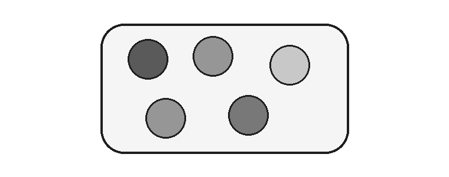
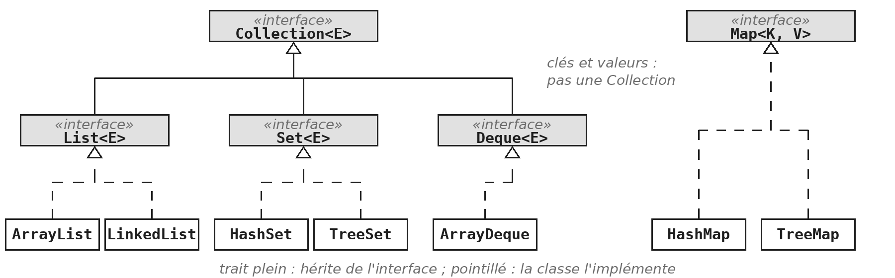
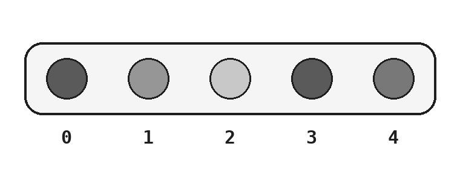
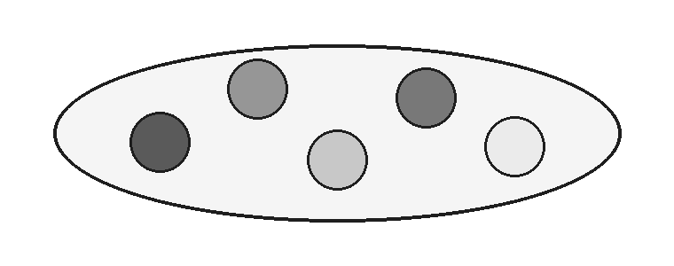
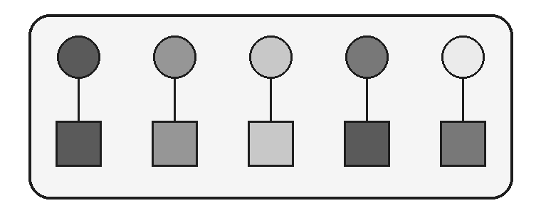
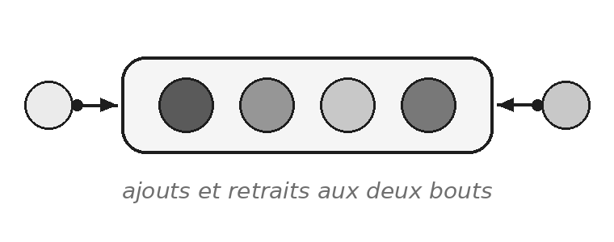

Un tableau a une taille fixe, choisie à sa création. Le module `TAB` l'avait annoncé : quand cette limite devient gênante, il faut une collection. Une collection grandit toute seule, et chacune tient une promesse différente.

Ce module répond à deux questions : comment ranger des objets dans une structure qui grandit, et laquelle choisir. La seconde compte plus que la première. La syntaxe s'apprend en une heure ; le bon choix évite des dizaines de lignes de vérifications. C'est le module le plus fourni du recueil, avec sept exercices, et le fil rouge en dépend aussi : le jeu de bataille de GameHub range ses cartes dans des collections.

> **À la fin de ce module, vous saurez**
> - déclarer une collection par son interface, et choisir son implémentation ;
> - utiliser une liste (`List`), un ensemble (`Set`), une table associative (`Map`) et une file à deux bouts (`Deque`) ;
> - choisir entre elles d'après la promesse que chacune tient ;
> - expliquer comment un ensemble décide que deux éléments sont égaux ;
> - passer un comportement à une méthode de collection, sous la forme d'un objet ;
> - lire et construire une collection emboîtée.

## 1. Une structure qui grandit

> **Démonstration** - `Demo_COL` : choisir une collection en se trompant d'abord
> La démonstration part d'une liste d'invités où le même nom figure deux fois. Une première correction est proposée, puis une seconde, beaucoup plus courte, qui ne tient qu'en un mot changé. Le même remède sert ensuite à un deuxième problème. Retenez la méthode plutôt que la syntaxe : on ne choisit pas une collection par habitude, on la choisit sur la promesse qu'elle tient. Et quand la structure porte une règle, personne n'a plus besoin d'y penser.

### Ce qu'on écrit entre chevrons

```java
List<String> titres = new ArrayList<>();

titres.add("Germinal");
titres.add(42);                  // refuse a la compilation

String premier = titres.get(0);  // aucune conversion
```

`List<String>` se lit « une liste de `String` ». Le type entre chevrons (`<` et `>`) est celui des éléments de la collection. C'est un paramètre : la même interface `List` sert pour des chaînes, des nombres ou des livres. Le compilateur vérifie à chaque ajout que l'élément est du bon type, et il connaît le type de ce qui sort. L'erreur apparaît donc à la compilation, pas à l'exécution.

À droite du `new`, les chevrons vides, appelés *diamant*, évitent de répéter le type : le compilateur le déduit de la déclaration. Vous apprenez ici à lire cette notation ; l'écriture d'une classe qui reçoit un type en paramètre, comme `List` le fait, est le sujet du module `GEN`.

### Des objets, pas des types primitifs

```java
List<Integer> annees = new ArrayList<>();   // List<int> : refuse

annees.add(1885);                // auto-boxing de int vers Integer
int premiere = annees.get(0);    // unboxing de Integer vers int
```

Une collection ne contient que des objets. On écrit donc `Integer` et non `int` entre les chevrons. Le module `POO` a présenté ces classes enveloppes, et la conversion automatique entre les deux formes, l'autoboxing (voir `POO §7`). Elles prennent ici leur raison d'être.

En pratique, vous écrivez `Integer` entre les chevrons et vous oubliez la différence. Avec deux exceptions :

- **Comparer deux `Integer` avec `==` compare deux objets**, pas deux nombres : écrivez `equals`, ou convertissez d'abord en `int`.
- **Un `Integer` peut valoir `null`**, ce qu'un `int` ne peut pas : la conversion échoue alors à l'exécution. COL §4 montre où ce cas se présente.

### Déclarer par l'interface

```java
List<String> titres = new ArrayList<>();
Set<String> auteurs = new HashSet<>();
Map<String, Integer> nombrePages = new HashMap<>();
```

`List`, `Set` et `Map` sont des interfaces ; `ArrayList`, `HashSet` et `HashMap` sont des classes qui les implémentent. On déclare la variable avec l'interface, ce que la variable promet, et on choisit la classe au moment du `new`, comment la promesse est tenue. Changer d'implémentation ne change alors qu'un mot.

C'est le principe du module `ITF` : le type le plus faible qui suffit (voir `ITF §4`). Le reste du programme ne connaît que la promesse, et l'implémentation peut changer sans qu'il le sache. Toutes ces interfaces et ces classes vivent dans le package `java.util`, qu'il faut importer.

Une *collection* rassemble des objets dans une seule structure, qui grandit et rétrécit au fil des ajouts et des retraits. Chaque sorte de collection ajoute à cette idée sa propre promesse : garder un ordre, refuser les doublons, ranger par clé, ou ne s'ouvrir que par ses bouts. Les sections suivantes les présentent une à une.



La carte ci-dessous situe les interfaces les unes par rapport aux autres, avec les classes qui les implémentent.



## 2. Une liste, des positions

Une liste (`List`) est une collection *ordonnée* : chaque élément y occupe une position, numérotée à partir de `0`, et l'ordre dans lequel on les a rangés est conservé. Elle accepte les doublons : la même valeur peut y figurer plusieurs fois, à des positions différentes. C'est la collection la plus proche du tableau, sans sa taille fixe : elle grandit à chaque ajout et rétrécit à chaque retrait.

On la choisit quand l'ordre compte, ou quand on a besoin de retrouver un élément par sa position : une liste de lecture, les coups d'une partie, les lignes d'un fichier.



### Les opérations d'une liste

```java
List<String> titres = new ArrayList<>();
titres.add("Germinal");
titres.add("Nana");
titres.add(0, "Candide");          // insere en tete

titres.size();                     // 3
titres.get(1);                     // "Germinal"
titres.contains("Nana");           // true
titres.remove("Nana");             // retire l'element
```

Une liste garde l'ordre d'ajout, et accepte les doublons. C'est le remplaçant direct du tableau : des positions numérotées à partir de 0, comme `t[0]`, mais sans taille fixe. La méthode `add` ajoute à la fin, ou à la position demandée si on la donne.

| Méthode | Ce qu'elle fait |
|---|---|
| `get(i)` | retourne l'élément en position `i` ; `IndexOutOfBoundsException` si elle n'existe pas |
| `set(i, valeur)` | remplace l'élément en position `i` (rappel : les indices commencent à `0`) |
| `indexOf(valeur)` | retourne la position d'un élément, ou `-1` s'il est absent |
| `remove(...)` | retire une position, ou un élément |

> **Attention** - `remove` sur une liste d'`Integer`
> La méthode `remove` existe en deux versions : `remove(int)` retire la position, `remove(Object)` retire l'élément. Sur une `List<Integer>`, `remove(2)` retire donc l'élément en position 2 (donc le troisième), pas le nombre 2.

### Parcourir une collection

```java
for (String titre : titres) {
    System.out.println(titre);
}

System.out.println(titres);      // [Candide, Germinal]
```

La boucle for-each, vue au module `TAB` pour les tableaux, accepte n'importe quelle collection : une liste, un ensemble, et les vues d'une table présentées en COL §4. Elle parcourt les éléments dans l'ordre que la collection garantit, s'il y en a un.

Contrairement à un tableau, dont l'affichage produisait un code illisible, une collection s'affiche entre crochets, éléments séparés par des virgules. C'est commode pour vérifier ce que contient une structure en cours de mise au point.

### Ce que la boucle for-each utilise : `Iterable` et `Iterator`

```java
Iterator<String> it = titres.iterator();
while (it.hasNext()) {
    String titre = it.next();
    System.out.println(titre);
}
```

La boucle for-each n'est pas réservée aux collections du JDK : elle accepte tout objet qui implémente l'interface `Iterable`, dont hérite `Collection`. Cette interface ne promet qu'une chose : savoir fournir un `Iterator`, un objet qui parcourt les éléments un par un. Il répond à deux questions : `hasNext()`, reste-t-il un élément ? et `next()`, lequel ?

Le code ci-dessus est, à peu de chose près, ce que le compilateur écrit pour vous quand il rencontre une boucle for-each sur une collection. Vous n'aurez presque jamais à écrire un itérateur vous-même. Il faut toutefois le connaître pour un cas précis, que COL §5 présente : retirer des éléments pendant un parcours.

### `ArrayList` ou `LinkedList`

Les deux classes tiennent exactement la même promesse : celle de `List`. Un programme qui déclare ses variables avec l'interface fonctionne avec l'une comme avec l'autre, et le test de `COL.5` le vérifie justement sur une `LinkedList`.

Elles diffèrent par leur fonctionnement interne, donc par leur rapidité selon l'usage. `ArrayList` range ses éléments dans un tableau qu'elle agrandit elle-même, ce qui rend `get(i)` immédiat. `LinkedList` chaîne ses éléments les uns aux autres, ce qui rend immédiats les ajouts et retraits aux deux bouts, mais lent `get(i)`. Prenez `ArrayList` sauf raison précise.

### `Collection` et `Collections`

```java
Collections.sort(titres);             // trie la liste elle-meme
Collections.shuffle(titres);          // la melange
String premier = Collections.min(titres);
int fois = Collections.frequency(titres, "Nana");
```

Les deux noms ne diffèrent que d'une lettre, et la confusion est classique.

- **L'interface `Collection`** est l'interface mère de `List` et de `Set` : elle déclare ce que toutes les collections savent faire, `add`, `remove`, `size`, `contains`.
- **La classe `Collections`**, au pluriel, est une classe utilitaire, comme `Math` : uniquement des méthodes statiques, qui travaillent sur des collections.

Les méthodes `sort` et `shuffle` reçoivent une `List`, parce qu'un ensemble n'a pas de positions à réordonner. Elles modifient la liste reçue et ne retournent rien. Les méthodes `min` et `max` retournent le plus petit et le plus grand élément, `frequency` compte les apparitions d'une valeur. La Javadoc de `Collections` en contient une vingtaine d'autres.

### Nommer ses bornes

```java
private static final int MINIMUM = 0;
private static final int MAXIMUM = 1000;

System.out.printf("Nombres entre %d et %d%n", MINIMUM, MAXIMUM);
int tire = MINIMUM + hasard.nextInt(MAXIMUM - MINIMUM + 1);
```

Une première version de ce programme écrivait `hasard.nextInt(1001)`. Le lecteur devait deviner d'où sortait 1001, et pourquoi pas 1000. La réponse tient au module `ENU` : `nextInt(n)` de la classe `Random` retourne un entier de `0` inclus à `n` exclu, et il faut donc compter les valeurs de l'intervalle.

Avec deux constantes, le calcul se lit au lieu de se deviner. Le gain le plus utile est ailleurs : les mêmes constantes servent au message. Le jour où l'intervalle change, le programme ne peut plus annoncer 0 à 1000 en tirant jusqu'à 500. Les squelettes de `COL.1`, `COL.5` et `COL.6` vous donnent ces constantes : servez-vous-en partout. C'est la règle `CC-NOM.7`.

> **Exercices** - `COL.1` Deux façons d'être trié, puis `COL.3` Lire des noms et les trier
> `COL.1` oppose deux manières d'obtenir des nombres triés : trier une liste, ou les ranger dans une structure qui reste triée, ce que la démonstration a montré. Lisez bien la consigne de la première méthode : la liste reçue ne doit pas être modifiée, et `Collections.sort` modifie celle qu'elle reçoit. `COL.3` remplit une liste à partir d'un `Scanner`, que la classe fournie `SourceDeTexte` vous donne déjà ouvert : l'exercice porte sur les collections, pas sur les fichiers. Les deux exercices finissent sur une question d'ordre.

## 3. Un ensemble, sans doublons

Un ensemble (`Set`) est une collection qui ne contient jamais deux fois la même valeur, comme un ensemble au sens mathématique. Il n'a pas de positions : on ne demande pas « le troisième élément », on demande « cette valeur y est-elle ? ». On le choisit quand l'unicité est la règle : les auteurs d'une bibliothèque, les cours suivis par un étudiant, les numéros déjà tirés.



### Ce qu'un ensemble refuse

```java
Set<String> auteurs = new HashSet<>();

auteurs.add("Zola");             // true
auteurs.add("Zola");             // false : deja present
auteurs.size();                  // 1
auteurs.contains("Zola");        // true
```

Un ensemble ne garde qu'un exemplaire de chaque valeur. Ajouter une valeur présente ne lève aucune erreur : rien ne se passe, et `add` retourne `false` pour le signaler. C'est ce que la démonstration a exploité.

Un ensemble n'a pas de positions : ni `get(i)`, ni `add(i, x)`. On l'interroge avec `contains`, on le parcourt avec la boucle for-each, mais on ne demande jamais « le troisième élément ». Ce n'est pas une limite : c'est ce qui lui permet d'autres services, que `COL.6` vous fera découvrir.

### Qui décide que deux éléments sont égaux

```java
record Exemplaire(String titre, int numero) { }
```

```java
Set<Exemplaire> rayon = new HashSet<>();
rayon.add(new Exemplaire("Nana", 1));
rayon.add(new Exemplaire("Nana", 1));

rayon.size();                    // 1
```

Le module `ENU` l'avait annoncé en présentant les records : la question de l'égalité reviendrait. Pour savoir si une valeur est déjà présente, un `HashSet` appelle `hashCode` puis `equals` sur ses éléments.

- **`String` et `Integer`** les définissent comme on s'y attend : deux chaînes de mêmes lettres sont égales.
- **Un `record`** les définit aussi, en comparant ses composants : les deux exemplaires ci-dessus ne comptent donc qu'une fois.
- **Une classe ordinaire** qui ne redéfinit rien compare des références : deux objets construits séparément sont différents, même avec les mêmes valeurs, et l'ensemble en garde deux.

Écrire `equals` et `hashCode` à la main est possible, toujours ensemble[^contrat], et IntelliJ les génère. Ce cours ne vous le demandera pas : un `record` suffit dans tous les exercices. La même règle vaut pour les clés d'une table, en COL §4.

[^contrat]: Les deux méthodes sont liées par un contrat : si `a.equals(b)` retourne `true`, alors `a.hashCode()` et `b.hashCode()` doivent retourner le même nombre. L'inverse n'est pas exigé : deux objets différents peuvent avoir le même code de hachage, ce qui ralentit un peu la recherche sans la fausser. Un `HashSet` cherche d'abord dans la case que désigne `hashCode`, puis compare avec `equals` : si deux objets égaux avaient des codes différents, il les rangerait dans deux cases, et ne verrait jamais le doublon. C'est pourquoi on les redéfinit toujours ensemble.

### `Hash` ou `Tree`

| | `HashSet`, `HashMap` | `TreeSet`, `TreeMap` |
|---|---|---|
| Ordre de parcours | aucun ordre garanti | trié en permanence |
| Les éléments doivent | définir `equals` et `hashCode` | savoir se comparer |
| Quand le choisir | par défaut | quand l'ordre compte |

Les ensembles (`Set`) et les tables associatives (`Map`) existent chacun en deux implémentations principales, et la différence est la même des deux côtés. Les classes `Hash` rangent les éléments selon leur code de hachage, ce qui les rend très rapides mais ne garantit aucun ordre de parcours. Les classes `Tree` les rangent dans un arbre trié : le parcours se fait toujours dans l'ordre, au prix d'un peu de vitesse.

Savoir se comparer est le cas des chaînes, des nombres, des dates et des énumérations, dont l'ordre est celui de déclaration (voir `ENU §2`). Pour vos propres classes, il faut leur apprendre à se comparer, ce que COL §6 montre : sans cela, un `TreeSet` de records lève une exception au premier ajout. Une troisième implémentation, `LinkedHashSet` et `LinkedHashMap`, garde l'ordre d'ajout ; vous ne la croiserez pas dans les exercices.

> **Exercices** - `COL.6` Un ensemble sans doublons
> L'exercice fait constater les deux services d'un ensemble : il ne garde qu'un exemplaire de chaque valeur, et il répond très vite à `contains`. La première question demande pourquoi une liste ne le peut pas : cherchez avant de lire la Javadoc. Le squelette du programme vous donne trois constantes, le nombre de tirages et les deux bornes, et le calcul de COL §2 sert de nouveau. Le résultat de la deuxième question surprend presque toujours.

## 4. Une table, des clés

Une table associative (`Map`) range des couples : à chaque *clé* correspond une *valeur*. On ne la parcourt pas pour chercher : on donne la clé, et la table retourne la valeur. Les clés sont uniques, comme les éléments d'un ensemble ; les valeurs peuvent se répéter. On la choisit chaque fois qu'on retrouve une information par un identifiant : un dictionnaire, un annuaire, un stock par référence.



### Ranger et retrouver par clé

```java
Map<String, Integer> nombrePages = new HashMap<>();
nombrePages.put("Germinal", 591);
nombrePages.put("Candide", 160);

nombrePages.get("Candide");            // 160
nombrePages.containsKey("Nana");       // false
nombrePages.size();                    // 2
```

Une table associative, `Map` en Java, associe une valeur à chaque clé. On y range avec `put`, on retrouve avec `get` en donnant la clé, et on ne parcourt jamais pour chercher. Un dictionnaire, un annuaire, un stock par référence : tout ce qui se consulte par un identifiant est une table. Les chevrons contiennent deux types : celui des clés, celui des valeurs.

Les clés sont uniques, comme les éléments d'un ensemble, et pour la même raison : elles sont comparées par `equals` et `hashCode`, ou rangées dans un arbre pour une `TreeMap`. Un second `put` avec la même clé remplace la valeur. Les valeurs, elles, peuvent se répéter. Remarquez qu'une table n'est pas une `Collection` : l'interface `Map` n'hérite pas de `Collection`, et n'a pas de méthode `add`.

### Une clé absente

```java
Integer inconnu = nombrePages.get("Nana");           // null
int nombre = nombrePages.getOrDefault("Nana", 0);    // 0

int plantage = nombrePages.get("Nana");    // NullPointerException
```

Une clé inconnue n'est pas une erreur pour une table : `get` retourne simplement `null`, et c'est au programme de le prévoir. La dernière ligne est le cas annoncé en COL §1 : la valeur `null` ne peut pas être convertie en `int`, et la conversion automatique échoue à l'exécution, par une `NullPointerException` qui ne désigne pas clairement la cause.

La méthode `getOrDefault` évite le problème : elle retourne la valeur si la clé existe, et la valeur par défaut fournie sinon. Elle sert souvent quand une absence a un sens naturel : zéro pour un compte, une liste vide pour un ensemble de résultats.

### Trois façons de parcourir une table associative

```java
for (String titre : nombrePages.keySet()) { ... }

for (int nombre : nombrePages.values()) { ... }

for (Map.Entry<String, Integer> entree : nombrePages.entrySet()) {
    System.out.println(entree.getKey() + " : " + entree.getValue());
}
```

Une table ne se parcourt pas directement, mais elle offre trois vues, que la boucle for-each parcourt : `keySet` retourne l'ensemble des clés, `values` la collection des valeurs, et `entrySet` l'ensemble des couples. Chaque couple est un objet de type `Map.Entry`, avec ses deux accesseurs `getKey` et `getValue`.

Quand on a besoin des deux à la fois, c'est la vue à préférer : parcourir les clés puis appeler `get` pour chacune refait une recherche à chaque tour. Ces vues suivent l'ordre de la table : aucun pour une `HashMap`, l'ordre des clés pour une `TreeMap`.

> **Exercices** - `COL.2` Un annuaire, puis `COL.4` Compter les mots d'un texte
> `COL.2` range des fiches par nom, puis pose la question qui fait l'exercice : peut-on obtenir les fiches dans l'ordre des noms ? Répondez d'abord sans changer de table, puis en en changeant : la seconde réponse ne demande qu'une ligne, et le test passe toujours. `COL.4` est l'usage le plus courant d'une table : accumuler un décompte, où `getOrDefault` fait gagner trois lignes. Les deux exercices finissent sur une question de conception ; celle de `COL.2`, sur la méthode `chercher` qui retourne `null`, trouvera sa réponse en `COL.7`.

## 5. Passer un comportement

### Des méthodes ajoutées aux interfaces

```java
// dans l'interface Map<K, V>
default V getOrDefault(Object cle, V parDefaut) { ... }
```

Le module `ITF` l'avait annoncé : vous utiliseriez des méthodes par défaut sans le savoir, dès ce module (voir `ITF §6`). Vous venez de le faire avec `getOrDefault`. Java 8 a ajouté de telles méthodes à `Collection` et à `Map`, parmi elles `getOrDefault`, `removeIf` et `computeIfAbsent`.

Le problème qu'elles ont résolu est celui d'ITF §6, à l'échelle du monde. Ajouter une méthode abstraite à `Map` aurait cassé toutes les classes qui l'implémentent, y compris celles écrites hors du JDK. Une méthode par défaut contient son propre code : chaque table l'a reçue d'office. Deux de ces méthodes ont une particularité, qui fait le sujet de cette section : elles reçoivent un comportement en paramètre.

### Retirer pendant un parcours

```java
for (String titre : titres) {
    if (titre.length() > 20) {
        titres.remove(titre);   // ConcurrentModificationException
    }
}
```

Retirer un élément d'une collection pendant qu'une boucle for-each la parcourt lève une `ConcurrentModificationException`. L'itérateur caché dans la boucle détecte que la collection a changé sous ses pieds, et refuse de continuer plutôt que de sauter un élément en silence.

Deux remèdes. Le premier écrit l'itérateur explicitement, et lui demande de retirer l'élément qu'il vient de fournir, ce qu'il sait faire sans se perdre :

```java
Iterator<String> it = titres.iterator();
while (it.hasNext()) {
    if (it.next().length() > 20) {
        it.remove();
    }
}
```

Le second, plus court, est la méthode `removeIf`, qui fait exactement ce travail : c'est l'objet de la sous-section suivante.

### Une méthode qui reçoit un critère

```java
// dans l'interface Collection<E>
default boolean removeIf(Predicate<? super E> filtre) { ... }

// dans l'interface Predicate<T>
boolean test(T valeur);
```

La méthode `removeIf` parcourt la collection et appelle `test` sur chaque élément ; ceux pour lesquels `test` retourne `true` sont retirés. Elle ignore tout du critère : elle sait seulement qu'on lui a donné un objet capable de répondre oui ou non.

`Predicate` est une interface fonctionnelle, au sens d'`ITF §6` : elle possède une seule méthode abstraite. Elle appartient au package `java.util.function`, qui en contient d'autres, dont `Function`, en COL §7. Le `? super E` se lit « un critère qui sait tester des `E` » ; il autorise par exemple un critère écrit pour des `Object` sur une liste de `String`, et son écriture sera détaillée au module `GEN`.

### Écrire le critère dans une classe

```java
public class TitreLong implements Predicate<String> {

    private static final int LONGUEUR_MAX = 20;

    @Override
    public boolean test(String titre) {
        return titre.length() > LONGUEUR_MAX;
    }
}
```

```java
titres.removeIf(new TitreLong());
```

Vous connaissez déjà tout ce qui est écrit ici : une classe qui implémente une interface, une méthode redéfinie, et un objet passé en paramètre à une méthode qui ne connaît que l'interface. C'est ITF §1, avec une interface que le JDK a écrite à votre place.

La classe porte un nom qui dit ce qu'elle teste. On peut la réutiliser, et la tester séparément. Le critère, lui, est une constante nommée : la règle de COL §2 vaut partout. Au module `LAM`, ce même critère s'écrira en une ligne, sans classe.

> **Exercices** - `COL.5` Filtrer avec un prédicat
> L'exercice applique exactement cette sous-section, sur des nombres pairs. La classe `EstPair` est testée seule, puis employée par deux méthodes, dont une qui compte sans rien supprimer. La première question vous fait essayer de supprimer les pairs autrement, avec une boucle : faites-le vraiment, ce que vous obtiendrez explique pourquoi `removeIf` existe.

## 6. Comparer et trier

Une seule question, deux réponses : comment Java sait-il dans quel ordre ranger des objets ? Un `TreeSet`, une `TreeMap` et le tri d'une liste ont tous besoin de savoir, pour deux éléments quelconques, lequel vient avant l'autre. Soit la classe le définit elle-même, c'est son ordre *naturel* ; soit on fournit un ordre de l'extérieur, un parmi d'autres.

### L'ordre naturel : `Comparable`

Un `TreeSet` ou une `TreeMap` doit savoir, pour deux éléments quelconques, lequel vient avant l'autre. Les chaînes, les nombres, les dates et les énumérations le savent déjà, parce que leurs classes implémentent l'interface `Comparable`. Une classe que vous écrivez peut faire de même :

```java
record Exemplaire(String titre, int numero)
        implements Comparable<Exemplaire> {

    @Override
    public int compareTo(Exemplaire autre) {
        return Integer.compare(numero, autre.numero);
    }
}
```

L'interface ne déclare qu'une méthode, `compareTo`, et son résultat se lit par son signe, pas par sa valeur :

| `a.compareTo(b)` retourne | Ce que cela veut dire |
|---|---|
| un nombre négatif | `a` vient avant `b` |
| zéro | `a` et `b` sont au même rang |
| un nombre positif | `a` vient après `b` |

Pour comparer deux nombres, `Integer.compare` (ou `Double.compare`) fait le travail ; pour comparer deux chaînes, leur propre `compareTo`. Évitez la soustraction `numero - autre.numero`, qu'on voit souvent : elle déborde pour de très grands écarts, et retourne alors le mauvais signe[^debordement].

C'est l'ordre *naturel* de la classe : celui qu'un `TreeSet` et `Collections.sort` emploient quand on ne leur dit rien. Il doit rester cohérent avec `equals` : un `TreeSet` considère comme doublons deux éléments dont `compareTo` retourne zéro, même s'ils ne sont pas égaux au sens d'`equals`.

Quand on veut un autre ordre que l'ordre naturel, ou quand on ne peut pas modifier la classe, on fournit l'ordre de l'extérieur : c'est la sous-section suivante.

[^debordement]: Par exemple, avec `numero` égal à `Integer.MAX_VALUE` (2 147 483 647, le plus grand `int`) et `autre.numero` égal à `-1`, la soustraction devrait donner 2 147 483 648. Ce nombre ne tient pas dans un `int` : le calcul déborde, et le résultat devient -2 147 483 648, le plus petit `int`. Le signe est négatif, et `compareTo` affirme que le plus grand des deux nombres vient avant l'autre. `Integer.compare(numero, autre.numero)` retourne bien un nombre positif.

### Un ordre fourni de l'extérieur : `Comparator`

```java
public class ParLongueur implements Comparator<String> {

    @Override
    public int compare(String a, String b) {
        return Integer.compare(a.length(), b.length());
    }
}
```

```java
titres.sort(new ParLongueur());                    // une liste
Set<String> rayon = new TreeSet<>(new ParLongueur());  // un ensemble trie
```

`Comparator` est une autre interface fonctionnelle : sa méthode `compare` reçoit les deux éléments, et retourne un nombre dont le signe se lit comme celui de `compareTo`. La différence est dans la place : `Comparable` est implémentée par la classe elle-même, et donne *son* ordre ; un `Comparator` est un objet à part, et donne *un* ordre parmi d'autres. On peut en écrire autant qu'on veut pour la même classe : par titre, par longueur, par année.

On le passe à `sort`, pour trier une liste, ou au constructeur d'un `TreeSet` ou d'une `TreeMap`, pour qu'ils rangent selon cet ordre. C'est le mécanisme de COL §5 : un comportement passé en paramètre, comme le `Predicate` de `removeIf`. Au module `LAM`, ce même comparateur s'écrira en une ligne, sans classe.

### `Comparable` ou `Comparator` ?

| Choisissez | Quand |
|---|---|
| `Comparable` | il existe un ordre évident, qu'on voudra presque toujours |
| `Comparator` | on veut un autre ordre, ponctuellement |
| `Comparator` | on veut plusieurs ordres pour la même classe |
| `Comparator` | on ne peut pas modifier la classe, comme `String` |

La question qui tranche : l'ordre appartient-il à la classe, ou à l'usage qu'on en fait ? Les deux coexistent sans problème : une classe peut avoir son ordre naturel, et des comparateurs pour les autres besoins.

## 7. Des collections emboîtées

### Lire un type emboîté

```java
Map<String, List<String>> titresParAuteur = new HashMap<>();

List<String> deZola = titresParAuteur.get("Zola");    // null
```

Une collection peut contenir des collections. `Map<String, List<String>>` se lit en partant de l'extérieur : une table, dont les clés sont des chaînes, et dont chaque valeur est une liste de chaînes. Ici, les titres de chaque auteur. La déclaration documente la structure à elle seule : sans lire une ligne de plus, on sait qu'un auteur a plusieurs titres, et qu'ils sont ordonnés.

La table, en revanche, ne crée rien d'elle-même. Tant qu'aucun titre de Zola n'a été rangé, il n'existe aucune liste pour Zola, et `get` retourne `null`. Ajouter un titre demande donc deux étapes : obtenir la liste, en la créant si elle n'existe pas encore, puis y ajouter.

### Créer au premier usage

```java
public class NouvelleListe implements Function<String, List<String>> {

    @Override
    public List<String> apply(String auteur) {
        return new ArrayList<>();
    }
}
```

```java
titresParAuteur.computeIfAbsent("Zola", new NouvelleListe())
               .add("Germinal");
```

La méthode `computeIfAbsent` fait les deux étapes en une. Si la clé a déjà une valeur, elle la retourne. Sinon, elle appelle la méthode `apply` de l'objet reçu, range le résultat dans la table, et le retourne. On ajoute ensuite le titre à la liste obtenue, qu'elle soit ancienne ou neuve.

`Function<T, R>` est une interface fonctionnelle de `java.util.function`, comme `Predicate` : sa méthode `apply` reçoit un `T` et retourne un `R`. Le mécanisme est celui de COL §5 : `removeIf` recevait un objet qui sait tester, `computeIfAbsent` reçoit un objet qui sait fabriquer. La méthode `apply` reçoit la clé, ici le nom de l'auteur ; elle n'en a pas besoin pour créer une liste vide, mais l'interface le lui donne.

> **Exercices** - `COL.7` Une table de collections
> L'exercice emboîte une table et des ensembles : à chaque étudiant, les cours qu'il suit. Le fascicule explique les deux décisions de conception, un ensemble plutôt qu'une liste, un ensemble vide plutôt que `null` (`CC-ERR.2`) ; comparez la seconde avec la méthode `chercher` de `COL.2`. Vous y écrivez aussi une classe `NouvelEnsemble`, sur le modèle de `NouvelleListe`. La première question vous demande d'écrire la même méthode sans `computeIfAbsent` : faites-le, pour mesurer ce qu'elle épargne. La dernière porte sur ce que `coursDe` livre à son appelant (`CC-OBJ.2`).

## 8. Une file, deux bouts

Une file à deux bouts (`Deque`) est une suite d'éléments qu'on ne touche que par ses extrémités : on ajoute et on retire au début ou à la fin, jamais au milieu. C'est le modèle d'une file d'attente, qu'on sert par un bout et qu'on allonge par l'autre, ou d'une pioche de cartes.



### Une file à deux bouts

```java
Deque<String> attente = new ArrayDeque<>();

attente.addLast("Zola");
attente.addLast("Hugo");
attente.addFirst("Sand");        // passe devant

System.out.println(attente);     // [Sand, Zola, Hugo]
```

Une `Deque`, file à double entrée, se prononce « dèque ». C'est une liste qu'on ne manipule que par ses deux bouts : on ajoute et on retire aux deux extrémités, jamais au milieu. Ce n'est pas une limite gênante : beaucoup de problèmes n'ont besoin de rien d'autre, et la structure le dit alors clairement.

Une file d'attente ajoute à la fin et sert au début. Une pioche de cartes prend au-dessus et, au jeu de bataille, remet les cartes gagnées en dessous : c'est le rôle qu'elle jouera dans le fil rouge. `ArrayDeque` est l'implémentation à préférer ; `LinkedList`, vue en COL §2, implémente aussi `Deque`, mais elle est plus lente pour cet usage.

### Prendre et remettre

```java
String suivant = attente.pollFirst();   // "Sand", retire
String ensuite = attente.peekFirst();   // "Zola", reste

while (!attente.isEmpty()) {
    System.out.println(attente.pollFirst());
}
```

La méthode `pollFirst` retire et retourne le premier élément ; `peekFirst` le retourne sans le retirer. Sur une file vide, les deux retournent `null`. Les méthodes existent par paires symétriques : `addFirst` et `addLast`, `pollFirst` et `pollLast`, `peekFirst` et `peekLast`.

Il existe une seconde famille, `removeFirst` et `getFirst`, qui font la même chose mais lèvent une exception sur une file vide au lieu de retourner `null`. Les deux familles se valent. Ce qui compte est de vérifier que la file n'est pas vide avant de puiser, comme dans la boucle ci-dessus.

Le jeu de bataille tient tout entier dans cette boucle : tant qu'aucune pioche n'est vide, chaque joueur prend sa première carte, et le gagnant remet les deux à la fin de la sienne.

> **Exercices** - `G.21` à `G.27` (fil rouge GameHub)
> La quatrième partie de GameHub écrit un jeu de bataille, et elle s'appuie sur ce module de bout en bout. `G.21` reprend le `Deck` d'`ENU.3`, qui rangeait ses cartes dans un tableau, et le passe à une `List` : le mélange se réduit à `Collections.shuffle`. `G.22` donne une valeur à chaque carte, dont l'ordre de déclaration décide de la force. `G.23` écrit une première version du jeu, et distribue le paquet dans deux `Deque`. `G.24` à `G.26` écrivent la méthode `jouer` en trois temps : la mise en place, la boucle (`pollFirst` pour piocher, `addLast` pour remettre), le résultat. `G.27` traite enfin la bataille elle-même, quand deux cartes sont égales.

## Aide-mémoire

Cette page regroupe, par besoin, les collections du module et leurs méthodes. Toutes viennent de `java.util`, sauf `Predicate` et `Function`, de `java.util.function`.

| Je veux | Je déclare | Je crée | À savoir |
|---|---|---|---|
| garder un ordre et des positions | `List<E>` | `new ArrayList<>()` | doublons acceptés |
| refuser les doublons | `Set<E>` | `new HashSet<>()` | `TreeSet` pour un ordre trié |
| retrouver par clé | `Map<K, V>` | `new HashMap<>()` | `TreeMap` pour des clés triées |
| prendre et remettre aux bouts | `Deque<E>` | `new ArrayDeque<>()` | jamais d'insertion au milieu |

| Sur | J'appelle | Ce que j'obtiens |
|---|---|---|
| toute collection | `add`, `remove`, `contains`, `size`, `isEmpty` | modifier, tester, compter |
| une liste | `get(i)`, `set(i, x)`, `indexOf(x)`, `sort(comparateur)` | la position, l'ordre |
| une table | `put`, `get`, `containsKey`, `getOrDefault` | `get` retourne `null` si la clé manque |
| une table | `keySet`, `values`, `entrySet` | les trois vues à parcourir |
| une table | `computeIfAbsent(cle, fabrique)` | la valeur, créée au besoin |
| une file | `addFirst`, `addLast`, `pollFirst`, `peekFirst` | `poll` et `peek` retournent `null` si vide |
| `Collections` | `sort`, `shuffle`, `min`, `max`, `frequency` | sur une liste |

Pour un ensemble ou les clés d'une table, les éléments doivent définir `equals` et `hashCode` (un `record` le fait) ; pour un `TreeSet` ou une `TreeMap`, ils doivent être `Comparable`, ou recevoir un `Comparator`. Les quatre squelettes suivants sont prêts à adapter.

### Compter des occurrences

```java
Map<String, Integer> compte = new HashMap<>();
for (String mot : mots) {
    compte.put(mot, compte.getOrDefault(mot, 0) + 1);
}
```

### Regrouper par clé

```java
Map<String, List<String>> titresParAuteur = new HashMap<>();
for (Livre livre : livres) {
    titresParAuteur.computeIfAbsent(livre.auteur(), new NouvelleListe())
                   .add(livre.titre());
}
```

`NouvelleListe` implémente `Function<String, List<String>>`, et sa méthode `apply` retourne une `new ArrayList<>()` (voir COL §7).

### Parcourir une table

```java
for (Map.Entry<String, Integer> entree : compte.entrySet()) {
    System.out.println(entree.getKey() + " : " + entree.getValue());
}
```

### Retirer selon un critère, puis trier

```java
titres.removeIf(new TitreLong());      // TitreLong implements Predicate<String>
titres.sort(new ParLongueur());        // ParLongueur implements Comparator<String>
Collections.sort(titres);              // l'ordre naturel : Comparable
```

Ne retirez jamais d'élément dans une boucle for-each sur la même collection : `ConcurrentModificationException`. Utilisez `removeIf`, ou un `Iterator` et sa méthode `remove` (voir COL §5).

## Ce qu'il faut retenir

- Une collection grandit toute seule ; on la déclare par son interface, et on choisit la classe au `new`.
- Une liste garde l'ordre et les doublons ; un ensemble refuse les doublons ; une table range par clé ; une file à deux bouts ne se manipule que par ses extrémités.
- `Hash` par défaut, `Tree` quand l'ordre compte.
- Un ensemble et les clés d'une table reposent sur `equals` et `hashCode` : un `record` les écrit pour vous.
- Une clé absente donne `null` : `getOrDefault` et `computeIfAbsent` l'évitent.
- `removeIf` et `computeIfAbsent` reçoivent un comportement, sous la forme d'un objet.
- Un ordre se définit dans la classe (`Comparable`, l'ordre naturel) ou se fournit de l'extérieur (`Comparator`, un ordre parmi d'autres).

La leçon qui dépasse ce module est la façon de choisir : une collection se choisit sur la promesse qu'elle tient, et quand la structure porte une règle, personne n'a plus besoin d'y penser.
