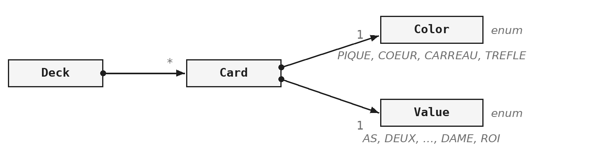

Ce module ajoute deux formes de type à celles que vous connaissez. L'énumération (`enum`) sert quand les valeurs possibles se comptent sur les doigts : une couleur de feu, un jour de la semaine, un résultat de partie. Le `record` sert quand une donnée n'est qu'une donnée, sans comportement propre et sans état qui change.

Les deux ont un point commun : ils font dire au compilateur ce qu'un commentaire disait jusqu'ici. Une énumération interdit la quatrième couleur de feu ; un record interdit la modification après construction. Dans les deux cas, l'erreur devient impossible à écrire, plutôt que pénible à retrouver.

> **À la fin de ce module, vous saurez**
> - déclarer une énumération, et utiliser les méthodes que toute énumération possède ;
> - tirer parti de l'ordre des constantes, en sachant ce qu'il engage ;
> - comparer des constantes et aiguiller avec les trois formes du `switch` ;
> - donner des données et des méthodes à une énumération ;
> - tirer un nombre au hasard et assembler un texte avec un séparateur ;
> - déclarer un record, et reconnaître quand il ne convient pas.

## 1. Des valeurs qui se comptent

### Trois couleurs, pas une de plus

Un feu de signalisation a exactement trois couleurs. Avant les énumérations, on les représentait par des constantes entières :

```java
static final int VERT   = 0;
static final int ORANGE = 1;
static final int ROUGE  = 2;

feu.setCouleur(7);   // compile sans broncher
```

Cela fonctionne, au sens où le programme tourne, et trois constantes bien nommées valent déjà mieux que les nombres 0, 1 et 2 écrits en clair (`CC-NOM.7`). Le problème est ailleurs : le type de la variable est `int`, et un `int` accepte toutes les valeurs d'un `int`. La ligne qui demande la couleur 7 compile, et casse un jour à l'exécution. Le même défaut existe avec un `String` : rien ne distingue « VERT » de « vert », de « verd » ou d'un espace de trop.

L'énumération déplace cette vérification : ce qui était une convention à respecter devient une règle que le compilateur applique.

### D'autres types que la classe

Jusqu'ici, écrire du Java voulait dire écrire des classes. Il existe d'autres formes de type, et vous en verrez cinq cette année :

| Type | Ce qu'il apporte | Où |
|---|---|---|
| `enum` | une liste de valeurs fermée | ce module |
| `record` | une donnée immuable, en une ligne | ce module |
| `abstract class` | un comportement partagé, incomplet | module `ABS` |
| `interface` | un contrat sans implémentation | module `ITF` |
| classe anonyme | une classe écrite sur place, sans nom | module `LAM` |

Il n'y a rien à retenir de ce tableau pour l'instant, sinon que le paysage est plus large que les classes, et qu'il se découvrira morceau par morceau.

## 2. Déclarer une énumération

### La syntaxe

Le mot-clé `enum` remplace `class`, et la liste des valeurs possibles s'écrit entre accolades :

```java
public enum CouleurDeFeu { VERT, ORANGE, ROUGE }
```

```java
CouleurDeFeu couleur = CouleurDeFeu.VERT;
couleur = CouleurDeFeu.ROUGE;   // d'accord
couleur = 7;                    // refus a la compilation
```

Ces valeurs sont des constantes ; comme toute constante en Java, elles s'écrivent en majuscules. Une variable déclarée `CouleurDeFeu` ne peut recevoir qu'une des trois valeurs, ou `null`. La dernière ligne ne compile pas, et c'est exactement le service rendu : l'erreur se voit au moment où elle s'écrit, pas six mois plus tard.

Une énumération est un type comme un autre. Elle sert de type de champ, de type de paramètre et de type de retour.

### Ce que toute énumération sait faire

Cinq méthodes existent sur toute énumération, sans que rien soit écrit : elles viennent de la classe `java.lang.Enum`, dont toute énumération hérite.

| Appel | Ce qu'il retourne | Exemple |
|---|---|---|
| `name()` | le nom de la constante | `"ROUGE"` |
| `ordinal()` | sa position, à partir de 0 | `2` |
| `values()` | un tableau de toutes les constantes | `[VERT, ORANGE, ROUGE]` |
| `valueOf("VERT")` | la constante qui porte ce nom | `VERT` |
| `compareTo(autre)` | l'écart entre les deux positions | `-2` |

- `name()` retourne le nom écrit dans la déclaration ; `toString()` fait la même chose tant qu'on ne la redéfinit pas.
- `values()` est statique : elle s'appelle sur le type, pas sur une valeur, et retourne les constantes dans l'ordre de déclaration.
- `valueOf` fait le chemin inverse, du texte vers la constante, et lève une exception si le nom est inconnu.
- `compareTo` retourne un résultat négatif si la première constante est déclarée avant la seconde. C'est ce qui rend une énumération triable sans effort.

### L'ordre de déclaration compte

Les méthodes `values`, `ordinal` et `compareTo` suivent l'ordre dans lequel les constantes sont écrites. Cet ordre devient donc une donnée du programme :

```java
CouleurDeFeu.VERT.ordinal();      // 0
CouleurDeFeu.ROUGE.ordinal();     // 2
CouleurDeFeu.values().length;     // 3
```

Deux conséquences pratiques. D'abord, cet ordre se choisit : pour un feu de signalisation, c'est celui du cycle, et non l'ordre alphabétique. Ensuite, il ne se modifie pas à la légère : insérer une constante au milieu change le résultat d'`ordinal` pour toutes celles qui suivent. C'est sans effet si le code ne s'appuie que sur les noms, et lourd de conséquences s'il s'appuie sur les positions.

Pour la même raison, évitez d'enregistrer un ordinal dans un fichier ou une base de données. Le nom, retourné par `name()`, est stable ; la position ne l'est pas. Cela ressortira au module `FIC`.

## 3. L'ordre porte l'information

Une énumération ne remplace pas seulement des constantes : elle peut contenir une partie de la logique, et faire disparaître des conditions.

> **Démonstration** - `Demo_ENU` : le cycle sans conditions
> La démonstration part d'un lecteur de musique dont le bouton enchaîne trois modes de lecture, avec trois conditions. Un quatrième mode est ajouté à l'énumération, et le lecteur ne l'atteint jamais : le compilateur n'a rien dit, et le comportement est faux. La méthode est ensuite réécrite en deux lignes, à partir de `values` et d'`ordinal` ; le cinquième mode fonctionne alors sans que rien d'autre soit touché.

### Passer à la valeur suivante

Le tableau retourné par `values()` contient les constantes dans l'ordre de déclaration, donc dans l'ordre du cycle :

```java
CouleurDeFeu[] cycle = CouleurDeFeu.values();

int suivante = (couleur.ordinal() + 1) % cycle.length;
couleur = cycle[suivante];
```

Ajouter un à la position courante donne la suivante, et le reste de la division par la longueur du tableau ramène à zéro quand on dépasse la fin. Le nombre de couleurs n'apparaît nulle part : c'est `cycle.length` qui le donne, et il suit la déclaration quoi qu'il arrive.

> **Attention**
> Les parenthèses autour de l'addition sont indispensables : l'opérateur `%` a priorité sur `+`. Sans elles, le modulo s'applique d'abord au 1, et le feu reste bloqué sur sa première couleur. Le code compile sans le moindre avertissement : ce genre de faute est le plus coûteux qui soit, parce que rien ne le signale. Un test l'attrape immédiatement.

### Ce que ce détour fait gagner

Le gain n'est pas la longueur du code : deux lignes au lieu de six, ce serait une économie sans intérêt. Le gain est que ce qui change souvent, la liste des valeurs, ne se change plus qu'à un seul endroit. Une quatrième couleur s'ajoute sans qu'une ligne change ailleurs, et il n'y a plus de condition à lire, donc plus d'endroit où se tromper. C'est le critère de `CC-CLS.4` : une conception se juge à ce qu'elle exige quand le besoin bouge.

La contrepartie est réelle, et il faut la nommer. En s'appuyant sur l'ordre, le code dépend d'une information qui ne se lit pas dans la méthode, mais dans la déclaration de l'énumération. Quelqu'un qui réordonne les constantes par souci de propreté casse le cycle sans le savoir. La Javadoc de l'énumération doit donc dire que l'ordre est celui du cycle et qu'il ne se modifie pas : un commentaire utile dit ce que le code ne peut pas dire (`CC-COM.3`).

> **Exercices** - `ENU.1` Un feu de signalisation
> L'exercice demande explicitement les deux versions de `changeDeCouleur` : celle avec des conditions, et celle sans. La comparaison ne vaut que si les deux sont écrites. Il ajoute une question de conception : le constructeur doit placer le feu dans le même état que `desactive`, et il vaut mieux appeler la méthode que recopier ses instructions.

## 4. Comparer et aiguiller : `switch`

Cette section installe le `switch`, dans ses trois formes. Il resservira tout au long de l'année, et une énumération est le meilleur endroit pour l'apprendre, parce que c'est là que le compilateur peut vérifier qu'aucun cas n'a été oublié.

### Comparer deux valeurs

```java
if (couleur == CouleurDeFeu.ROUGE) {
    System.out.println("Stop");
}
```

Sur les énumérations, `==` fait ce qu'on attend. Chaque constante est créée une seule fois, au chargement de la classe, et toute variable qui vaut `ROUGE` désigne exactement le même objet : comparer les références revient donc à comparer les valeurs.

C'est une exception notable. Sur les `String` et sur les objets en général, `==` ne compare pas les valeurs mais compare les références, ce qui peut réserver des surprises. Sur les énumérations, cet opérateur est à la fois correct et préférable à `equals`, parce qu'il ne lève pas d'exception si la variable vaut `null`.

### La forme classique

```java
switch (jour) {
    case SAMEDI:
    case DIMANCHE:
        System.out.println("Repos");
        break;
    default:
        System.out.println("Travail");
}
```

C'est la forme héritée du C, et celle que vous rencontrerez dans le code existant. Le `switch` évalue une expression, saute à l'étiquette correspondante, et exécute tout ce qui suit jusqu'au premier `break`. Sans `break`, l'exécution continue sur le cas suivant : c'est voulu ici, pour traiter le samedi et le dimanche ensemble, mais c'est bien plus souvent accidentel. L'oubli du `break` est la faute la plus fréquente de cette forme.

Sur une énumération, les étiquettes s'écrivent sans le nom du type : `SAMEDI` et non `Jour.SAMEDI`, parce que le type est déjà connu par l'expression du `switch` (le paramètre `jour` passé au `switch` est de type `Jour`).

### La forme à flèches

```java
switch (jour) {
    case SAMEDI, DIMANCHE -> System.out.println("Repos");
    default               -> System.out.println("Travail");
}
```

Cette forme est arrivée avec Java 14, et c'est celle à écrire aujourd'hui. Avec la flèche, un seul cas s'exécute, jamais celui qui suit : il n'y a plus de `break` à oublier. Les étiquettes qui partagent un traitement se regroupent sur une même ligne, séparées par des virgules. Quand une branche demande plusieurs instructions, on ouvre des accolades après la flèche.

### Un `switch` qui retourne une valeur

Un `switch` peut produire une valeur au lieu d'exécuter des instructions. Il s'utilise alors comme n'importe quelle expression, et se termine par un point-virgule :

```java
String message = switch (jour) {
    case SAMEDI, DIMANCHE -> "Repos";
    case VENDREDI         -> "Bientôt";
    default               -> "Au boulot !";
};
```

Chaque branche fournit la valeur, elle ne l'affiche pas. Cette forme mérite d'être préférée dès qu'il s'agit de choisir une valeur : la variable `message` reçoit sa valeur une fois pour toutes, ce qui élimine le cas où une branche oublierait de l'affecter. Quand une branche a besoin de plusieurs lignes, elle s'écrit entre accolades et fournit sa valeur avec le mot-clé `yield`.

### Tous les cas, sans oubli

Sur une énumération, le compilateur connaît la liste complète des cas. Il peut donc vérifier que toutes les constantes sont traitées :

```java
String consigne = switch (couleur) {
    case VERT   -> "Passez";
    case ORANGE -> "Ralentissez";
    case ROUGE  -> "Arretez";
};
```

Cet exemple n'a pas de `default`, et il compile, parce que les trois couleurs y sont. Le jour où une quatrième couleur s'ajoute à l'énumération, ce même code cesse de compiler, et le message désigne l'endroit exact à compléter. C'est l'inverse de la démonstration, où l'ajout d'un mode passait inaperçu. Écrire un `default` qui ne sert qu'à faire taire le compilateur revient à renoncer à cette vérification : quand tous les cas sont couverts, mieux vaut s'en passer.

> **Exercices** - `ENU.2` Une température, deux unités
> L'énumération sert ici de paramètre de méthode, son usage le plus courant. La vraie question est ailleurs : combien de valeurs l'objet doit-il stocker ? En garder deux, une par unité, c'est accepter qu'elles se contredisent un jour. La conversion se fait donc au moment où on la demande, à partir d'une seule valeur stockée. Pour nommer les méthodes, voir `CC-MET.4`.

## 5. Une `enum` est une classe

Jusqu'ici, l'énumération n'était qu'une liste de noms. Elle peut aussi contenir des données et des méthodes, ce qui déplace la question de la conception : où placer l'information ?

### Une énumération qui contient des données

```java
public enum Discount {

    BASIC(0.05), FIDELITY(0.075), SPECIAL(0.10);

    private final double taux;

    Discount(double taux) {
        this.taux = taux;
    }

    public double appliquer(double prix) {
        return prix * (1 - taux);
    }
}
```

Une énumération est une classe, et le reste jusqu'au bout : elle accepte des champs, un constructeur et des méthodes. Chaque constante passe ses arguments au constructeur, et devient un objet construit une fois pour toutes, avec ses propres valeurs.

L'intérêt se voit à l'usage. Le taux d'une remise appartient à la remise, et non à la classe qui calcule un prix. Écrire `SPECIAL.appliquer(prix)` place le calcul là où vit l'information, et évite qu'une table de correspondance traîne ailleurs dans le programme.

### Trois détails de syntaxe

- **Le point-virgule après la dernière constante** devient obligatoire dès qu'un champ, un constructeur ou une méthode suit la liste. Son oubli est la faute de frappe la plus fréquente sur ce sujet.
- **Le constructeur est implicitement privé :** un `new` sur une énumération est impossible. Les seules instances possibles sont celles de la liste, créées au chargement de la classe ; c'est ce qui garantit qu'il n'existe qu'un objet par constante, et donc que `==` fonctionne.
- **Les champs sont déclarés `final`**, parce qu'une constante dont l'état change n'est plus une constante. Rien ne l'impose techniquement, mais s'en écarter n'a pas de bonne raison.

### Un jeu de cartes, avec des énumérations

Le jeu de cartes est l'exemple type où les énumérations s'imposent, parce que rien n'y change jamais : il n'y aura pas de cinquième couleur, et le roi restera la plus haute figure. Avant de coder, il faut distinguer ce qui est fixe de ce qui se combine :

- les 4 couleurs et les 13 valeurs ne changeront jamais : ce sont deux énumérations, `Color` et `Value` ;
- chaque constante connaît son libellé : `PIQUE` porte « Pique », `AS` porte « As » ;
- une carte associe une couleur et une valeur : c'est une classe `Card`, à deux champs ;
- le jeu, `Deck`, rassemble les 52 cartes, sans que le nombre 52 apparaisse dans le code.



Une seule énumération de 52 constantes, `AS_DE_PIQUE`, `DEUX_DE_PIQUE` et ainsi de suite, fonctionnerait. Mais elle ne dirait rien de la structure du jeu : rien n'y indiquerait que `AS_DE_PIQUE` et `AS_DE_COEUR` ont la même valeur. Deux énumérations de 4 et 13 constantes portent cette structure, et la carte n'est plus que leur rencontre.

### Toutes les combinaisons

Construire un jeu complet, c'est produire toutes les combinaisons des deux énumérations. Deux boucles for-each imbriquées sur `values()` y suffisent :

```java
Card[] cartes = new Card[Color.values().length * Value.values().length];
int i = 0;
for (Color couleur : Color.values()) {
    for (Value valeur : Value.values()) {
        cartes[i] = new Card(couleur, valeur);
        i++;
    }
}
```

Le nombre 52 n'apparaît nulle part : il est le produit des tailles des deux énumérations (4 × 13), et se recalcule tout seul. Ajouter une couleur ou une valeur suffit à changer la taille du jeu, sans toucher à cette boucle. C'est le même raisonnement qu'en `ENU §3`, appliqué à deux dimensions.

## 6. Un détour par deux outils

Deux classes de la bibliothèque standard, sans rapport avec les énumérations, mais dont l'exercice suivant a besoin.

### Outil 1 : `Random` pour tirer un nombre au hasard

La classe `java.util.Random` produit des nombres au hasard[^pseudo]. Sa méthode `nextInt(n)` retourne un entier de `0` inclus à `n` exclu :

```java
Random hasard = new Random();

int de = hasard.nextInt(6) + 1;            // 1 a 6
int rang = hasard.nextInt(cartes.length);  // 0 a cartes.length - 1
```

La borne exclue tombe bien : c'est exactement l'intervalle des indices d'un tableau de cette taille. Pour simuler un dé, il faut donc ajouter un au résultat.

Un seul objet `Random` suffit pour tout un programme : en créer un nouveau à chaque tirage est inutile. Un seul champ, construit une fois, règle la question.

Pour mélanger un tableau, l'exercice demande de parcourir les cartes de la fin vers le début, et d'échanger chacune avec une carte tirée au hasard parmi elle-même et celles qui la précèdent, c'est-à-dire avec l'indice `hasard.nextInt(i + 1)`. Tirer dans tout le paquet mélangerait aussi, mais pas équitablement : certaines dispositions sortiraient plus souvent que d'autres. Ce mélange porte un nom, l'algorithme de Fisher-Yates.

### Outil 2 : `StringJoiner` pour assembler un texte avec un séparateur

Afficher une liste séparée par des virgules est un exercice classique, avec toujours le même piège : la virgule en trop à la fin. On s'en tire d'ordinaire par un test sur l'indice, qui encombre la boucle sans rien apporter au sens. La classe `StringJoiner` fait exactement ce travail :

```java
StringJoiner joiner = new StringJoiner(", ");
for (Card carte : cartes) {
    joiner.add(carte.toString());
}
System.out.println(joiner);
```

On lui donne le séparateur, on ajoute les éléments, et elle place le séparateur entre eux. Il n'y a plus de condition à lire. Son constructeur accepte aussi un préfixe et un suffixe, pour encadrer la liste de crochets ou de parenthèses.

> **Exercices** - `ENU.3` Un jeu de cartes
> L'exercice réunit tout ce que `ENU §5` a montré : deux énumérations qui connaissent un libellé, un constructeur, une méthode, et la construction du jeu par double boucle. L'affichage doit tenir sur une ligne, cartes séparées par des virgules : c'est là que `StringJoiner` sert. Pour documenter l'ordre des constantes, voir `CC-COM.3`.

[^pseudo]: En réalité, `Random` est un générateur *pseudo-aléatoire* : il calcule chaque nombre à partir du précédent, par une formule fixe. La suite a l'air due au hasard, mais elle est entièrement déterminée par sa valeur de départ, la *graine* : `new Random(42)` produit toujours la même suite, ce qui est précieux pour reproduire un test. Pour tout ce qui touche à la sécurité (mots de passe, jetons), on utilise `java.security.SecureRandom`, conçue pour être imprévisible.

## 7. Les records

Changement de sujet. Le `record` ne remplace pas l'énumération : il répond à un autre besoin, transporter une donnée, sans comportement et sans état qui change.

### Une donnée, et rien d'autre

Le mot-clé `record` déclare une classe faite pour contenir des données. Ses *composants* se déclarent entre parenthèses, comme des paramètres :

```java
public record Point(int x, int y) { }
```

```java
Point origine = new Point(0, 0);
System.out.println(origine.x());   // 0
```

Le corps entre accolades reste vide dans le cas le plus simple, et il est fréquent qu'il le reste. L'accesseur porte le nom du composant, sans préfixe : on écrit `origine.x()`, et non `origine.getX()`. C'est déroutant les premières fois, et c'est la convention.

### Ce que le compilateur écrit

À partir de cette seule ligne, le compilateur écrit :

- le constructeur, avec les composants dans l'ordre déclaré ;
- un accesseur par composant, nommé `x()` et non `getX()` ;
- les méthodes `toString`, `equals` et `hashCode`.

```java
Point a = new Point(1, 2);
Point b = new Point(1, 2);

a.toString();   // "Point[x=1, y=2]"
a.equals(b);    // true
```

Une ligne de déclaration remplace une trentaine de lignes écrites à la main. La méthode `equals` mérite qu'on s'y arrête : deux objets `Point` construits séparément avec les mêmes valeurs sont égaux, parce que le record compare ses composants. Ce n'est pas le comportement d'une classe ordinaire, où `equals` compare les références tant qu'on ne la redéfinit pas. La question reviendra au module `COL`.

### Un record ne change pas

- Un record est `final` : aucune classe n'en hérite.
- Ses composants sont `final` : il n'existe aucun setter.
- Un record construit reste tel quel jusqu'à sa disparition.

L'immuabilité n'est pas un effet de bord, c'est le principe. Un record modélise une valeur, et une valeur ne se modifie pas : on en fabrique une autre. Changer l'abscisse d'un point revient à construire un nouveau point. C'est ce qui rend l'objet sûr à partager, puisque personne ne peut le modifier dans le dos de celui qui l'a créé (`CC-OBJ.2`).

### Ajouter une méthode

Le corps du record accueille des méthodes, qui accèdent directement aux composants :

```java
public record Rectangle(int largeur, int hauteur) {

    public int aire() {
        return largeur * hauteur;
    }
}
```

La règle est la même que pour une classe ordinaire : ce qui se calcule ne se stocke pas. Ajouter un composant `aire` obligerait à le maintenir cohérent avec la largeur et la hauteur, et ouvrirait la porte à la contradiction.

### Valider à la construction

Rien n'empêche, par défaut, de construire un rectangle de largeur nulle. Le *constructeur compact* est l'endroit prévu pour l'interdire :

```java
public record Rectangle(int largeur, int hauteur) {

    public Rectangle {
        if (largeur <= 0 || hauteur <= 0) {
            throw new IllegalArgumentException("dimensions positives");
        }
    }
}
```

Il porte le nom du record, sans liste de paramètres ni parenthèses, et s'exécute avant l'affectation des composants. L'instruction `throw` interrompt la construction et signale l'erreur à l'appelant : l'objet n'est pas créé. Le mécanisme complet des exceptions est le sujet du module `EXC`.

### Quand le record ne convient pas

Le record est excellent là où il convient, et inadapté partout ailleurs. Le critère est simple : un objet qui change d'état, ou qui porte une logique métier, n'est pas un record.

| Ce que vous modélisez | La forme |
|---|---|
| une adresse, un point, un résumé de partie | un record |
| un compte dont le solde change | une classe |
| un feu qui change de couleur | une classe |
| un objet dont d'autres doivent hériter | une classe |

> **Exercices** - `ENU.4` Un record d'étudiant, puis `G.6` à `G.9` (fil rouge GameHub)
> L'en-tête du record est fourni : votre part se limite à la méthode `passe`, et c'est tout l'intérêt de l'exercice. Plusieurs tests sont verts avant que vous ayez écrit une ligne : ce n'est pas une panne, c'est le compilateur qui a fait le travail. Pour la conception, voir `CC-OBJ.2`. Le fil rouge applique ensuite les deux notions du module à GameHub : les énumérations `TypeJeu` et `ResultatPartie`, puis le record `ResumePartie`.

## Ce qu'il faut retenir

- Une énumération fait vérifier par le compilateur une liste de valeurs fermée.
- L'ordre de déclaration est une donnée : `values()`, `ordinal()` et `compareTo` le suivent.
- `==` compare deux constantes en toute sécurité.
- Un `switch` qui couvre toutes les constantes se passe de `default`, et le compilateur signale le cas oublié.
- Une énumération est une classe : elle peut contenir des données et des méthodes.
- Un record est une donnée immuable ; le compilateur écrit son constructeur, ses accesseurs, `toString`, `equals` et `hashCode`.

Les deux types de ce module ont le même effet : une erreur qui ne se voyait qu'à l'exécution devient une erreur de compilation.
