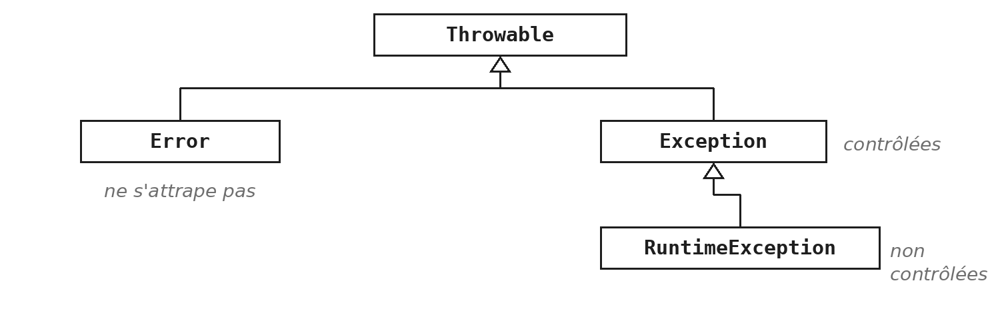
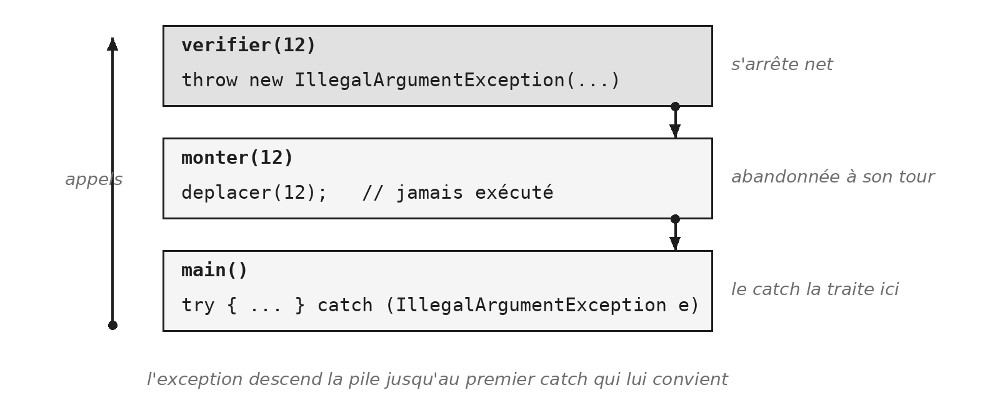

Jusqu'ici, quand quelque chose tournait mal, le programme s'arrêtait sur un message rouge, ou continuait avec une valeur fausse. Ce module donne un moyen de dire ce qui ne va pas, à l'endroit où on le constate, et de le traiter à l'endroit où l'on peut y faire quelque chose.

Ce sont deux gestes distincts, faits à deux endroits différents : *lever* une exception, et l'*attraper*. Presque tout ce qui suit découle de cette séparation. Le module pèse aussi à l'examen : chaque session commence par une classe qui lève ses propres exceptions.

> **À la fin de ce module, vous saurez**
> - expliquer ce qu'est une exception, et comment elle remonte la pile des appels ;
> - écrire votre propre classe d'exception, la lever avec `throw` et la déclarer avec `throws` ;
> - choisir, pour une exception contrôlée, entre l'attraper et la déclarer ;
> - écrire un `try` avec un ou plusieurs `catch`, et un `finally` quand il faut remettre les choses en place ;
> - reconnaître une exception non contrôlée, et vous protéger de la plus fréquente, `NullPointerException` ;
> - choisir entre une exception du JDK et une exception à vous.

## 1. Un objet qui interrompt

> **Démonstration** - `Demo_EXC` : faire planter, lire la trace, corriger
> La démonstration part d'un panier dont on demande la moyenne alors qu'il est vide. Le premier essai ne plante pas du tout : il affiche une valeur absurde, sans rien signaler. Le second plante, et c'est un progrès. On lit alors la trace ensemble, dans le bon sens, puis on discute trois corrections avant d'en coder une. Deux idées à retenir : un plantage bruyant vaut mieux qu'un résultat faux qui continue en silence ; et on lève une exception là où l'on constate le problème, on l'attrape là où l'on peut y faire quelque chose.

### Vous levez déjà des exceptions

```java
public int etageCourant() {
    throw new UnsupportedOperationException(
            "etageCourant n'est pas encore implementee");
}
```

Depuis le module `POO`, chaque méthode à compléter des squelettes contient une ligne de ce genre. Vous avez vu le test passer au rouge avec ce message, sans vous demander d'où il venait : c'était une exception, levée exprès. Quand l'incrément `G.15` du fil rouge vous a demandé de lever « une exception explicite » dans la fabrique, vous avez sans doute recopié ce geste. C'était le bon.

Ce module explique ce qui se passe quand cette ligne s'exécute, comment écrire vos propres exceptions, et comment les attraper.

### Une exception est un objet

Une exception n'a rien de magique : c'est un objet, d'une classe comme les autres, que l'on crée avec `new`. Au moment de sa création, il mémorise un message et l'état de la pile des appels. C'est ce qu'affiche la trace.



Toutes les exceptions descendent de la classe `Throwable`.

- **Une `Error`**, comme `OutOfMemoryError` ou `StackOverflowError`, dit que la JVM elle-même ne peut plus continuer. On ne l'attrape pas : il n'y a rien à faire d'utile à ce moment-là.
- **Une `Exception`** signale ce que le programme peut traiter. Ses descendantes sont dites *contrôlées*.
- **Une `RuntimeException`**, sous-branche d'`Exception`, est dite *non contrôlée*, comme toutes ses descendantes.

La différence entre contrôlée et non contrôlée porte sur ce que le compilateur exige ; EXC §2 la montre, et EXC §4 revient sur les non contrôlées.

### Les exceptions remontent la pile

```java
void monter(int etage) {
    verifier(etage);       // l'exception traverse monter
    deplacer(etage);       // jamais execute
}

void verifier(int etage) {
    if (etage > dernierEtage) {
        throw new IllegalArgumentException("Etage " + etage
                + " au-dela du dernier, " + dernierEtage);
    }
}
```

Quand on appelle `monter` avec un étage tel que `etage > dernierEtage`, elle appelle `verifier`, qui lève l'exception. La méthode `verifier` ne termine pas son exécution : elle s'arrête net, à l'instant même où le `throw` est exécuté. La méthode `monter` ne reprend pas non plus à la ligne suivante. L'exception traverse chaque méthode de la pile, de la plus récente à la plus ancienne, et chacune est abandonnée à son tour, jusqu'à ce qu'un `catch` l'arrête.

Si aucune ne l'attrape avec un `catch`, l'exception sort du `main`, et la JVM affiche la trace. La trace est exactement la pile des appels décrite dans le mémento technique (`TEC-EXE.1`), figée au moment de la création de l'exception.

### Du `throw` au `catch`



Le schéma se lit de deux façons. De bas en haut, ce sont les appels : `main` appelle `monter`, qui appelle `verifier`. Chaque appel empile une méthode, et la plus récente est en haut.

De haut en bas, c'est le trajet de l'exception. `verifier` la lève avec `throw` et s'arrête net. L'exception descend dans `monter`, qui ne la traite pas : `monter` est abandonnée à son tour, et `deplacer` n'est jamais exécutée. Elle arrive enfin dans `main`, où l'appel était entouré d'un `try`. Le `catch` correspond au type de l'exception, il la reçoit, et le programme continue après le `catch`. EXC §3 montre comment écrire ce `try` et ce `catch`, et surtout où les placer.

## 2. Lever, et déclarer

### Écrire sa classe d'exception

```java
public class EtageInaccessibleException extends Exception {

    public EtageInaccessibleException(String message) {
        super(message);
    }
}
```

Une exception à soi tient en ces quelques lignes : une classe qui hérite d'`Exception`, et un constructeur qui reçoit le `message` et le transmet à la classe mère par `super`. Tout le travail est déjà fait par `Exception` : mémoriser le `message`, capturer la pile, se laisser attraper. La méthode `getMessage()` retourne le `message` transmis à `super`. Il existe aussi un constructeur sans message, mais indiquez toujours un message qui donne le contexte de l'erreur : c'est lui que lira celui qui découvrira la trace.

Inutile d'y ajouter des champs : un message qui dit ce qui était attendu et ce qui a été reçu suffit presque toujours. C'est la règle `CC-ERR.4`. Le nom se termine par `Exception`, par convention.

Le choix de la classe mère, `Exception` ou `RuntimeException`, a une conséquence que la sous-section « Attraper ou déclarer » montre, et EXC §4 donne le critère. À l'examen, la première question de chaque session demande d'écrire une classe de ce genre.

### Lever avec `throw`, déclarer avec `throws`

```java
public void appeler(int etage) throws EtageInaccessibleException {
    if (etage < 0 || etage > dernierEtage) {
        throw new EtageInaccessibleException("Etage " + etage
                + " hors de l'intervalle 0 a " + dernierEtage);
    }
    etageCourant = etage;
}
```

Les deux mots se ressemblent et ne font pas la même chose.

- **`throw` est une instruction**, dans le corps de la méthode : il crée l'objet et l'envoie.
- **`throws` fait partie de la signature** : il prévient l'appelant que cette méthode peut échouer de cette façon.

Une méthode peut déclarer plusieurs exceptions, séparées par des virgules. Un constructeur annonce une exception exactement de la même façon : `throws` après la parenthèse.

Remarquez le message : il nomme l'étage demandé et l'intervalle permis. Quelqu'un qui lira la trace sans le code saura quoi corriger. Remarquez aussi l'ordre : la vérification vient *avant* la modification de `etageCourant`. Une méthode qui refuse une demande doit laisser l'objet dans l'état où elle l'a trouvé.

### Attraper ou déclarer

```java
void depuisLeBouton(int etage) {
    try {
        ascenseur.appeler(etage);
    } catch (EtageInaccessibleException e) {
        System.out.println("Refus : " + e.getMessage());
    }
}

void depuisLeBadge(int etage) throws EtageInaccessibleException {
    ascenseur.appeler(etage);
}
```

Pour une exception contrôlée, le compilateur exige un choix. Dès qu'une méthode appelle `appeler`, il refuse de compiler tant qu'elle n'a pas choisi :

- **attraper**, c'est-à-dire traiter l'exception ici, avec `try` et `catch` ;
- **déclarer**, c'est-à-dire la laisser passer à l'appelant, qui aura le même choix.

Ce n'est pas une politesse : c'est la seule chose que le compilateur sait vérifier à propos des erreurs, et il le fait pour les exceptions contrôlées seulement. Aucun des deux choix n'est le bon dans l'absolu. On attrape quand on peut faire quelque chose d'utile ; sinon, on déclare, et la question remonte d'un cran. Déclarer jusqu'au `main` revient à laisser le programme s'arrêter sur une trace.

Pour une exception non contrôlée, le compilateur n'exige rien : c'est EXC §4. Vous retrouverez ce `throws` dans les tests du module `JUN` : une méthode de test qui appelle une méthode capable d'échouer doit, elle aussi, choisir.

> **Exercices** - `EXC.1` Lever sa propre exception, puis `EXC.2` Un compte, sans exception
> `EXC.1` met en pratique cette section : une classe d'exception, une méthode qui la lève, un programme qui l'attrape. Lisez l'encadré sur le vrai piège avant d'écrire la moindre ligne : le test vérifie ce que devient le point quand le déplacement est refusé. Les deux questions de fin portent sur le choix de la classe mère. `EXC.2` fait exprès l'inverse : un compte, sans aucune exception. Gardez la réponse à sa question finale, elle sert à l'exercice suivant. Pour les messages, voir `CC-ERR.4`.

## 3. Attraper là où l'on peut agir

### Ce que le `try` saute

```java
try {
    ascenseur.appeler(2);
    ascenseur.appeler(9);              // leve l'exception
    System.out.println("Arrive");      // jamais affiche
} catch (EtageInaccessibleException e) {
    System.out.println("Refus : " + e.getMessage());
}
System.out.println("Fin");             // toujours affiche
```

- **Au premier `throw`, le reste du `try` est abandonné.** Le programme n'y retourne jamais : ce qui suivait l'instruction fautive est perdu.
- **Le `catch` s'exécute, puis tout ce qui le suit.**
- **Sans exception, le `catch` est simplement ignoré.**

Le premier appel a réussi : l'ascenseur est bien au deuxième étage. Le second a échoué avant de modifier quoi que ce soit, si `appeler` est bien écrite : c'est tout l'enjeu de l'encadré d'`EXC.1`.

Une variable déclarée dans le `try` n'existe ni dans le `catch`, ni après : déclarez-la avant si vous en avez besoin des deux côtés.

### Plusieurs `catch`, ou un seul

```java
try {
    ascenseur.appeler(etage);
    porte.ouvrir();
} catch (EtageInaccessibleException e) {
    afficher("Etage refuse : " + e.getMessage());
} catch (PorteBloqueeException | CoupureException e) {
    signalerPanne(e.getMessage());
}
```

Quand une exception sort du `try`, Java essaie les `catch` un par un, de haut en bas, et exécute le premier dont le type convient. Les suivants sont ignorés.

*Convenir* veut dire la même chose qu'au module `ABS` : une `EtageInaccessibleException` est aussi une `Exception`. Un `catch` écrit pour une classe mère attrape donc toutes ses filles. Il en découle une règle d'ordre : un `catch` pour une classe fille doit venir avant celui de sa mère, sans quoi il ne serait jamais atteint, et le compilateur le refuse.

La barre verticale réunit des types qui n'ont pas de lien d'héritage entre eux, quand le traitement est le même. Faut-il un `catch` par exception, ou un seul pour toute la famille ? Le fascicule pose la question à `EXC.3`, et la règle `CC-ERR.5` y répond.

### Un `catch` fait quelque chose

```java
try {
    ascenseur.appeler(etage);
} catch (EtageInaccessibleException e) {
    System.out.println("Refus : " + e.getMessage());
    ecran.proposerEtagesValides();
}
```

La démonstration a montré le `catch` vide : le programme ne dit plus rien, et tout semble aller bien. Le plantage était bruyant mais honnête ; ce silence ment. L'erreur ressurgira plus loin, à un endroit qui n'a plus rien à voir avec sa cause. C'est la règle `CC-ERR.6`.

Trois réactions sont honnêtes :

- **traiter :** redemander, proposer autre chose, prendre une valeur de repli que l'on assume ;
- **informer :** dire ce qui a échoué ;
- **ne pas attraper du tout,** et laisser l'exception remonter jusqu'à quelqu'un qui saura quoi en faire.

Une nuance, que vous croiserez dans GameHub. Attraper une exception pour redemander une saisie est un vrai traitement, même quand l'objet exception ne sert plus. On nomme alors la variable `ignoree` : le nom dit que c'est voulu.

### Ce que `finally` garantit

```java
void deplacer(int etage) throws EtageInaccessibleException {
    porte.verrouiller();
    try {
        ascenseur.appeler(etage);
    } finally {
        porte.deverrouiller();         // dans tous les cas
    }
}
```

Cette méthode n'attrape rien : elle déclare l'exception et la laisse passer. Mais la porte doit être déverrouillée, que l'appel réussisse ou non. Écrire `deverrouiller` après le `try` ne suffirait pas : en cas d'exception, la ligne ne serait jamais atteinte.

Le bloc `finally` s'exécute à la sortie du `try`, que celui-ci se termine normalement ou par une exception, attrapée ou non. Il peut suivre un `catch`, ou se passer de `catch` comme ici. On s'en sert pour libérer ce qu'on a pris : un verrou, une connexion, un fichier ouvert. Le module `FIC` montrera une écriture plus courte pour les fichiers, qui fait ce travail toute seule.

> **Exercices** - `EXC.3` Un numéro de compte vérifié, puis `EXC.6` Ce que `finally` garantit
> `EXC.3` reprend le compte de l'exercice précédent et lui ajoute un numéro vérifié. Les messages sont imposés au caractère près : chacun dit ce qui était attendu et ce qui a été reçu. L'encadré du fascicule pose la question qui fait l'exercice : trois exceptions ou une seule. Essayez les quatre numéros fournis avant de décider combien de `catch` écrire, et faites l'expérience de la seconde question : le compilateur a quelque chose à dire. `EXC.6` fait constater ce que `finally` garantit. La première version ouvre la caisse, encaisse, puis la referme, trois gestes à la suite : un seul test échoue, et son nom dit pourquoi. La seconde version déplace la fermeture dans un `finally`, sans ajouter de `catch`. Voir `CC-ERR.4` et `CC-ERR.5`.

## 4. Celles que le compilateur ne voit pas

### Une exception que personne n'annonce

```java
String saisie = "douze";
int etage = Integer.parseInt(saisie);   // compile sans rien dire

// Exception in thread "main" java.lang.NumberFormatException:
//     For input string: "douze"
```

La méthode `Integer.parseInt` peut échouer, et sa signature n'en dit rien : `NumberFormatException` hérite de `RuntimeException`. Le compilateur ne demande donc ni `try` ni `throws`, et le programme plante à la première saisie qui n'est pas un nombre.

La JVM lève elle-même plusieurs exceptions de cette famille : `ArithmeticException`, rencontrée pendant la démonstration (une division entière par zéro), `ArrayIndexOutOfBoundsException` au module `TAB`, et la plus fréquente de toutes, présentée juste après. Elles peuvent survenir presque partout, et le compilateur ne vous prévient d'aucune.

### `NullPointerException` : la plus fréquente

```java
String titre = null;

titre.equals("Nana")                   // plantage

titre != null && titre.equals("Nana")  // false
"Nana".equals(titre)                   // false
Objects.equals(titre, "Nana")          // false
```

C'est l'exception que vous rencontrerez le plus souvent. `titre.equals("Nana")` appelle une méthode sur l'objet désigné par `titre`. Si `titre` vaut `null`, il n'y a pas d'objet à qui demander, et la JVM lève une `NullPointerException`.

La protection classique teste d'abord la non-nullité : `titre != null && titre.equals("Nana")`. L'ordre est essentiel. L'opérateur `&&` s'arrête dès que la première condition est fausse, et la seconde n'est alors jamais évaluée ; inverser les deux tests remet le plantage.

Deux écritures plus courtes font la même chose :

- **la constante d'abord**, `"Nana".equals(titre)` : une constante n'est jamais `null`, et l'appel retourne simplement `false` ;
- **`Objects.equals(titre, "Nana")`**, de `java.util`, qui gère le `null` des deux côtés.

Tester partout la non-nullité reste un filet de sécurité. La vraie protection est en amont : ne pas produire de `null`, ni en retour ni en paramètre (`CC-ERR.2` et `CC-ERR.3`), et préférer une valeur vide. La règle `CC-ERR.7` résume le cas de la comparaison.

> **Exercices** - `EXC.4` Provoquer, puis traiter
> L'exercice se fait dans un ordre précis, et cet ordre est l'exercice. Écrivez d'abord le programme sans aucun `try`. Lancez-le avec une taille négative, puis avec une position hors du tableau, et lisez les deux messages : ils vous disent quelles exceptions attraper. Constatez surtout que le code a compilé sans rien dire, et que le programme s'arrête net : la boucle ne repart pas. Seulement ensuite, écrivez `placerDouze`, qui traite les deux cas, et relancez avec les mêmes saisies : la boucle survit. Sans la première partie, vous saurez écrire le `try`, mais pas pourquoi il est là.

### Réutiliser plutôt que créer

Le JDK contient déjà des exceptions pour les cas les plus courants. Toutes trois sont non contrôlées, et vivent dans `java.lang` : aucun import n'est nécessaire.

| Exception | Elle signale |
|---|---|
| `IllegalArgumentException` | un paramètre refusé |
| `IllegalStateException` | un objet dans le mauvais état |
| `UnsupportedOperationException` | une opération absente |

La première dit que l'appelant a passé une valeur qui n'a pas de sens, comme un dernier étage négatif. La deuxième dit que la demande était peut-être correcte, mais pas à ce moment-là, parce que l'objet n'est pas dans le bon état : appeler un ascenseur en panne. La troisième dit qu'une opération n'existe pas, ou pas encore : c'est celle de vos squelettes.

Quand l'une d'elles dit exactement ce qui se passe, servez-vous-en. On crée sa propre exception quand l'appelant doit pouvoir la distinguer des autres, ou quand il doit être obligé de s'en soucier. Dans ce dernier cas, elle hérite d'`Exception`, et le compilateur imposera le choix d'EXC §2 ; sinon, elle hérite de `RuntimeException`. À l'examen, l'énoncé précise souvent « il ne faut pas la créer » : c'est l'une de celles-ci.

### Lever une exception du JDK

```java
public Ascenseur(int dernierEtage) {
    if (dernierEtage < 0) {
        throw new IllegalArgumentException(
                "Le dernier etage doit etre positif ou nul, pas " + dernierEtage);
    }
    this.dernierEtage = dernierEtage;
}
```

Rien ne change par rapport à vos propres exceptions, sinon qu'il n'y a rien à écrire ni à déclarer : le constructeur ci-dessus n'a pas de clause `throws`, puisque l'exception n'est pas contrôlée.

Le message reste votre responsabilité. `new IllegalArgumentException()` sans message ne dit rien à celui qui lira la trace : nommez ce qui était attendu, et la valeur reçue (`CC-ERR.4`). Le module `JUN` vous demandera d'écrire une méthode qui lève une `IllegalArgumentException`, et de le vérifier.

C'est aussi la réponse promise au module `ENU`. Rien n'empêchait de construire un `Student` avec une cote de 47 : un record accepte un constructeur compact, où l'on place exactement cette vérification (voir `ENU §7`). Si la cote sort de 0 à 20, il lève une `IllegalArgumentException`, et l'objet n'est jamais créé.

> **Exercices** - `EXC.5` Lire une trace, puis le fil rouge relu (`G.15` et `G.24`)
> `EXC.5` refait seul ce que la démonstration a fait avec vous : lancer un programme qui plante, et lire la trace avant de toucher au code (voir `TEC-EXE.1`). Recopiez exactement ce que dit la trace, ponctuation comprise ; l'une des réponses ne ressemble à aucun nom que vous avez écrit, et c'est elle qui apprend quelque chose. GameHub n'a pas d'incrément consacré aux exceptions, mais il en lève depuis longtemps : relisez `G.15`, dont la fabrique lève une `UnsupportedOperationException`, et `G.24`, qui lève une `IllegalArgumentException` si l'un des joueurs est `null`. Vos messages nomment-ils ce qui a été refusé ? Et si votre GameHub lit des nombres au clavier, votre `catch` redemande-t-il, ou reste-t-il muet (`CC-ERR.6`) ?

## Ce qu'il faut retenir

- Une exception est un objet ; levée par `throw`, elle remonte la pile jusqu'au premier `catch` qui lui convient.
- `throw` lève, dans le corps ; `throws` déclare, dans la signature.
- Pour une exception contrôlée, le compilateur exige un choix : attraper ou déclarer.
- Un `catch` fait quelque chose : traiter, informer, ou ne pas attraper du tout.
- `finally` s'exécute toujours, et remet les choses en place.
- Une `RuntimeException` passe inaperçue à la compilation ; `NullPointerException` est la plus fréquente.
- Une exception du JDK quand elle dit exactement ce qui se passe ; la vôtre quand l'appelant doit la distinguer.

La séparation qui structure tout le module tient en une phrase : on lève là où l'on constate le problème, on attrape là où l'on peut y faire quelque chose.
