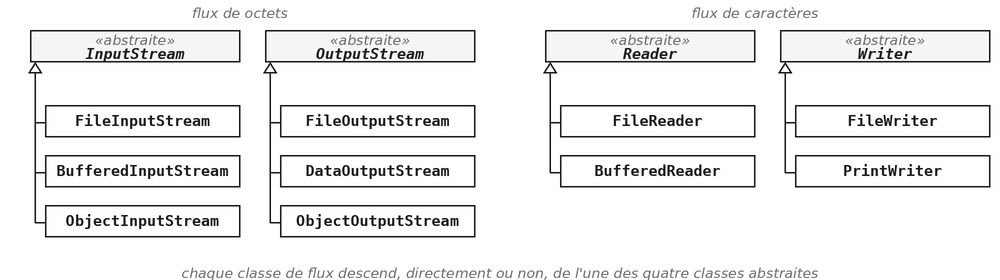
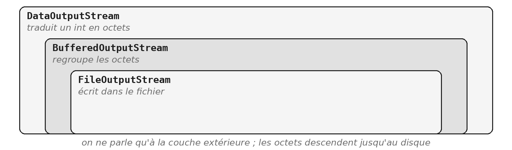

Tout ce que vos programmes construisent depuis le début de l'année disparaît quand ils s'arrêtent. Ce module montre comment faire persister une information : l'écrire dans un fichier, et savoir la relire.

Il y a deux façons de s'y prendre, le texte et les objets, et elles n'ont pas les mêmes propriétés. Le module ne vous dira pas laquelle choisir : la démonstration et les exercices vous en feront juger vous-même.

> **À la fin de ce module, vous saurez**
> - expliquer ce qu'est un flux, et lire le nom d'une classe de flux ;
> - emboîter des flux, et fermer un flux quoi qu'il arrive, avec un `try` avec ressources ;
> - traiter ou déclarer une `IOException` ;
> - écrire un fichier texte, et le relire ligne par ligne en reconstruisant ses champs ;
> - écrire un objet entier dans un fichier, et le relire ;
> - choisir entre le texte et les objets, en sachant ce que chacun coûte.

## 1. Ce qui entre, ce qui sort

### Tout s'efface à l'arrêt

Relancez n'importe quel programme écrit cette année : il repart de zéro. Les objets qu'il avait créés, les saisies de l'utilisateur, tout est perdu, parce que tout vivait dans la mémoire du programme, le temps qu'il tourne. Un fichier, lui, vit sur le disque, et survit à l'arrêt.

Écrire un fichier, c'est envoyer une suite d'octets vers le disque. Un fichier ne contient que des octets : il ne sait pas s'il contient du texte, des nombres ou des objets. C'est le programme qui l'a écrit qui le sait, et celui qui relit le fichier doit le savoir aussi. Reste donc à décider ce que représentent ces octets : c'est la question de tout le module, et il y répond de deux façons très différentes.

### Vous écrivez déjà dans un flux

```java
// System.out est un flux de sortie, ouvert pour vous
PrintStream console = System.out;
console.println("Uccle : 12 degres");

// System.in est un flux d'entree, lu par le Scanner
Scanner clavier = new Scanner(System.in);
String saisie = clavier.nextLine();
```

Un *flux*, *stream* en anglais, est un tuyau : on y écrit d'un côté, les données sortent de l'autre, dans l'ordre et dans un seul sens. Un flux de sortie reçoit ce que le programme envoie ; un flux d'entrée fournit ce que le programme lit.

Vous utilisez deux flux depuis le premier module sans les avoir nommés.

- `System.out` est un objet de la classe `PrintStream`, que la machine virtuelle ouvre vers la console.
- `System.in` est un flux d'entrée branché sur le clavier, que le `Scanner` découpe en lignes.

Écrire dans un fichier ne demande aucune notion nouvelle : on ouvre un autre flux, dont l'extrémité est un fichier au lieu de la console.

### Deux familles de flux, quatre classes racines

| Famille | Lire | Écrire |
|---|---|---|
| Octets, la racine | `InputStream` | `OutputStream` |
| Octets, vers un fichier | `FileInputStream` | `FileOutputStream` |
| Caractères, la racine | `Reader` | `Writer` |
| Caractères, vers un fichier | `FileReader` | `FileWriter` |

Toutes les classes de flux du package `java.io` descendent de quatre classes abstraites. Ce sont les *racines* de leurs hiérarchies d'héritage : chaque classe de flux en descend, directement ou non.



 Le tableau se lit en deux temps : la famille, puis le sens.

- **Les flux d'octets** transportent des octets tels quels, sans les interpréter.
- **Les flux de caractères** transportent du texte : ils convertissent chaque caractère en octets à l'écriture, et les octets en caractères à la lecture, selon un encodage.

Les noms suivent une règle simple. Le suffixe dit la famille et le sens : `InputStream`, `OutputStream`, `Reader`, `Writer`. Le préfixe dit ce que la classe ajoute : `File` pour un fichier, `Buffered` pour un tampon, `Object` pour des objets. Une classe inconnue se range ainsi d'un coup d'œil.

### Les flux s'emboîtent

```java
OutputStream fichier = new FileOutputStream("temperatures.bin");
OutputStream tampon = new BufferedOutputStream(fichier);
DataOutputStream sortie = new DataOutputStream(tampon);

sortie.writeInt(12);        // quatre octets
sortie.writeDouble(12.5);   // huit octets
sortie.close();             // ferme les trois
```



Aucune classe ne fait tout. La première sait où écrire, mais seulement des octets, un par un. La deuxième garde les octets dans un tampon, en mémoire, et ne touche le disque que lorsque le tampon est plein : beaucoup moins d'accès, beaucoup plus rapide. La troisième sait traduire un `int` ou un `double` en octets.

On les emboîte comme des poupées russes, et on ne parle qu'à la dernière. Le constructeur de chaque couche reçoit la couche du dessous : c'est pour cela qu'on lit souvent ces créations sur une seule ligne, de droite à gauche, `new DataOutputStream(new BufferedOutputStream(new FileOutputStream(...)))`. Fermer la couche extérieure ferme toutes les autres.

> **Exercices** - `FIC.1` Trois classes qui se connaissent
> L'exercice ne touche à aucun fichier. Il construit trois petites classes, un étudiant inscrit à des cours donnés par des enseignants, que `FIC.2` et `FIC.3` enregistreront de deux façons différentes. Lisez l'encadré sur ce que retourne `getCours` avant d'écrire la méthode : un test vérifie qu'on ne peut pas vider un étudiant à travers sa liste (`CC-OBJ.2`).

## 2. Fermer quoi qu'il arrive

### Un flux ouvert se ferme

```java
Writer sortie = new FileWriter("journal.txt");
try {
    sortie.write("Uccle;12");
} finally {
    sortie.close();     // meme si write echoue
}
```

Un flux ouvert n'est pas qu'un objet Java. Le système d'exploitation a ouvert le fichier pour lui, et ne le libère qu'à la fermeture. Sur certains systèmes, un fichier resté ouvert ne peut plus être déplacé ni supprimé ; partout, le nombre de fichiers ouverts à la fois est limité.

Il y a plus sournois. La plupart des flux d'écriture gardent ce qu'on leur envoie dans un tampon. Sans fermeture, le tampon n'est jamais vidé et le contenu peut ne jamais atteindre le disque : le fichier existe, mais il est vide.

Le module `EXC` vous a donné l'outil : le bloc `finally` s'exécute toujours, exception ou non (voir `EXC §3`). Il garantit la fermeture même si une erreur survient dans le bloc, à condition de ne jamais l'oublier.

### Le `try` avec ressources

```java
try (Writer sortie = new FileWriter("journal.txt")) {
    sortie.write("Uccle;12");
}   // sortie.close() est appele ici, exception ou non
```

C'est la même garantie que le `finally`, mais c'est le compilateur qui écrit la fermeture à votre place : on ne peut plus l'oublier, ni mal l'écrire. On déclare la ressource entre les parenthèses du `try`, et elle est fermée à la sortie du bloc, quoi qu'il arrive.

- **La variable déclarée entre parenthèses n'existe que dans le bloc.**
- **On peut en déclarer plusieurs,** séparées par un point-virgule : elles sont fermées dans l'ordre inverse de leur ouverture.
- **Un `catch` et un `finally` peuvent suivre,** comme pour un `try` ordinaire ; la ressource est déjà fermée quand ils s'exécutent.

Toute classe qui implémente l'interface `AutoCloseable` s'y prête. Elle ne déclare qu'une méthode, `close` ; toutes les classes de flux l'implémentent, et `Scanner` aussi. C'est l'écriture que promettait `EXC §3`, et désormais la seule à utiliser pour un fichier.

### `IOException`, une exception contrôlée

```java
public static String premiereLigne(File fichier) throws IOException {
    try (Scanner entree = new Scanner(fichier)) {
        return entree.nextLine();
    }
}
```

Une entrée-sortie dépend de ce que le programme ne contrôle pas : un fichier peut être absent ou verrouillé, le disque peut être plein. `IOException` est donc une exception contrôlée : comme au module `EXC`, le compilateur vous oblige à décider ce qu'il faut faire quand elle se produit : l'attraper là où l'on peut agir, ou la déclarer et laisser l'appelant décider (voir `EXC §2`). Ici, la méthode déclare.

Ses filles précisent l'échec. Le constructeur de `Scanner` lève une `FileNotFoundException` si le fichier n'existe pas ; comme c'est une fille d'`IOException`, la déclaration de la mère la couvre. `EOFException` signale qu'on a voulu lire au-delà de la fin d'un fichier binaire : FIC §4 dira quand on la rencontre.

## 3. Écrire et relire du texte

### Écrire comme sur la console

```java
File fichier = new File("uccle.txt");
try (PrintWriter sortie = new PrintWriter(new FileWriter(fichier))) {
    sortie.println("Uccle;12");
    sortie.printf("%s;%d%n", "Ostende", 9);
}
```

C'est l'emboîtement de FIC §1, dans la famille des caractères. Le `FileWriter` sait écrire des caractères dans un fichier ; le `PrintWriter` ajoute `print`, `println` et `printf`, que vous connaissez depuis le premier module (voir `TMP §4`). Tout ce que vous saviez afficher, vous savez maintenant l'écrire.

Le fichier produit contient deux lignes, lisibles dans n'importe quel éditeur. Chaque nombre y a été converti en chiffres, exactement comme `println` le fait à la console.

À l'ouverture, `new FileWriter(fichier)` vide le fichier s'il existait déjà. Pour ajouter des lignes à la fin, on écrit `new FileWriter(fichier, true)`.

> **Attention** - un `PrintWriter` ne lève pas d'exception
> Les méthodes de `PrintWriter` ne lèvent pas d'`IOException` : en cas d'échec d'écriture, elles le notent en silence, et seule la méthode `checkError` permet de le savoir. C'est commode pour écrire, mais un disque plein passe inaperçu.

### Relire ligne par ligne

```java
File fichier = new File("uccle.txt");
try (Scanner entree = new Scanner(fichier)) {
    while (entree.hasNextLine()) {
        System.out.println(entree.nextLine());
    }
}
```

La classe `Scanner` lit un fichier comme elle lit le clavier. Seul le constructeur change : `new Scanner(fichier)` au lieu de `new Scanner(System.in)`. La méthode `hasNextLine` dit s'il reste une ligne, `nextLine` la retourne, et la boucle s'arrête d'elle-même à la fin du fichier.

La lecture n'est pas le miroir de l'écriture. On a écrit des nombres ; on relit des lignes de caractères, et rien d'autre. Retrouver les nombres est l'affaire de la sous-section suivante.

Vous rencontrerez aussi une écriture plus ancienne : un `BufferedReader` posé sur un `FileReader`, dont la méthode `readLine` retourne `null` quand le fichier est épuisé. Les deux font le même travail ; les corrigés du module utilisent `Scanner`.

### Une ligne, plusieurs champs

```java
String ligne = "Uccle;12";
String[] champs = ligne.split(";");

String station = champs[0];
int temperature = Integer.parseInt(champs[1]);
```

Un fichier texte ne sait pas qu'il contient une station et une température : il contient huit caractères. C'est le *format*, choisi par le programmeur, qui dit où s'arrête un champ et où commence le suivant : ici, un point-virgule entre les champs, et une ligne par relevé. La méthode `split` découpe la ligne, et `Integer.parseInt` reconvertit le texte en nombre (voir `POO §7`).

Ce format est un contrat entre deux morceaux de code : celui qui écrit et celui qui relit. Changez l'un sans l'autre, et la relecture se trompe. Et si un champ peut lui-même contenir le séparateur, un nom avec un point-virgule par exemple, le découpage casse : c'est l'avertissement de `FIC.3`.

Vous croiserez peut-être `StringTokenizer` dans du code plus ancien : cette classe existe toujours, mais sa documentation elle-même conseille d'utiliser `split` à sa place.

### Un nom n'est pas un fichier

```java
File dossier = new File("releves");
File fichier = new File(dossier, "uccle.txt");

dossier.mkdirs();                       // cree le dossier s'il manque
System.out.println(fichier.exists());
System.out.println(fichier.length());   // en octets
```

Le nom de la classe trompe : un `File` n'est pas un fichier, c'est son adresse. Le créer ne crée aucun fichier ; on construit d'ailleurs un `File` vers un fichier qui n'existe pas chaque fois qu'on s'apprête à en écrire un. Il permet d'interroger le système : `exists`, `length`, `mkdirs`. Les constructeurs de flux acceptent un `File` comme une chaîne, et les signatures des exercices du module en reçoivent un.

Le constructeur à deux arguments, un dossier et un nom, évite d'écrire le séparateur de dossiers à la main. Ce séparateur n'est pas le même sous Windows et sous macOS ; Java le pose pour vous. La méthode `mkdirs` crée le dossier et tous ses parents manquants : sans elle, ouvrir un flux vers un fichier d'un dossier absent lève une `FileNotFoundException`.

> **Pour aller plus loin** - `Path` et `Files`
> Depuis Java 7, l'interface `Path` désigne un chemin, comme `File`, et la classe `Files` lui ajoute des raccourcis statiques : `Files.writeString(chemin, "Uccle;12\n")` écrit une chaîne en une ligne, et `Files.readAllLines(chemin)` relit toutes les lignes dans une `List<String>`. Ces méthodes ouvrent et ferment le fichier elles-mêmes, et lèvent les mêmes `IOException`. Un chemin se construit par `Path.of("releves", "uccle.txt")` ; vous trouverez aussi `Paths.get(...)` dans du code plus ancien. `File` n'est pas déprécié pour autant, et les exercices l'emploient : les deux se convertissent l'un dans l'autre par `fichier.toPath()` et `chemin.toFile()`.

## 4. Écrire l'objet tel quel

### Un format à inventer pour chaque classe

Un relevé tient sur une ligne : une station, une température. Mais un objet qui en contient d'autres, une liste qui contient des objets qui en contiennent d'autres encore, demande un format plus élaboré, et autant de code pour le relire. Le texte demande, pour chaque classe, un format, une écriture et une relecture, et plus l'objet est riche, plus le format se complique.

Java pourrait-il écrire un objet entier, d'une seule instruction, et le reconstruire à la lecture ? Et si oui, qu'y gagne-t-on, et qu'y perd-on ?

> **Démonstration** - `Demo_FIC` : les mêmes données, deux fois
> La démonstration écrit les mêmes données de deux façons : la première avec ce que vous venez de voir, le texte ; la seconde avec une instruction nouvelle. Regardez ce que chaque version demande d'écrire, ce qui échoue, et ce que contient chaque fichier.

### Les flux d'objets

```java
// ecrire : les methodes de DataOutputStream, plus une
sortie.writeInt(2026);
sortie.writeObject(releve);

// relire : dans le meme ordre
int annee = entree.readInt();
Releve lu = (Releve) entree.readObject();
```

`sortie` est un `ObjectOutputStream` posé sur un `FileOutputStream`, et `entree` un `ObjectInputStream` posé sur un `FileInputStream`, chacun ouvert dans un `try` avec ressources. C'est l'emboîtement de FIC §1, avec une couche qui sait aussi écrire des objets : elle ajoute `writeObject` aux méthodes des types primitifs. On appelle cette écriture la *sérialisation*.

Le fichier ne garde pas d'étiquettes : la lecture doit suivre l'ordre de l'écriture, un `int` puis un objet. Lire dans un autre ordre donne des valeurs fausses ou une exception. La méthode `readObject` retourne un `Object`, d'où le transtypage. Si la variable est générique, une `List<Releve>` par exemple, le transtypage ne peut pas être vérifié : c'est l'un des deux cas où l'on accepte l'avertissement « unchecked » (voir `GEN §3`).

### Une étiquette, pas un contrat

```java
public class Releve implements Serializable {
    private final String station;
    private final int temperature;

    // constructeur et accesseurs : rien d'autre a ajouter
}
```

Au module `ITF`, une interface était un contrat : des méthodes que la classe s'engage à fournir. `Serializable` n'en déclare aucune : c'est un marqueur, une étiquette (voir `ITF §6`). La classe donne son accord pour que ses objets soient transformés en octets.

Le compilateur ne vérifie rien : une classe sans l'étiquette compile, et c'est l'écriture qui échoue, une fois le programme lancé, par une `NotSerializableException`. La démonstration a montré ce qui arrive. Les classes du JDK qui contiennent des données sont presque toutes déjà étiquetées, comme `String`, `Integer`, `ArrayList` ou `LocalDate` : c'est pourquoi une liste de chaînes ou de dates s'écrit sans qu'on y pense, alors qu'une classe écrite par vous doit le demander. Et tous les objets qu'un objet contient doivent l'être aussi.

### Où s'arrête un fichier

| Méthode de lecture | Comment s'annonce la fin |
|---|---|
| `Scanner.nextLine` | `hasNextLine()` retourne `false` avant |
| `BufferedReader.readLine` | la méthode retourne `null` |
| `DataInputStream.readInt` | elle lève une `EOFException` |
| `ObjectInputStream.readObject` | elle lève une `EOFException` |

Une lecture finit toujours par atteindre la fin du fichier, et chaque classe le dit à sa manière. Le texte prévient : on demande avant de lire, ou on reçoit `null`. Le binaire ne prévient pas : on lit, et une exception répond qu'il n'y avait plus rien. *EOF* signifie *end of file*, fin de fichier.

L'exception signale ici une situation normale, et non une erreur. On peut boucler jusqu'à elle, mais il est plus simple de savoir d'avance combien d'éléments relire : par exemple en écrivant d'abord leur nombre, ou en écrivant la liste entière en un seul `writeObject`.

> **Exercices** - `FIC.2` Enregistrer des objets, `FIC.3` Enregistrer du texte, puis `G.35` Un journal qui survit (fil rouge GameHub)
> `FIC.2` et `FIC.3` enregistrent exactement les mêmes étudiants, l'un en objets, l'autre en texte. Faites-les dans cet ordre, et ouvrez les deux fichiers produits, comme dans la démonstration. `FIC.2` vous fournit les classes de `FIC.1`, déjà étiquetées. `FIC.3` vous impose un format : lisez l'avertissement sur `split` avant d'écrire la relecture. Les questions de fin des deux exercices n'ont pas de réponse ici : cherchez-les vraiment, elles disent ce qu'on choisit en choisissant un format. Côté fil rouge, le journal de GameHub ne garde rien depuis `G.13` ; `G.35` lui donne une mémoire : chaque partie terminée s'écrit dans un fichier, relu au lancement suivant pour afficher l'historique. Avant d'écrire une ligne, décidez du format, avec la question des exercices : qui lira ce journal, et quand ?

## Aide-mémoire

Cette page regroupe, par tâche, les classes et les méthodes du module. Toutes viennent de `java.io`, sauf `Scanner`, de `java.util`.

| Je veux | Je construis | J'appelle | À savoir |
|---|---|---|---|
| écrire du texte | `new PrintWriter(new FileWriter(fichier))` | `println`, `printf` | ne lève rien : `checkError` |
| écrire à la suite | `new FileWriter(fichier, true)` | idem | sans `true`, le fichier est vidé |
| relire du texte | `new Scanner(fichier)` | `hasNextLine`, `nextLine` | `FileNotFoundException` |
| découper une ligne | rien : la ligne lue est une `String` | `split(";")`, `Integer.parseInt` | `NumberFormatException` |
| écrire des objets | `new ObjectOutputStream(new FileOutputStream(fichier))` | `writeObject`, `writeInt` | classe `Serializable` |
| relire des objets | `new ObjectInputStream(new FileInputStream(fichier))` | `readObject`, puis transtyper | `EOFException` en fin |
| désigner un fichier | `new File(dossier, nom)` | `exists`, `mkdirs`, `length` | ne crée rien |

Chaque flux s'ouvre dans un `try` avec ressources, et la méthode qui l'ouvre déclare `throws IOException`, sauf à l'attraper. Les quatre squelettes suivants sont prêts à adapter.

### Écrire des lignes

```java
public static void ecrire(List<Releve> releves, File fichier) throws IOException {
    try (PrintWriter sortie = new PrintWriter(new FileWriter(fichier))) {
        for (Releve r : releves) {
            sortie.println(r.station() + ";" + r.temperature());
        }
    }
}
```

### Relire des lignes, et les découper

```java
public static List<Releve> relire(File fichier) throws IOException {
    List<Releve> releves = new ArrayList<>();
    try (Scanner entree = new Scanner(fichier)) {
        while (entree.hasNextLine()) {
            String[] champs = entree.nextLine().split(";");
            releves.add(new Releve(champs[0], Integer.parseInt(champs[1])));
        }
    }
    return releves;
}
```

### Écrire une liste d'objets

```java
public static void ecrire(List<Releve> releves, File fichier) throws IOException {
    try (ObjectOutputStream sortie =
            new ObjectOutputStream(new FileOutputStream(fichier))) {
        sortie.writeObject(releves);    // la liste entiere, en une fois
    }
}
```

### Relire une liste d'objets

```java
@SuppressWarnings("unchecked")
public static List<Releve> relire(File fichier)
        throws IOException, ClassNotFoundException {
    try (ObjectInputStream entree =
            new ObjectInputStream(new FileInputStream(fichier))) {
        return (List<Releve>) entree.readObject();
    }
}
```

La méthode `readObject` déclare aussi une `ClassNotFoundException`, contrôlée : la classe des objets relus doit exister dans le programme qui les relit. Écrire la liste en un seul `writeObject` évite de se demander où s'arrête le fichier : un seul `readObject` la reconstruit entière. Dans ces squelettes, `Releve` est un `record Releve(String station, int temperature) implements Serializable` : ses accesseurs s'appellent `station()` et `temperature()` (voir `ENU §7`).

## Ce qu'il faut retenir

- Un fichier ne contient que des octets ; c'est le format qui leur donne un sens.
- Un flux va dans un seul sens ; octets ou caractères, on les emboîte et on ne parle qu'à la couche extérieure.
- Un flux ouvert se ferme : le `try` avec ressources le garantit.
- `IOException` est contrôlée : on la traite, ou on la déclare.
- Le texte : `PrintWriter` pour écrire, `Scanner` pour relire, `split` et `parseInt` pour retrouver les champs.
- Les objets : `writeObject` et `readObject`, dans le même ordre, sur des classes étiquetées `Serializable`.

Le texte se lit par un humain et par n'importe quel programme, au prix d'un format à écrire et à relire ; les objets s'écrivent en une instruction, au prix d'un fichier que seul Java sait relire. Le choix dépend de la question des exercices : qui lira ce fichier, et quand ?
