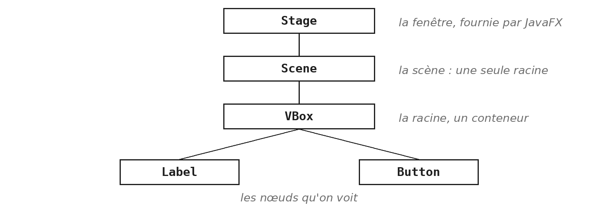
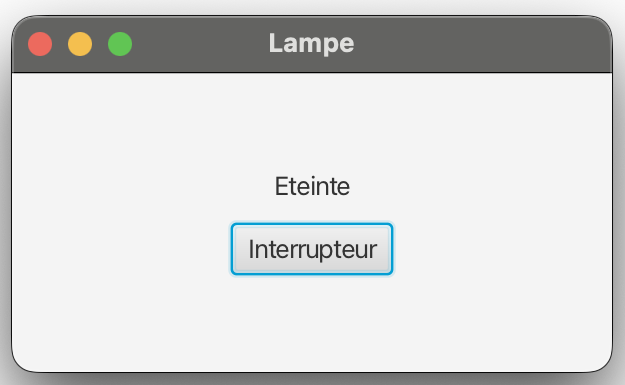
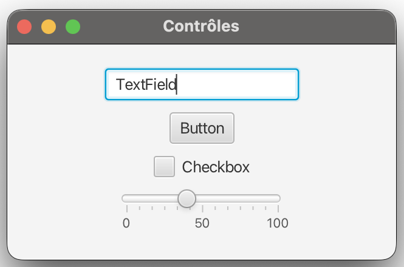
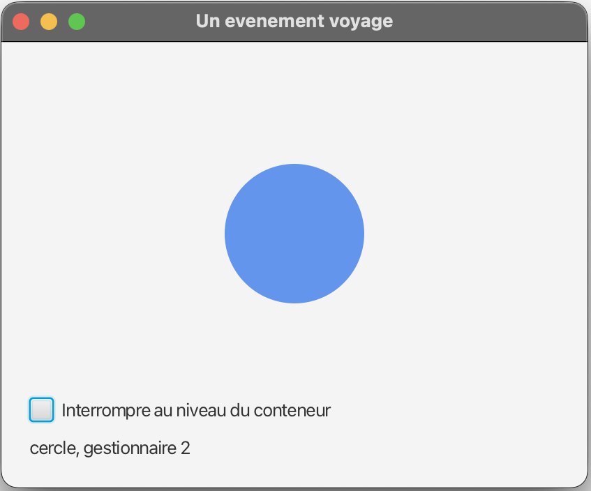
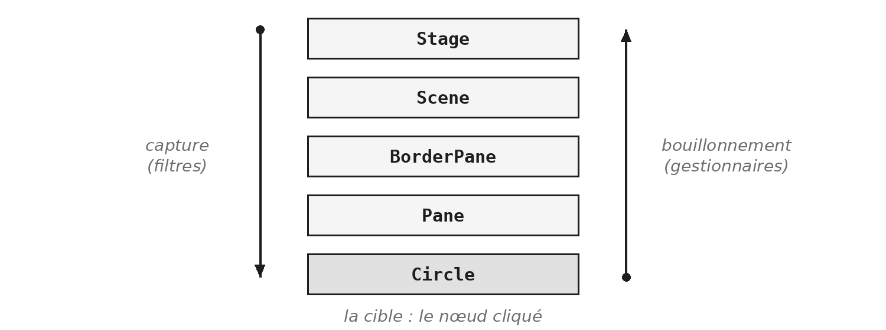
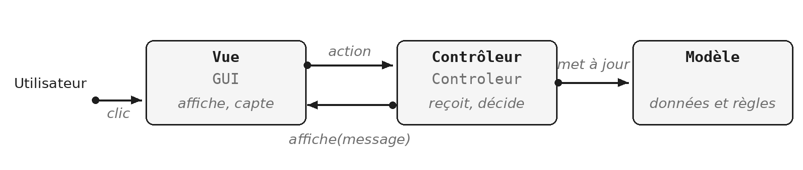
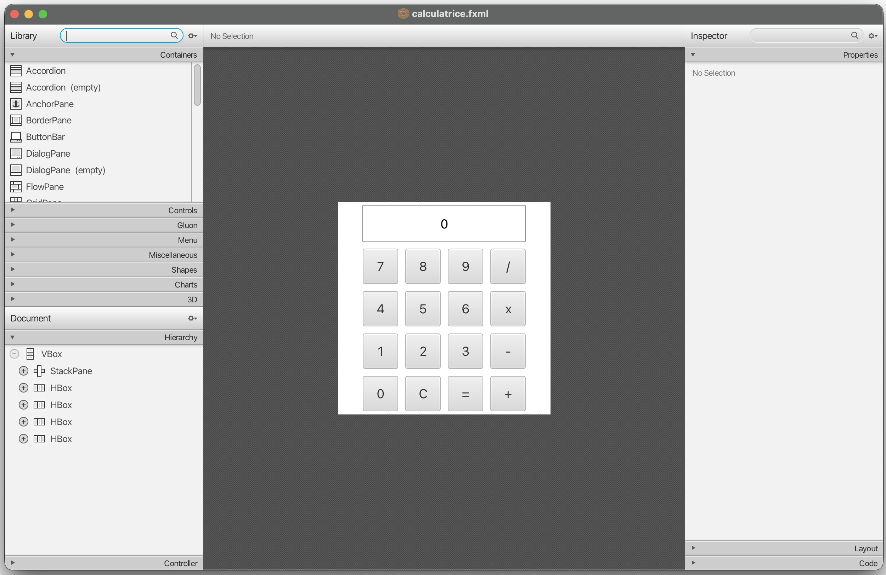
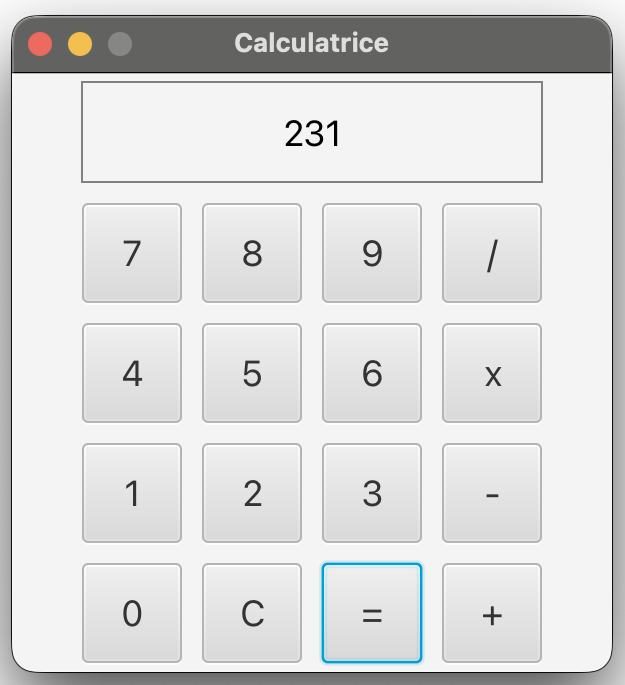

Jusqu'ici, vos programmes posaient des questions et attendaient la réponse dans la console. Ce module change de rapport : c'est l'utilisateur qui décide de ce qui arrive, et quand. Votre programme attend, et réagit.

Le module est le plus gros du cours, et ses slides sont réparties en trois decks. Le premier apprend à réagir à un geste : un clic, une touche. Le deuxième change de point de vue : au lieu d'écouter ce que fait l'utilisateur, on observe des valeurs, puis on sépare ce qu'on voit de ce qui calcule. Le troisième assemble le tout sur une calculatrice, pas à pas. La question JavaFX de l'examen repose surtout sur la première partie : chaque année, elle demande de relier un composant au code qu'il déclenche.

> **À la fin de ce module, vous saurez**
> - lancer une application JavaFX, et diagnostiquer un démarrage qui échoue ;
> - construire un écran : une fenêtre, une scène, des conteneurs et des contrôles ;
> - brancher un composant sur le code qu'il déclenche, et retirer ce branchement ;
> - lire un événement, et réagir au clavier et à la souris ;
> - expliquer le voyage d'un événement, et l'intercepter avec un filtre ;
> - observer une propriété, et lier une valeur à une autre ;
> - séparer le modèle, la vue et le contrôleur, et décrire une vue en FXML.

## 1. Lancer une application JavaFX

### JavaFX n'est plus dans le JDK

```xml
<dependency>
    <groupId>org.openjfx</groupId>
    <artifactId>javafx-controls</artifactId>
    <version>21.0.2</version>
</dependency>
```

JavaFX a été livrée avec le JDK pendant quelques années, puis en a été retirée, à partir de Java 11. C'est devenu un projet indépendant, OpenJFX. Installer un JDK ne vous donne donc pas JavaFX : il faut l'ajouter au projet, comme n'importe quelle bibliothèque.

Le projet du cours le fait pour vous depuis le premier jour. Ces lignes sont déjà dans son `pom.xml`, à côté de celles de `JUnit`, et Maven a téléchargé la bibliothèque au premier chargement : rien à installer, rien à configurer. Vous trouverez en ligne des procédures qui font télécharger un SDK JavaFX et le déclarer dans IntelliJ : ne les suivez pas, elles concernent les projets sans Maven (voir `IDE.28`). Pourquoi Java a connu trois bibliothèques graphiques successives, AWT, Swing et JavaFX, le mémento technique l'explique en `TEC-FX.1`.

### La classe à lancer s'appelle `Lanceur`

```java
public class LanceurLampe {

    public static void main(String[] args) {
        Application.launch(Lampe.class, args);
    }
}
```

Une application JavaFX hérite de la classe `Application`. Pourtant, ce n'est pas elle qu'on lance : chaque exercice et chaque démonstration de ce module contient une classe dont le nom commence par `Lanceur`, et c'est elle qu'il faut exécuter.

La raison est un contrôle du lanceur de Java. Quand la classe principale hérite d'`Application`, il exige que JavaFX soit chargé d'une façon particulière, comme module. Or Maven place les bibliothèques sur le classpath ordinaire. Le lanceur s'arrête alors avant d'avoir exécuté une seule ligne de votre code. Une classe qui n'hérite de rien ne déclenche pas ce contrôle : son `main` s'exécute, et c'est `Application.launch` qui démarre JavaFX. Ce n'est pas un bricolage, c'est la forme recommandée pour une application qui ne passe pas par les modules (`TEC-FX.4`). Vous n'avez rien à écrire dans ces classes : elles sont fournies.

### Si rien ne démarre

Le message le plus fréquent des premières minutes est aussi le plus trompeur : « JavaFX runtime components are missing ». Rien ne manque. Il signifie seulement que la bibliothèque n'a pas été annoncée à la machine virtuelle au démarrage.

- **Premier réflexe :** vérifier la classe lancée. Vous avez sans doute lancé la classe d'application au lieu du `Lanceur`.
- **En secours :** passer par Maven. Dans la fenêtre Maven, sous Plugins puis javafx, un double-clic sur `javafx:run` construit lui-même la bonne ligne de commande (`IDE.28`). Le message lui-même est expliqué en `ERR.7`.

## 2. Une fenêtre et ses composants

### Qui appelle `start` ?

```java
public class Lampe extends Application {

    @Override
    public void start(Stage fenetre) {
        Label etat = new Label("Eteinte");
        fenetre.setScene(new Scene(new StackPane(etat), 300, 150));
        fenetre.setTitle("Lampe");
        fenetre.show();
    }
}
```

Vous n'écrivez jamais `new Lampe()`, et vous ne créez pas la fenêtre. C'est JavaFX qui le fait : `launch` construit un objet de votre classe, avec son constructeur sans paramètre, puis appelle sa méthode `start` en lui donnant une fenêtre déjà prête. Votre travail se limite à remplir cette fenêtre et à l'afficher.

La classe `Application` est abstraite, et `start` est sa méthode abstraite : c'est le module `ABS` appliqué à une bibliothèque (voir `ABS §6`). JavaFX sait *quand* appeler `start` ; vous seul savez *quoi* y mettre.

Remarquez la dernière ligne. La méthode `start` se termine en quelques millisecondes, mais la fenêtre reste ouverte et le programme continue de tourner. Ce qu'il fait pendant ce temps est le sujet de FX §3.

### Le graphe de scène



Tout ce qu'une fenêtre affiche est un *nœud*, un objet d'une sous-classe de `Node` : un libellé, un bouton, un cercle, et aussi les conteneurs qui les rangent. Les nœuds s'emboîtent : une racine contient des enfants, qui contiennent leurs propres enfants. On appelle cet arbre le *graphe de scène*.

Le schéma se lit de haut en bas, et le vocabulaire vient du théâtre.

La fenêtre, le `Stage`, est fournie par JavaFX : c'est le plateau sur lequel évoluent les acteurs. Cette fenêtre affiche une scène, la `Scene` : c'est le décor dans lequel les acteurs évoluent.

La scène n'accepte qu'un nœud, sa racine. Et cette racine contient tous les autres nœuds : ce sont eux qu'on voit. Pour afficher plusieurs composants, on les range donc dans un conteneur, qui devient la racine.

### Construire le graphe de scène

```java
Label etat = new Label("Eteinte");
Button interrupteur = new Button("Interrupteur");

VBox racine = new VBox(etat, interrupteur);
Scene scene = new Scene(racine, 300, 150);

// un enfant peut s'ajouter apres coup
racine.getChildren().add(new Label("Bureau"));
```



Le même arbre, construit en code, dans l'ordre où on l'écrit : d'abord les nœuds qu'on verra, puis le conteneur qui les range, qui devient la racine, enfin la scène qui reçoit cette racine. Il ne reste qu'à donner la scène à la fenêtre, ce que fait `start`.

Les enfants d'un conteneur se lisent et se modifient par `getChildren`, qui retourne une liste : vous savez vous en servir depuis le module `COL`. Si on ne donne pas de taille à la scène, elle s'adapte à son contenu. Gardez cet arbre en tête : il est la clé de FX §5.

### Les conteneurs

| Conteneur | Range ses enfants | Usage typique |
|---|---|---|
| `HBox` | côte à côte | une rangée de boutons |
| `VBox` | les uns sous les autres | un formulaire |
| `BorderPane` | en cinq zones | une application |
| `StackPane` | empilés et centrés | un texte sur une forme |

En JavaFX, on ne place pas un composant à des coordonnées fixes. On le confie à un conteneur, qui décide de sa position et la recalcule quand la fenêtre change de taille : c'est ce qui permet à une interface de rester lisible quand on l'agrandit.

Un `BorderPane` ne range pas ses enfants dans une liste : il a cinq zones (le haut, le bas, la gauche, la droite et le centre), qu'on remplit une à une par `setTop`, `setCenter` ou `setBottom`.

Un `StackPane` empile ses enfants dans l'ordre où on les ajoute : le dernier est au-dessus.

La Javadoc en présente d'autres : `FlowPane`, qui passe à la ligne comme un texte, et `GridPane`, qui range en lignes et en colonnes.

### Les contrôles

```java
Label consigne = new Label("Piece :");
TextField saisie = new TextField("Bureau");
Button valider = new Button("Valider");

saisie.setPromptText("ex. Cuisine");
String piece = saisie.getText();
saisie.setEditable(false);
```



Un *contrôle* est un nœud avec lequel l'utilisateur interagit.

- **Un `Label`** affiche un texte que l'utilisateur ne modifie pas.
- **Un `TextField`** reçoit une saisie, que `getText` relit. Un texte d'invite, grisé, s'affiche tant que le champ est vide ; `setEditable(false)` le met en lecture seule.
- **Un `Button`** déclenche une action quand on l'actionne.

Les trois partagent `setText` et `getText`. La Javadoc de chaque contrôle est longue : ne cherchez pas à la lire en entier, cherchez-y ce dont vous avez besoin, au moment où vous en avez besoin. `Ctrl+Q` sur un nom de classe l'ouvre sans quitter l'éditeur (`IDE.14`). La case à cocher et le curseur viendront en FX §6.

## 3. Brancher un bouton

### Le programme attend

Dans un programme console, c'est vous qui décidez de ce qui se passe, comme dans une recette de cuisine : le programme affiche une question, lit la réponse, passe à la suivante. L'ordre est écrit dans le code.

Une interface graphique renverse ce rapport. L'utilisateur peut cliquer sur n'importe quel bouton, dans n'importe quel ordre, ou taper au clavier. Le programme ne sait pas ce qui va arriver : il attend. Chaque geste devient un objet, un *événement*, que JavaFX transmet au code qui a demandé à en être prévenu, et à lui seul. On appelle cette façon de programmer la *programmation événementielle*.

Vous avez déjà rencontré ce mécanisme sous un autre nom. Au module `ITF`, le magasin prévenait ses abonnés sans les connaître : c'est le patron Observateur (voir `ITF §5`). Un bouton fonctionne exactement ainsi. Il ne connaît pas votre programme ; il connaît une interface, et votre code vient s'y abonner. Un événement sans abonné se perd.

> **Démonstration** - `Demo_FX` : le bouton qui ne fait rien
> La démonstration part d'un bouton qui s'affiche, s'enfonce quand on clique, et ne déclenche rien. Tout y est correct ; il manque une seule chose. Elle le branche ensuite de trois façons qui produisent le même objet. Retenez moins la syntaxe que la question : quel est cet objet que le bouton reçoit, et qu'en fait-il ?

### Un gestionnaire est un objet

```java
// javafx.event.EventHandler, simplifiee
public interface EventHandler<T extends Event> {
    void handle(T evenement);
}
```

```java
interrupteur.setOnAction(evenement -> basculer());
```

Les trois écritures de la démonstration produisent la même chose : un objet qui implémente `EventHandler`, appelé un *gestionnaire*. Le bouton le range, et quand on clique, il appelle sa méthode `handle` en lui passant l'événement.

L'interface est générique : son paramètre dit quel type d'événement le gestionnaire reçoit, un `ActionEvent` pour un bouton (voir `GEN §6`). Elle est aussi fonctionnelle, puisqu'elle ne déclare qu'une méthode : c'est pourquoi une lambda suffit, comme le module `LAM` l'annonçait (voir `LAM §3`). Lisez la lambda en deux temps : la flèche dit *quand*, au moment où l'événement survient ; la méthode appelée dit *quoi*, basculer la lampe. Le paramètre `evenement` est reçu, même si on ne s'en sert pas ici.

### `setOnAction` n'est qu'un raccourci

```java
private final EventHandler<ActionEvent> basculement = evenement -> basculer();
```

::: cote-a-cote
```java
private void verrouiller() {
    interrupteur.removeEventHandler(
        ActionEvent.ACTION, basculement);
}
```
```java
private void deverrouiller() {
    interrupteur.addEventHandler(
        ActionEvent.ACTION, basculement);
}
```
:::

La méthode `setOnAction` n'accepte qu'un gestionnaire à la fois : un second appel remplace le premier. La forme longue, `addEventHandler`, nomme explicitement le type d'événement écouté, ici `ActionEvent.ACTION`, et elle cumule : deux gestionnaires ajoutés s'exécutent tous les deux.

Pour retirer un gestionnaire, `removeEventHandler` demande l'objet exact qui a été ajouté. Écrire deux fois la même lambda ne suffit pas : chaque écriture crée un objet distinct, et le retrait ne trouverait rien à retirer. C'est la promesse du module `LAM` : une lambda est une valeur, qu'on range dans un champ pour la retrouver plus tard.

C'est aussi une question d'examen classique : activer un bouton et en désactiver un autre, en ajoutant et en retirant leurs gestionnaires.

> **Exercices** - `FX.1` Un compteur de participants, `FX.2` Un bouton Reset, puis `FX.3` Deux compteurs, et une mise en page
> Les trois exercices construisent la même application, de plus en plus riche : `FX.1` branche un bouton, `FX.2` en ajoute un second qui agit sur le même compteur, `FX.3` double les compteurs et compose les conteneurs. Ce module n'a aucune classe de test : chaque énoncé se termine par la liste de ce que vous devez observer en lançant l'application, et c'est elle qui remplace la barre verte de JUnit. Lisez les deux réflexes de l'introduction du fascicule avant `FX.1` : ils vous éviteront l'erreur la plus fréquente, un composant déclaré dans `start` et introuvable ensuite.

## 4. Ce que dit un événement

> **Démonstration** - `Demo_FX` : une touche frappée
> La démonstration ajoute un gestionnaire de clavier à l'application de tout à l'heure. Observez deux choses : ce que le gestionnaire reçoit, et l'endroit où on le pose.

### Ce que transporte un événement

```java
private void noterBouton(ActionEvent evenement) {
    Button presse = (Button) evenement.getSource();
    journal.setText("Dernier bouton : " + presse.getText());
}

// dans start
allumer.setOnAction(this::noterBouton);
eteindre.setOnAction(this::noterBouton);
```

Jusqu'ici, le paramètre du gestionnaire était ignoré. Il contient pourtant tout ce qu'on sait de l'événement : son type (`getEventType`), le composant concerné (`getSource`), et, selon la famille, la touche frappée ou la position de la souris. Un même gestionnaire peut alors servir à plusieurs composants.

La méthode `getSource` retourne un `Object` : il faut le transtyper pour s'en servir comme bouton. Le transtypage est sûr ici, puisque seuls des boutons ont reçu ce gestionnaire. Vous retrouverez ce geste dans la calculatrice, pour un gestionnaire partagé par les dix chiffres. La référence de méthode `this::noterBouton` vaut la lambda `evenement -> noterBouton(evenement)` (voir `LAM §3`).

### Les familles d'événements

| Classe | Produit par | Types utiles ici |
|---|---|---|
| `ActionEvent` | un bouton actionné | `ACTION` |
| `KeyEvent` | le clavier | `KEY_PRESSED`, `KEY_TYPED` |
| `MouseEvent` | la souris | `MOUSE_CLICKED` |
| `WindowEvent` | la fenêtre | `WINDOW_CLOSE_REQUEST` |

Toutes ces classes héritent d'`Event`. Chacune déclare des champs statiques qui désignent ses types précis : ce sont eux qu'on passe à `addEventHandler`, comme `ActionEvent.ACTION` en FX §3. Il y en a d'autres, comme `KEY_RELEASED`, `MOUSE_MOVED` ou `MOUSE_ENTERED`, et chaque famille a un type `ANY`, qui les regroupe tous. Un `ActionEvent` vient aussi d'un champ de saisie quand on y presse Entrée.

> **Attention** - les imports de `java.awt`
> Il existe un `KeyEvent` et un `MouseEvent` dans `java.awt.event`, hérités d'une bibliothèque plus ancienne, et ils n'ont rien à voir avec ceux de JavaFX. Quand la complétion vous propose un nom, lisez le package avant de valider : il doit commencer par `javafx` (voir `TEC-FX.1` et `IDE.11`).

> **Exercices** - `FX.4` Compter au clavier
> L'exercice reprend l'application de `FX.3` et lui ajoute le clavier : les touches 1, 2 et 0 font ce que font les boutons, qui continuent de fonctionner. L'encadré de l'énoncé dit où poser le gestionnaire. La question de fin demande pourquoi cela fonctionne même quand un bouton a le focus : FX §5 y répond.

### Une touche, deux événements

```java
racine.addEventHandler(KeyEvent.KEY_PRESSED, this::toucheEnfoncee);

private void toucheEnfoncee(KeyEvent evenement) {
    switch (evenement.getCode()) {
        case UP -> augmenterIntensite();
        case DOWN -> diminuerIntensite();
        default -> { }
    }
}
```

Une touche enfoncée produit toujours un `KEY_PRESSED`, puis un `KEY_RELEASED` quand on la lâche. Si elle produit un caractère, un `KEY_TYPED` s'y ajoute. Les deux familles ne répondent pas à la même question.

- **`KEY_TYPED` dit quel texte l'utilisateur a tapé :** `getCharacter` le donne.
- **`KEY_PRESSED` dit quelle touche physique il a enfoncée :** `getCode` la nomme par une valeur de l'énumération `KeyCode`.

Les flèches, Échap ou F1 n'ont pas de caractère : seul `KEY_PRESSED` les voit. Dans l'autre cas, `getCharacter` et `getCode` retournent une valeur vide, ce qui explique qu'un gestionnaire de `KEY_TYPED` ne verrait rien de la flèche haut. Le `switch` sur une énumération vient du module `ENU` : les étiquettes s'écrivent sans le nom du type, `UP` et non `KeyCode.UP` (voir `ENU §4`).

### La souris

```java
ampoule.addEventHandler(MouseEvent.MOUSE_CLICKED, evenement -> {
    if (evenement.getClickCount() == 2) {
        basculer();
    }
});
```

N'importe quel nœud peut recevoir des événements de souris, pas seulement un bouton : ici, l'ampoule est un `Circle`. Un `MOUSE_CLICKED` survient quand on presse puis relâche sur le même nœud. Les méthodes `getX` et `getY` donnent la position dans le nœud, `getClickCount` distingue le simple clic du double clic, et `getButton` dit quel bouton de la souris a servi. Un double clic produit deux `MOUSE_CLICKED`, le premier avec un compte de 1, le second avec un compte de 2 : le test ne réagit donc qu'au second.

Un bouton produit à la fois un `ActionEvent` et des `MouseEvent`, et ce ne sont pas les mêmes déclencheurs. L'`ActionEvent` survient aussi quand on actionne le bouton au clavier, avec la barre d'espace ; le `MOUSE_CLICKED` ne survient qu'à la souris. Quand un énoncé demande d'utiliser le clic de souris comme déclencheur, c'est le second qu'il faut écouter.

## 5. Un événement voyage

> **Démonstration** - `Demo_FX` : un événement voyage
> La démonstration pose trois gestionnaires : deux sur un cercle, un sur le conteneur qui l'entoure. Un seul clic les déclenche tous les trois. Notez l'ordre dans lequel ils s'affichent, avant qu'on ne l'explique. Puis une case à cocher change le comportement du conteneur : regardez ce que deviennent les gestionnaires du cercle.



### L'aller et le retour



Un clic sur le cercle ne concerne pas que le cercle. Le cercle est dans un conteneur, qui est dans la scène, qui est dans la fenêtre : le clic a eu lieu dans chacun d'eux. JavaFX en tient compte en faisant voyager l'événement le long de la branche du graphe de scène qui mène au nœud cliqué, la *cible*.

JavaFX trace d'abord le chemin, de la fenêtre jusqu'à la cible, puis le fait parcourir deux fois.

- **La capture :** l'événement descend, du `Stage` vers la cible, en passant par la scène et chaque conteneur.
- **Le bouillonnement :** il remonte le même chemin, de la cible vers le `Stage`.

Chaque nœud traversé peut intervenir, à l'aller comme au retour. C'est ce qui explique la question de `FX.4` : un gestionnaire de clavier posé sur la racine reçoit la touche même quand un bouton a le focus, parce que l'événement remonte jusqu'à elle.

### Filtre ou gestionnaire

| | Filtre | Gestionnaire |
|---|---|---|
| Phase | la descente | la remontée |
| Ordre | du haut vers la cible | de la cible vers le haut |
| Ajout | `addEventFilter` | `addEventHandler` |
| Sert à | intercepter avant les enfants | réagir à ce qui s'est passé |

Filtre et gestionnaire sont le même type d'objet, un `EventHandler`. Ce qui les distingue, c'est le moment où on les appelle : un filtre pendant la descente, un gestionnaire pendant la remontée. Les raccourcis `setOnAction` et `setOnMouseClicked` posent des gestionnaires.

Un filtre posé sur un conteneur voit donc passer l'événement avant ses enfants, et avant la cible. Dans la démonstration, le filtre du conteneur s'affichait avant les gestionnaires du cercle : ce n'était pas une question d'ordre d'écriture, mais de phase.

### `consume()`

```java
panneau.addEventFilter(MouseEvent.MOUSE_CLICKED, evenement -> {
    if (verrouille) {
        evenement.consume();
    }
});
```

La méthode `consume` marque l'événement comme traité : les nœuds suivants du chemin ne le reçoivent plus. Consommé par un filtre, il n'atteint jamais la cible. Les autres gestionnaires du même nœud, eux, sont encore appelés.

C'est ce qu'a fait la case à cocher de la démonstration. On s'en sert pour bloquer une saisie, ou pour qu'un panneau verrouillé ignore les clics destinés à ses enfants, sans toucher au code de ces enfants. Vous connaissez maintenant deux façons de rendre un composant sourd : retirer son gestionnaire, comme en FX §3, ou consommer l'événement avant qu'il ne l'atteigne.

> **Exercices** - `FX.5` Un événement voyage, puis `G.33` Le Nim dans une fenêtre (fil rouge GameHub)
> `FX.5` fait construire ce que la démonstration a montré, avec un empilement de quatre niveaux : vous verrez le filtre, puis les gestionnaires, et vous constaterez ce qu'un clic à côté du cercle déclenche. La seconde partie tient en une ligne : ne la cherchez pas dans le cercle. `G.33` donne une fenêtre au jeu de Nim, vous contre la machine : un libellé affiche la pile, trois boutons prennent une, deux ou trois allumettes, et les touches 1, 2 et 3 font la même chose. Les classes du Nim servent telles quelles, sauf sa boucle.

## 6. Une valeur qui prévient

### Réagir à un geste, ou à une valeur

Supposez qu'un libellé doive toujours afficher l'intensité de la lampe. Avec ce que vous savez, il faudrait le mettre à jour dans chaque gestionnaire qui modifie l'intensité : le bouton plus, le bouton moins, la touche flèche, et le jour où on ajoute un curseur, le curseur. Oublier un seul endroit, c'est afficher une valeur fausse.

Le problème est mal posé. Ce qui compte n'est pas le geste, c'est le changement de valeur, qui peut aussi venir d'un collage, d'un calcul ou du programme lui-même. JavaFX rend donc les valeurs observables : ce sont les *propriétés*.

### Une propriété est un objet

```java
private final IntegerProperty intensite = new SimpleIntegerProperty(50);

public int getIntensite() { return intensite.get(); }

public void setIntensite(int valeur) { intensite.set(valeur); }

public IntegerProperty intensiteProperty() { return intensite; }
```

Java n'a pas de notion de propriété dans le langage. Il a une convention, plus ancienne que JavaFX : un champ privé, un accesseur `get` et un mutateur `set` qui portent son nom, comme vous en écrivez depuis le module `POO`. JavaFX garde cette convention et y ajoute un troisième accès : une méthode dont le nom finit par `Property`, et qui retourne non pas la valeur, mais l'objet qui la contient. C'est sur cet objet qu'on peut s'abonner.

Il existe une classe par type : `IntegerProperty`, `DoubleProperty`, `StringProperty`, `BooleanProperty`.

### S'abonner à un changement

```java
intensite.addListener((propriete, ancienne, nouvelle) ->
        System.out.println(ancienne + " -> " + nouvelle));

intensite.set(80);   // affiche 50 -> 80
intensite.set(80);   // n'affiche rien : la valeur n'a pas change
```

La méthode `addListener` abonne un `ChangeListener` à la propriété. C'est une interface fonctionnelle, comme `EventHandler` : sa méthode unique, `changed`, reçoit trois paramètres, d'où les trois noms de la lambda. Le premier est la propriété elle-même, qu'on ignore presque toujours ; les deux autres sont l'ancienne valeur et la nouvelle.

Le listener n'est appelé qu'aux changements, jamais à l'abonnement : une fenêtre qui s'ouvre n'affiche donc rien tant que la valeur n'a pas bougé. Et une affectation qui ne change pas la valeur ne déclenche rien.

### Les contrôles en ont aussi

```java
CheckBox veilleuse = new CheckBox("Veilleuse");

veilleuse.selectedProperty().addListener(
        (propriete, avant, apres) -> passerEnVeilleuse(apres));
```

Presque tout ce qu'affiche un contrôle est une propriété : son texte, sa largeur, sa visibilité, son état coché ou désactivé. Une `CheckBox` a une `selectedProperty`, un `Label` une `textProperty`, un `Slider` une `valueProperty`. On s'y abonne exactement comme à la sienne. La case à cocher prévient quand elle change d'état, qu'on l'ait cochée à la souris, au clavier, ou que le programme l'ait cochée par `setSelected`.

> **Exercices** - `FX.6` Écouter une propriété, puis `FX.7` Un Slider et un Label
> `FX.6` vous fait chercher, dans la Javadoc de `TextField`, la propriété à laquelle s'abonner : ne cherchez pas ailleurs que dans l'éditeur, la démarche compte autant que la réponse. `FX.7` refait le geste sur un curseur, et vous fait rencontrer trois pièges, que l'énoncé annonce ; vous connaissez déjà deux des trois : le `Number`, et le listener muet à l'ouverture.

## 7. Lier plutôt qu'écouter

### Une dépendance déclarée

```java
Label affichage = new Label();

affichage.textProperty().bind(intensite.asString());

intensite.set(80);   // le libelle affiche 80, sans autre ligne
```

Un listener dit : *quand ceci change, exécute ce code*. Un *binding* dit : *ceci est égal à cela*. La différence paraît mince, elle ne l'est pas. Avec un listener, c'est votre code qui recopie la valeur, et il peut oublier ou se tromper. Avec un binding, il n'y a plus de code de recopie : la relation est déclarée une fois, et JavaFX la maintient, pour toujours.

La méthode `bind` lie une propriété à une valeur observable. Rien à afficher au départ : le lien s'applique dès qu'il est posé. Une propriété liée ne s'écrit plus que par son lien : un `setText` sur elle lèverait une exception.

### Des valeurs qui se calculent

| Sur | La méthode | Produit |
|---|---|---|
| un nombre | `add`, `multiply` | un nombre |
| un nombre | `greaterThan`, `lessThan` | un booléen |
| un nombre | `asString` | un texte |
| un texte | `length`, `isEmpty` | un nombre, un booléen |
| un booléen | `not`, `and`, `or` | un booléen |

Une propriété ne se lie pas seulement à une autre propriété : elle se lie à une expression. Chaque méthode du tableau fabrique une nouvelle valeur observable, qui se recalcule quand ce dont elle dépend change. Les expressions s'enchaînent : `intensite.multiply(2).greaterThan(100)` est un booléen qui suit l'intensité. C'est ainsi qu'on désactive un bouton sans écrire de condition dans aucun gestionnaire : `plus.disableProperty().bind(intensite.greaterThanOrEqualTo(100))`.

### Dans les deux sens

```java
Slider curseur = new Slider(0, 100, 50);

curseur.valueProperty().bindBidirectional(reglage);

reglage.set(75);   // le curseur se place sur 75
// et si l'utilisateur deplace le curseur, reglage le suit
```

Un binding ordinaire a une source et une cible, et la cible ne s'écrit plus. Le binding bidirectionnel garde deux propriétés égales, dans les deux sens : chacune peut être modifiée, et l'autre suit. C'est ce qu'on veut pour un réglage qu'on peut changer de deux endroits, ici un curseur et une valeur du programme. Aucun exercice ne l'emploie : retenez seulement qu'il existe.

> **Exercices** - `FX.8` Lier plutôt qu'écouter, puis `G.34` Des boutons qui savent quand se taire (fil rouge GameHub)
> `FX.8` impose une contrainte : aucun listener, aucun gestionnaire de clavier. Trois composants dépendent d'un champ de saisie, et chaque dépendance s'écrit en une instruction. Comparez votre code à celui de `FX.7` une fois fini : la question de fin demande ce que le binding fait disparaître, et ce qu'il vous fait perdre. `G.34` répond par un binding à une question laissée ouverte par `G.33` : la fenêtre du Nim tient une `IntegerProperty` qui suit la taille de la pile, et chaque bouton se désactive par une seule instruction, celui qui prend trois allumettes quand il en reste moins de trois.

## 8. Séparer l'écran du calcul

### Trois responsabilités

Jusqu'ici, tout tenait dans une classe : les composants, les gestionnaires, et la règle elle-même. Ça suffit pour un compteur. Dès qu'une application contient une vraie logique, une calculatrice ou un jeu, ce mélange coûte cher. On sépare alors trois rôles, sous le nom de MVC, déjà rencontré au module `ITF` (voir `ITF §4`) :

- **le modèle** tient les données et les règles, et ignore tout de l'écran ;
- **la vue** montre, et ne décide de rien ;
- **le contrôleur** écoute la vue, interroge le modèle, met la vue à jour.



Le gain le plus visible : le modèle se teste par JUnit, une fenêtre ne se teste pas (voir `JUN §5`).

### Qui connaît qui

::: cote-a-cote
```java
// le modele, sans JavaFX
public class Lampe {
    private boolean allumee;

    public void basculer() {
        allumee = !allumee;
    }

    public boolean estAllumee() {
        return allumee;
    }
}
```
```java
// dans le controleur
private void basculer() {
    lampe.basculer();
    etat.setText(lampe.estAllumee()
            ? "Allumee" : "Eteinte");
}
```
:::

La règle tient dans les dépendances. Le contrôleur connaît le modèle et la vue ; le modèle ne connaît personne ; la vue ne connaît pas le modèle. Le modèle ne connaît ni les boutons ni les libellés : il dit seulement si la lampe est allumée, et sait la basculer. Le contrôleur reçoit le clic, demande au modèle d'agir, puis lit son état pour mettre la vue à jour.

La méthode `basculer` du contrôleur porte le même nom que celle de la lampe, mais elle ne décide plus de rien : elle transmet, puis affiche.

## 9. Décrire l'écran en FXML

### Écrire l'écran, ou le décrire

Jusqu'ici, la vue était du code Java, dans `start`. Une vue construite en Java mélange deux choses : la structure de l'écran (quels conteneurs, quels contrôles), et la façon de la construire (les `new` et les `getChildren`). Le FXML ne garde que la structure, dans un fichier à part, que JavaFX transforme en objets au chargement. Le fichier décrit ce qu'on voit, le contrôleur ce qui se passe. L'outil Scene Builder dessine ce fichier à la souris (`IDE.29`).



> **À retenir**
> Le FXML n'est pas à l'examen. Il sert à la calculatrice de `FX.9`, et à toute application de taille réelle.

### Un élément, un objet

```xml
<?import javafx.scene.control.Button?>
<?import javafx.scene.control.Label?>
<?import javafx.scene.layout.VBox?>

<VBox spacing="10" alignment="CENTER">
    <Label text="Eteinte"/>
    <Button text="Interrupteur"/>
</VBox>
```

Le FXML est du XML : des balises qui encadrent des données. Un élément s'ouvre et se ferme, `<VBox>` puis `</VBox>`, ou se ferme aussitôt, `<Label/>`, quand il n'a pas de contenu. Il contient des attributs, des paires nom et valeur entre guillemets. Le FXML donne un sens précis à chaque morceau :

- **un élément crée un objet** de la classe du même nom ;
- **un attribut appelle le mutateur** du même nom : `spacing` appelle `setSpacing` ;
- **les éléments imbriqués deviennent les enfants ;**
- **les classes s'importent,** comme en Java.

Cette règle vous rend autonome : pour savoir ce qu'on peut écrire sur un élément, on cherche les setters de sa classe dans la Javadoc.

### Charger une vue

```java
@Override
public void start(Stage fenetre) throws IOException {
    FXMLLoader chargeur = new FXMLLoader(
            ApplicationLampe.class.getResource("lampe.fxml"));

    fenetre.setScene(new Scene(chargeur.load()));
    fenetre.show();
}
```

Un fichier FXML n'est pas du code : il se range dans `src/main/resources`, dans le même package que la classe, et Maven le copie à côté des classes compilées. La méthode `getResource` le retrouve à partir de la classe. Le `FXMLLoader` lit le fichier, crée tous les objets qu'il décrit, et retourne la racine. Il peut échouer si le fichier est absent ou mal écrit : `load` déclare une `IOException`, contrôlée, que `start` laisse passer (voir `EXC §2`).

### La vue et son contrôleur

```java
public class ControleurLampe {
    private final Lampe lampe = new Lampe();

    @FXML private Label etat;

    @FXML
    private void basculer(ActionEvent evenement) {
        lampe.basculer();
        etat.setText(lampe.estAllumee() ? "Allumee" : "Eteinte");
    }
}
```

Côté fichier, la vue porte trois ajouts : `fx:controller` sur la racine, qui nomme le contrôleur ; `fx:id="etat"` sur le libellé ; `onAction="#basculer"` sur le bouton. Au chargement, le `FXMLLoader` crée un objet de la classe désignée par `fx:controller`, sans que vous écriviez de `new`. Puis, pour chaque élément qui porte un `fx:id`, il range l'objet créé dans le champ du contrôleur qui porte ce nom : c'est l'*injection*. Le contrôleur ne crée pas ses composants, il les reçoit. Enfin, `onAction="#basculer"` désigne la méthode à appeler à chaque clic : c'est `setOnAction`, écrit dans le FXML. Le dièse est indispensable, et son oubli est l'erreur la plus fréquente.

L'annotation `@FXML` autorise le chargeur à remplir un champ privé ou à appeler une méthode privée : sans elle, il faudrait les rendre publics.

## 10. La calculatrice, pas à pas



Le troisième deck n'apprend rien de neuf : il assemble ce que les sections précédentes ont posé, sur une seule application. C'est l'exercice `FX.9`. Cette section en donne le fil ; le deck et l'énoncé le détaillent étape par étape.

### Ce qu'on va construire

Une calculatrice simplifiée : les quatre opérations, sur des entiers seulement, et sans priorité des opérations. Chaque opérateur calcule ce qui précède : `2 x 3 + 4 x 5` donne donc 50, et non 26. Trois fichiers, trois rôles :

```text
src/main/java/be/ephec/java/fx/e09/
    ApplicationCalculatrice.java   // fournie
    Lanceur.java                   // fournie
    Controleur.java                // a ecrire
    Modele.java                    // a ecrire
src/main/resources/be/ephec/java/fx/e09/
    calculatrice.fxml              // a ecrire
```

C'est aussi l'ordre de travail : la vue d'abord, parce qu'on la voit tout de suite ; puis le contrôleur, branché sur ses boutons ; enfin le modèle, que le contrôleur appelle.

### La vue

Avant d'écrire une ligne, on dessine l'arbre. La racine est une `VBox`, qui empile ses enfants. Son premier enfant est l'écran, un `StackPane` qui superpose un `Rectangle` (le cadre) et un `Text` (le nombre affiché). Les quatre suivants sont les lignes de touches, quatre `HBox` de quatre `Button`. Les dimensions tombent juste : quatre boutons de 50 et trois espaces de 10 font 230, exactement la largeur du cadre.

```xml
<StackPane alignment="CENTER">
    <Rectangle width="230" height="50" fill="TRANSPARENT" stroke="GRAY"/>
    <Text fx:id="affichage" text="0"/>
</StackPane>

<HBox spacing="10" alignment="CENTER">
    <Button text="7" prefWidth="50" prefHeight="50" onAction="#chiffrePresse"/>
    <!-- ... -->
</HBox>
```

Dans un `StackPane`, le dernier enfant est au-dessus : le texte s'affiche par-dessus le cadre. Le `fx:id` du texte correspond au champ `@FXML private Text affichage` du contrôleur. Les classes utilisées s'importent en tête du fichier, sans quoi le chargement échoue, et Scene Builder refuse de les afficher.

### Le contrôleur

Seize touches, mais trois comportements : les dix chiffres ajoutent leur chiffre au nombre affiché, les opérateurs et le « = » déclenchent un calcul, et « C » remet tout à zéro. D'où trois méthodes dans le contrôleur, `chiffrePresse`, `operateurPresse` et `effacer`, et non seize.

```java
String chiffre = ((Button) evenement.getSource()).getText();
```

Dix boutons, une seule méthode : c'est l'événement qui dit quelle touche a été pressée (voir FX §4). Si l'écran montre « 0 », le chiffre le remplace ; sinon, il s'accole à la fin.

### Le modèle

```java
public long calculer(long premier, long second, String operateur) {
    return switch (operateur) {
        case "+" -> premier + second;
        // ... les trois autres, et la division par zero
    };
}
```

Le modèle ne connaît rien de JavaFX : deux nombres, un opérateur, un résultat. La division par zéro lève une `ArithmeticException`, plutôt que de retourner 0, ce qui ferait passer une erreur pour un résultat (`CC-ERR.1`) : c'est le contrôleur qui décidera d'afficher « Erreur ». Le modèle se vérifie par une classe de test, avant d'être branché.

Une opération se tape en plusieurs clics : entre deux clics, le contrôleur doit se souvenir du premier nombre et de l'opérateur choisi. Ce sont donc des champs, puisqu'une variable locale disparaît à la fin de la méthode :

```java
private final Modele modele = new Modele();

private long premierNombre = 0;
private String operateurEnAttente = "";
private boolean nouvelleSaisie = true;
```

Le booléen `nouvelleSaisie` dit si le prochain chiffre commence un nouveau nombre : sans lui, `5 + 6` afficherait 56.

### Vérifier, puis aller plus loin

La fenêtre n'a pas de test JUnit : la vérification passe par une liste d'observations, dans l'énoncé de `FX.9`. Le modèle, lui, se vérifie en une seconde. C'est toute la différence que fait l'architecture.

Les améliorations possibles sont de bons exercices libres : taper les chiffres au clavier, respecter la priorité des opérations, ajouter des opérations. La priorité change le modèle bien plus que le contrôleur, et c'est le signe d'un bon découpage : la vue n'a pas à bouger.

> **Exercices** - `FX.9` Une calculatrice, en MVC
> L'exercice suit exactement le troisième deck : la vue d'abord, puis le contrôleur branché, puis le modèle et sa classe de test, enfin les opérateurs. L'énoncé donne la logique des opérateurs et la liste de ce qu'il faut observer. Pour aller plus loin, un démineur complet est proposé à part, facultatif : vous écrivez la grille et ses règles, la fenêtre est fournie, et onze tests JUnit vérifient votre grille sans ouvrir de fenêtre.

## Aide-mémoire

Cette page regroupe, par tâche, les classes et les méthodes du module. Elles viennent des packages `javafx.*` : vérifiez l'import, et non `java.awt`.

| Je veux | J'écris | À savoir |
|---|---|---|
| lancer l'application | la classe `Lanceur`, fournie | jamais la classe `Application` |
| remplir la fenêtre | `start(Stage fenetre)` : `setScene`, `setTitle`, `show` | une `Scene` n'a qu'une racine |
| ranger des nœuds | `HBox`, `VBox`, `BorderPane`, `StackPane` | `getChildren().add(...)` |
| lire une saisie | `TextField` : `getText`, `setText` | `Label` pour afficher |
| réagir à un bouton | `bouton.setOnAction(e -> ...)` | remplace le gestionnaire précédent |
| ajouter ou retirer | `addEventHandler`, `removeEventHandler` | retirer demande le même objet |
| réagir au clavier | `addEventHandler(KeyEvent.KEY_PRESSED, ...)` | `getCode()` : `KeyCode.UP`… |
| réagir à la souris | `addEventHandler(MouseEvent.MOUSE_CLICKED, ...)` | `getClickCount()`, `getX()` |
| savoir qui a déclenché | `evenement.getSource()` | à transtyper |
| intercepter avant les enfants | `addEventFilter(...)`, puis `consume()` | pendant la descente |
| suivre une valeur | `propriete.addListener((p, avant, apres) -> ...)` | rien à l'abonnement |
| lier une valeur | `cible.bind(source)`, `bindBidirectional` | une cible liée ne s'écrit plus |
| décrire la vue en FXML | `FXMLLoader`, `fx:id`, `onAction="#methode"`, `@FXML` | le fichier dans `src/main/resources` |

Les quatre squelettes suivants sont prêts à adapter.

### Une fenêtre, un bouton, un libellé

```java
public class Compteur extends Application {
    private int valeur = 0;

    @Override
    public void start(Stage fenetre) {
        Label affichage = new Label("0");
        Button plus = new Button("+1");
        plus.setOnAction(evenement -> {
            valeur++;
            affichage.setText(String.valueOf(valeur));
        });
        fenetre.setScene(new Scene(new VBox(10, affichage, plus), 200, 120));
        fenetre.setTitle("Compteur");
        fenetre.show();
    }
}
```

### Activer et désactiver un gestionnaire

```java
private final EventHandler<ActionEvent> action = evenement -> agir();

private void activer() {
    bouton.addEventHandler(ActionEvent.ACTION, action);
}

private void desactiver() {
    bouton.removeEventHandler(ActionEvent.ACTION, action);
}
```

Le gestionnaire est rangé dans un champ : c'est le même objet qu'on ajoute et qu'on retire (voir FX §3).

### Réagir au clavier, sur la racine

```java
racine.addEventHandler(KeyEvent.KEY_PRESSED, evenement -> {
    switch (evenement.getCode()) {
        case DIGIT1 -> plusUn();
        case DIGIT0 -> remettreAZero();
        default -> { }
    }
});
```

### Lier plutôt qu'écouter

```java
IntegerProperty valeur = new SimpleIntegerProperty(0);

affichage.textProperty().bind(valeur.asString());
moins.disableProperty().bind(valeur.lessThanOrEqualTo(0));
```

Une fois liés, le libellé suit la valeur et le bouton se désactive seul à zéro : aucun gestionnaire ne s'en occupe (voir FX §7).

## Ce qu'il faut retenir

- On lance le `Lanceur`, jamais la classe qui hérite d'`Application`.
- Une fenêtre affiche une scène, qui a une racine ; les conteneurs rangent les nœuds.
- Une interface graphique attend : chaque geste est un événement, transmis à un gestionnaire, un objet qui implémente `EventHandler`.
- `setOnAction` remplace, `addEventHandler` cumule ; pour retirer un gestionnaire, il faut le même objet.
- Un événement descend jusqu'à la cible (les filtres), puis remonte (les gestionnaires) ; `consume` l'arrête.
- Une propriété prévient de ses changements ; un binding déclare qu'une valeur en suit une autre.
- MVC sépare ce qu'on voit de ce qui calcule ; le modèle se teste, la fenêtre se regarde.
