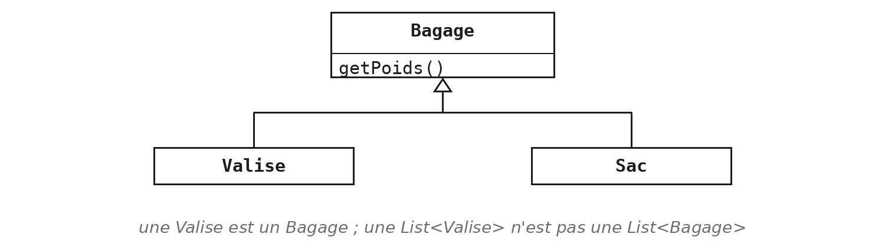
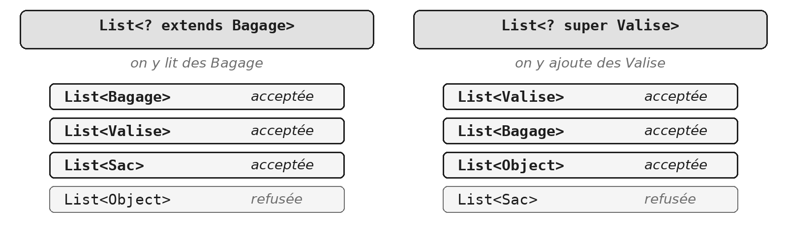

Depuis le module `COL`, vous écrivez `List<String>` et `Map<String, Integer>` sans vous demander qui a écrit les chevrons. Ce module vous fait passer de l'autre côté : écrire une classe une fois, et laisser celui qui l'utilise décider du type qu'elle contient.

Le module compte six exercices, qui montent sans rupture : un type, deux types, trois, une famille de types, une méthode, un héritage. Il pèse à l'examen : chaque session contient une question entière sur une classe générique, et presque toujours une classe qui enveloppe une collection.

> **À la fin de ce module, vous saurez**
> - écrire une classe générique à un ou plusieurs paramètres de type, et l'utiliser ;
> - écrire une classe générique qui enveloppe une collection, la forme de la question d'examen ;
> - expliquer ce que l'effacement de type permet, et ce qu'il interdit ;
> - choisir entre `? extends` et `? super` dans la signature d'une méthode ;
> - écrire une méthode générique, y compris une fabrique statique ;
> - hériter d'une classe générique, en gardant le paramètre ou en le fixant.

## 1. Un type en paramètre

### Quelqu'un a écrit ce `E`

```java
// ce que vous avez ecrit dans le module COL
List<String> titres = new ArrayList<>();

// ce qu'a ecrit l'auteur de List (extrait simplifie)
public interface List<E> {
    boolean add(E element);
    E get(int index);
}
```

Le `E` de la déclaration n'est pas un type : c'est une place laissée vide, que chaque utilisateur remplit. Quand vous écrivez `List<String>`, tous les `E` de l'interface valent `String`, et le compilateur vérifie que chaque `add` reçoit bien une `String`.

Imaginez que l'auteur de `List` n'ait pas eu ce `E` à sa disposition. Il aurait fallu une liste capable de tout recevoir, des `Object`. Que se passerait-il alors à la lecture ? Et surtout, à quel moment verrait-on une erreur ?

> **Démonstration** - `Demo_GEN` : l'erreur qui change de camp
> La démonstration part d'une classe écrite pour accepter n'importe quel objet, puis la rend générique en n'y changeant presque rien. Regardez à quel moment l'erreur apparaît dans chacune des deux versions, et où se trouve le transtypage. Retenez une phrase plutôt que la syntaxe : la généricité ne rend rien possible qui ne l'était pas déjà, elle avance le moment où l'erreur se voit, de l'exécution à la compilation.

### Déclarer un paramètre, le fixer à l'usage

```java
public class Casier<T> {
    private T contenu;

    public void deposer(T objet) {
        contenu = objet;
    }

    public T retirer() {
        T objet = contenu;
        contenu = null;
        return objet;
    }
}
```

```java
Casier<Valise> casier = new Casier<>();
```

- **`<T>` après le nom de la classe** déclare un paramètre de type.
- **`T` s'écrit ensuite partout où un type peut s'écrire :** champ, paramètre, retour, variable locale.
- **À l'usage, un argument de type prend sa place :** ici, `Valise`.

Deux mots à distinguer, comme pour les méthodes. Le `T` de la déclaration est le *paramètre de type* ; le `Valise` de l'usage est l'*argument de type*. Une méthode reçoit des valeurs, une classe générique reçoit des types.

À l'intérieur de la classe, `T` se comporte comme n'importe quel type, avec une seule limite, et elle compte : la classe ne sait rien de ce que sera `T`. Elle ne peut donc appeler sur un contenu que ce que tout objet sait faire, comme `toString` ou `equals`. Le diamant de droite, vu au module `COL`, laisse le compilateur déduire l'argument de la déclaration.

### Un `T` se transmet

```java
public class Consigne<T> {
    private final List<T> depots = new ArrayList<>();

    public void deposer(T objet) {
        depots.add(objet);
    }

    public int nombreDeDepots() {
        return depots.size();
    }
}
```

`T` peut servir d'argument à un autre type générique. Le champ est une `List<T>` : le `E` de la liste reçoit le `T` de la consigne. Une `Consigne<Valise>` contient donc une `List<Valise>`, et une `Consigne<String>` une `List<String>`, sans une ligne de plus.

La classe n'invente rien : elle *délègue* à la liste. Ce qu'elle ajoute, c'est un nom et un choix d'opérations : elle n'expose que ce qu'une consigne doit savoir faire.

> **À retenir** - la forme de la question d'examen
> C'est la forme de la question 2 de l'examen : une classe générique, une collection privée, quelques méthodes qui délèguent, et un `Programme` qui montre la même classe au service de deux types. Aucun exercice du module ne la pratique telle quelle : regardez-la bien.

> **Exercices** - `GEN.1` Une paire, un seul type
> L'exercice applique cette section sur une paire immuable : deux champs, deux accesseurs, un `toString` au format imposé. Faites l'expérience proposée avant d'écrire le `Programme`, et lisez ce que dit le compilateur : c'est la démonstration, refaite par vous-même. La seconde question de fin, `Paire<int>`, mérite d'être essayée vraiment : GEN §3 dira pourquoi le compilateur refuse.

## 2. Autant de types qu'il en faut

### Plusieurs paramètres

```java
public class Ticket<K, V> {
    private final K numero;
    private final V objet;

    public Ticket(K numero, V objet) {
        this.numero = numero;
        this.objet = objet;
    }
}
```

```java
Ticket<Integer, Valise> t = new Ticket<>(42, valise);
```

Une classe générique peut avoir plusieurs paramètres, déclarés dans les mêmes chevrons et séparés par des virgules. Chacun s'utilise indépendamment des autres, et l'usage donne un argument à chacun, dans l'ordre.

Un ticket de consigne relie un numéro à un objet. Rien n'oblige le numéro à être un nombre, ni l'objet à être une valise : la classe laisse les deux choix à son utilisateur. C'est la forme de la `Map<K, V>` du module `COL`. L'ordre compte : `Ticket<Valise, Integer>` est un autre type, et le compilateur refuserait alors `new Ticket<>(42, valise)`.

### Un argument de type peut être générique

```java
Map<String, List<Valise>> parVoyageur = new HashMap<>();

Casier<List<Valise>> casierFamille = new Casier<>();

Ticket<Integer, Casier<Valise>> ticket = new Ticket<>(7, new Casier<>());
```

Un argument de type peut contenir lui-même des chevrons ; on le lit de l'extérieur vers l'intérieur, et le compilateur vérifie chaque niveau. La première ligne se lit : une table dont les clés sont des chaînes et les valeurs des listes de valises, la forme rencontrée en `COL §7`.

La deuxième montre que rien ne distingue une classe du JDK d'une classe que vous écrivez : `Casier<List<Valise>>` est un casier qui contient une liste, et sa méthode `retirer` retourne une `List<Valise>`, sans transtypage. Dans la troisième, le diamant fonctionne même imbriqué.

> **Exercices** - `GEN.2` Un couple, deux types, puis `GEN.3` Deux sortes de triplets
> `GEN.2` applique la première sous-section ; lisez la remarque de l'énoncé sur le premier des deux couples demandés. `GEN.3` refait le geste deux fois, `TripletMemeType` puis `TripletTroisTypes` : écrivez-les l'une après l'autre, posez-les côte à côte, comptez les lignes qui diffèrent et notez où elles se trouvent. Les deux questions de fin sont l'exercice : discutez-les avant de regarder le corrigé, le compilateur ne peut pas y répondre à votre place.

## 3. Ce que le compilateur efface

### Une seule classe à l'exécution

```java
Casier<Valise> pourValises = new Casier<>();
Casier<String> pourMessages = new Casier<>();

System.out.println(pourValises.getClass() == pourMessages.getClass());   // true
```

Pour le compilateur, `Casier<Valise>` et `Casier<String>` diffèrent. À l'exécution, il n'existe qu'une classe `Casier`. Les arguments de type n'existent que pour le compilateur : une fois qu'il a tout vérifié, il les efface, et un objet `Casier` ne sait pas de quoi il est le casier. On appelle ce mécanisme l'*effacement de type*, en anglais *type erasure*.

La raison est historique. La généricité est arrivée avec Java 5, en 2004. Tout le code écrit avant devait continuer à tourner sur la même machine virtuelle, sans être recompilé. Le *type brut* que la démonstration a montré, `Casier` sans chevrons, vient de là : c'est ce qui reste d'une classe générique une fois ses arguments effacés.

### Vérifier, puis effacer

::: cote-a-cote
```java
// vous ecrivez
Casier<Valise> casier = new Casier<>();
casier.deposer(new Valise("bleue"));
Valise v = casier.retirer();
```
```java
// le compilateur en fait
Casier casier = new Casier();
casier.deposer(new Valise("bleue"));
Valise v = (Valise) casier.retirer();
```
:::

Le compilateur vérifie chaque usage de `T`, puis il remplace `T` par `Object` dans la classe, et il écrit lui-même le transtypage chez l'appelant. Le transtypage n'a donc pas disparu : c'est le compilateur qui l'écrit, à chaque appel.

La différence avec la première version de la démonstration est ailleurs. Ce transtypage-ci ne peut pas échouer, parce que le compilateur a vérifié tous les `deposer` avant de l'écrire. C'est la vérification qui refuse une erreur de type, pas le transtypage : elle a lieu avant l'effacement.

### Ce que l'effacement interdit

| Refusé | Parce qu'à l'exécution |
|---|---|
| `Casier<int>` | `T` devient `Object`, et un `int` n'est pas un objet |
| `new T()` | on ne sait plus quelle classe construire |
| `new T[10]` | un tableau doit connaître le type de ses cases |
| `static T champ;` | tous les casiers partagent une seule classe |

Chaque refus découle de la même cause : au moment de l'exécution, `T` n'existe plus.

- **La première ligne répond à la question de `GEN.1`.** Une classe générique ne connaît que des objets : on écrit `Casier<Integer>`, et l'autoboxing fait le reste (voir `COL §1`).
- **La troisième explique ce que la démonstration a laissé dans sa classe :** un tableau d'`Object`, et non un tableau de `T`. Un tableau vérifie à l'exécution ce qu'on y range, il doit donc savoir quel type il contient.
- **La dernière tient à ce qu'un membre `static` appartient à la classe** (voir `POO §4`), et que `Casier<Valise>` et `Casier<String>` n'en font qu'une.

### Le transtypage qu'on ne peut pas éviter

```java
// dans une classe generique, sur un tableau d'Object
@SuppressWarnings("unchecked")
T objet = (T) cases[i];

// au module FIC, en relisant un fichier
List<Valise> valises = (List<Valise>) entree.readObject();
```

Parfois, seul le programmeur sait ce que contient un `Object`. Après effacement, un transtypage vers `T` devient un transtypage vers `Object` : il ne vérifie rien. Un transtypage vers `List<Valise>` ne vérifie que `List`. Si le contenu n'est pas le bon, l'erreur surgira plus tard, à l'endroit où on lira l'élément, c'est-à-dire exactement ce que la généricité devait empêcher. Le compilateur le signale par un avertissement « unchecked ».

On l'accepte dans deux cas : dans une classe qui contrôle seule ce qu'elle range, comme la classe de la démonstration ; et quand une donnée revient d'un monde qui ignore la généricité, comme un fichier au module `FIC`. L'annotation `@SuppressWarnings("unchecked")` signe alors : « je l'ai vérifié ». Elle se pose sur la plus petite portée possible, une variable ou une méthode, et jamais pour faire taire un avertissement qu'on ne comprend pas.

## 4. Une famille de types

### Une `Valise` est un `Bagage`

```java
// Valise extends Bagage, Sac extends Bagage

List<Bagage> soute = new ArrayList<>();
soute.add(new Valise("bleue"));       // accepte
soute.add(new Sac());                 // accepte
```



Rien de neuf ici : c'est la substitution du module `ABS`. Partout où l'on attend un `Bagage`, on peut donner une `Valise`. Une liste de bagages peut donc contenir des valises et des sacs mélangés.

Mais une `List<Valise>` peut-elle passer là où l'on attend une `List<Bagage>` ? La réponse est non, et le compilateur le refuse. S'il l'acceptait, la méthode qui reçoit une `List<Bagage>` pourrait y ajouter un `Sac`, et la liste de valises de l'appelant contiendrait un intrus. Une `Valise` est un `Bagage`, mais une `List<Valise>` n'est pas une `List<Bagage>`. Les jokers répondent à ce problème.

> **Exercices** - `GEN.4` Le joker
> L'exercice se fait dans un ordre précis, et cet ordre est l'exercice. Écrivez d'abord la méthode avec un `Triplet<Personne>` en paramètre, comme l'énoncé le propose. Passez-lui un `Triplet<Etudiant>`, et lisez le refus du compilateur avant de lire l'encadré. Seulement ensuite, écrivez la version avec le joker.

### `? extends` : on lit

```java
public static double poidsTotal(List<? extends Bagage> bagages) {
    double total = 0;
    for (Bagage b : bagages) {
        total += b.getPoids();
    }
    // bagages.add(new Sac());   ne compile pas
    return total;
}
```

Le point d'interrogation se lit « quelque chose » : `? extends Bagage` est une liste de quelque chose qui est un `Bagage`. Une `List<Valise>` ou une `List<Sac>` y passent. La méthode ne sait pas quelle liste elle reçoit, mais elle sait que chaque élément est au moins un `Bagage` : elle peut donc lire et peser.

Ajouter, en revanche, lui est interdit. Si la liste reçue est une `List<Valise>`, un `Sac` y serait un intrus, et la méthode n'a aucun moyen de le savoir. Le compilateur refuse donc tout ajout, sauf `null`. Retirer ou vider la liste restent possibles : on ne peut rien y faire entrer, ce qui n'est pas tout à fait « lecture seule ».

### `? super` : on ajoute

```java
public static void charger(List<? super Valise> soute, int n) {
    for (int i = 0; i < n; i++) {
        soute.add(new Valise("grise"));
    }
}
```

```java
charger(new ArrayList<Bagage>(), 3);    // accepte
```

C'est le joker symétrique : `? super Valise` est une liste de quelque chose dont `Valise` hérite. Une `List<Valise>`, une `List<Bagage>` ou une `List<Object>` y passent, et quelle que soit la liste reçue, une `Valise` y a sa place. En revanche, la méthode ne sait pas ce qu'elle lirait : seulement des `Object`.

Le module `COL` a montré `removeIf(Predicate<? super E> filtre)`. Vous pouvez maintenant le lire : un critère écrit pour des `Bagage` sait tester des `Valise`, et peut donc servir sur une `List<Valise>`. Les reconnaître dans les signatures du JDK suffit : en écrire est rare.

### `? extends` ou `? super`

Tout dépend de ce que la méthode fait de la liste : la lire, ou la remplir.

| | `? extends Bagage` | `? super Valise` |
|---|---|---|
| Accepte | `Bagage`, `Valise`, `Sac` | `Valise`, `Bagage`, `Object` |
| Lire | oui, des `Bagage` | des `Object` seulement |
| Ajouter | non | oui, des `Valise` |
| La liste | fournit | reçoit |
| Exemple | `poidsTotal(...)` | `charger(...)` |

La question à se poser porte sur la méthode, pas sur la liste. Si la méthode lit, si la liste lui *fournit* des éléments, le joker est `extends`. Si elle ajoute, si la liste *reçoit* des éléments, le joker est `super`. Les anglophones retiennent la règle sous le nom PECS, *Producer Extends, Consumer Super*. Une méthode qui fait les deux, lire et ajouter, n'utilise pas de joker : elle prend une `List<Bagage>`.

### Des exemples, et des contre-exemples



```java
List<Valise> valises = new ArrayList<>();
List<Sac> sacs = new ArrayList<>();
List<Bagage> bagages = new ArrayList<>();
List<Object> objets = new ArrayList<>();

poidsTotal(valises);     // accepte : chaque Valise est un Bagage
poidsTotal(sacs);        // accepte : chaque Sac aussi
poidsTotal(objets);      // refuse : un Object n'est pas forcement un Bagage

charger(bagages, 2);     // accepte : une Valise a sa place parmi des Bagage
charger(objets, 2);      // accepte : et parmi des Object
charger(sacs, 2);        // refuse : une Valise n'a pas sa place parmi des Sac
```

Le raisonnement est toujours le même : se demander ce que la méthode va faire de la liste. `poidsTotal` lit des éléments et les traite comme des `Bagage` : toute liste dont les éléments sont des `Bagage` convient, quelle que soit leur sorte exacte. `charger` ajoute des `Valise` : toute liste où une `Valise` a sa place convient, c'est-à-dire une liste de `Valise` ou d'un type plus général. Le compilateur refuse exactement les cas où la méthode pourrait se tromper.

## 5. Une méthode générique

### Le compilateur déduit le `T`

```java
public static <T> T auHasard(List<T> elements) {
    int i = (int) (Math.random() * elements.size());
    return elements.get(i);
}
```

```java
Valise v = Tirage.auHasard(valises);    // T vaut Valise
String s = Tirage.auHasard(messages);   // T vaut String
Valise w = Tirage.<Valise>auHasard(valises);
```

Une méthode peut déclarer son propre paramètre de type, entre chevrons, avant le type de retour. Le `T` d'une classe est fixé une fois, à la création de l'objet ; celui d'une méthode est fixé à chaque appel, et peut valoir autre chose à l'appel suivant.

Personne ne l'écrit : le compilateur regarde l'argument, voit une `List<Valise>`, et en déduit `T`. Il sait alors que l'appel retourne une `Valise`. La dernière ligne montre la forme explicite ; vous la croiserez dans des documentations, rarement dans du code.

### Une méthode statique déclare son `T`

```java
public class Casier<T> {
    // ...

    public static <T> Casier<T> contenant(T objet) {
        Casier<T> casier = new Casier<>();
        casier.deposer(objet);
        return casier;
    }
}
```

```java
Casier<Valise> casier = Casier.contenant(valise);
```

Le `T` d'une classe appartient à chacun de ses objets. Une méthode statique est appelée sur la classe, sans objet : elle ne le voit pas, pour la même raison que le `static T champ` de GEN §3. Elle déclare donc son propre paramètre. Il porte ici la même lettre, comme dans le JDK (`List.of` fait pareil), mais c'est un autre `T` : celui de la méthode, déduit à chaque appel.

C'est une *fabrique*, au sens du module `POO` (voir `POO §4`) : une méthode statique qui construit et retourne un objet prêt à servir.

> **Exercices** - `GEN.5` Une méthode générique
> L'exercice déclare un `T` sur une méthode d'une classe qui n'est pas générique ; l'indice de l'énoncé vous évite d'écrire la boucle d'inversion. Lisez la remarque honnête de l'énoncé, puis faites l'expérience de la première question : la méthode réécrite avec un `Object`. Comparez avec `auHasard`, et cherchez ce qui fait la différence entre les deux.

## 6. Hériter d'une classe générique

### Deux façons d'hériter

```java
public class CasierFerme<T> extends Casier<T> {
    private final String code;

    public CasierFerme(String code) {
        this.code = code;
    }
}
```

```java
public class CasierVelo extends Casier<Velo> {
    // deposer(Velo) et retirer() : Velo, herites tels quels
}
```

Une fille peut rester générique, ou fixer le type une fois pour toutes. `CasierFerme` reste générique : on peut créer un `CasierFerme<Valise>` ou un `CasierFerme<Sac>`, et chacun hérite des méthodes de `Casier` pour ce type. `CasierVelo` ne l'est plus : il est un `Casier<Velo>`, et rien d'autre. On écrit `new CasierVelo()` sans chevrons, et sa méthode `retirer` retourne un `Velo`.

Pour le reste, l'héritage fonctionne comme au module `ABS` : redéfinition, `super`, polymorphisme.

### Une interface générique

```java
public class Vestiaire implements Depot<Manteau> {
    private Manteau accroche;

    @Override
    public void deposer(Manteau m) { accroche = m; }

    @Override
    public Manteau retirer() { return accroche; }
}
```

Une interface aussi peut être générique. L'interface `Depot<T>` déclare ici `deposer(T)` et `retirer()`, qui retourne un `T`. La classe qui l'implémente transmet le type, ou le fixe : `Vestiaire` fixe le type, et dans ses méthodes, `T` est remplacé par `Manteau`, ce que l'annotation `@Override` confirme. `Casier<T>` pourrait de son côté implémenter `Depot<T>`, et transmettre son paramètre.

Vous connaissez déjà plusieurs interfaces génériques : `List<E>`, et les `Predicate<T>`, `Function<T, R>` et `Comparator<T>` du module `COL`. Le module `LAM` vous les fera implémenter sans écrire de classe.

> **Exercices** - `GEN.6` Hériter d'une classe générique, puis `G.31` Un objet par joueur (fil rouge GameHub)
> `GEN.6` fournit `Couple<T>` et vous fait écrire `CoupleNomme<T>` ; lisez l'encadré sur `super` et `this` avant d'écrire le constructeur. La première question de fin rejoint le module `ABS` : une méthode de la mère qui appelle du code écrit après elle (`CC-CLS.3`). Côté fil rouge, le jeu de Nim garde deux stratégies dans deux champs jumeaux, et choisit la bonne par un opérateur ternaire. `G.31` vous fait écrire une seule classe, `ParJoueur<T>`, qui garde une chose pour chaque joueur, et l'introduire dans le Nim : la même classe y sert pour des stratégies et pour des joueurs, sans transtypage. Elle stocke la même chose qu'une `Paire<T>` : que dit-elle de plus ?

## Ce qu'il faut retenir

- Une classe générique reçoit un type en paramètre ; l'utilisateur le fixe, et le compilateur vérifie chaque usage.
- La généricité ne rend rien possible : elle avance l'erreur de l'exécution à la compilation.
- La forme de l'examen : une classe générique qui enveloppe une collection privée et lui délègue le travail.
- À l'exécution, les arguments de type sont effacés : ni `new T()`, ni `new T[]`, ni `static T`, ni `Casier<int>`.
- Une `List<Valise>` n'est pas une `List<Bagage>` : `? extends` pour lire, `? super` pour ajouter.
- Une méthode peut déclarer son propre `T`, que le compilateur déduit à chaque appel.

La phrase qui résume le module : la généricité ne change pas ce que le programme fait, elle change le moment où l'on découvre qu'il se trompe.
