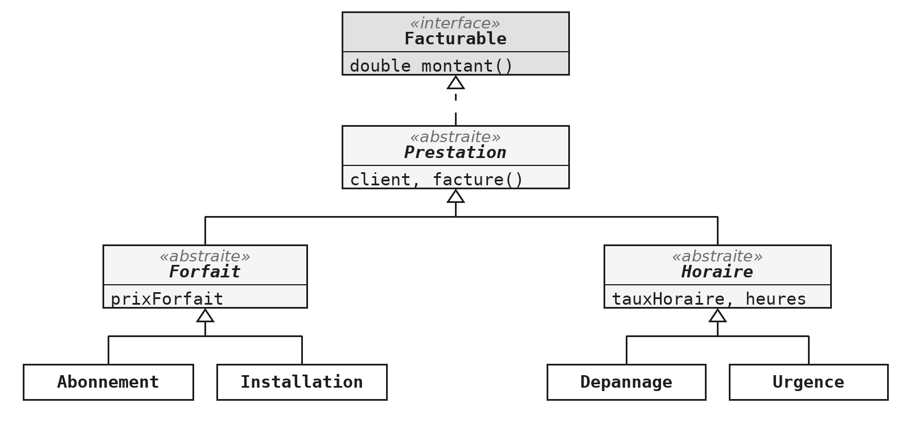
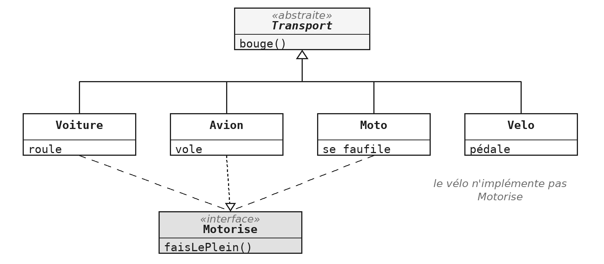

Le module `ABS` a montré comment partager du code entre des classes voisines. Celui-ci répond à une autre question : comment faire travailler ensemble des classes qui n'ont rien en commun ?

La réponse tient en une phrase : décrire ce qu'on attend, sans dire qui le fera. Une interface énonce un service, et laisse à d'autres le soin de le rendre. C'est la notion qui porte le découplage, et donc la majorité des conceptions que vous rencontrerez en entreprise. Elle sert aussi dans deux questions de l'examen : la hiérarchie d'`ABS.4`, dont le sommet est une interface, et l'interface graphique, qui fonctionne entièrement sur ce principe.

> **À la fin de ce module, vous saurez**
> - déclarer une interface, et l'implémenter dans des classes qui n'ont aucun lien de parenté ;
> - utiliser une interface comme type de variable et de paramètre ;
> - combiner une classe mère et plusieurs interfaces dans une même classe ;
> - choisir entre interface et classe abstraite, ou les employer ensemble ;
> - faire dépendre une classe d'un contrat plutôt que d'une autre classe ;
> - reconnaître et écrire le patron Observateur.

## 1. Ce qu'une interface déclare

> **Démonstration** - `Demo_ITF` : trois mots, et le programme accepte l'inconnu
> La démonstration part d'un programme qui fonctionne : un fournisseur, des clients abonnés, des produits qui arrivent. Une épicerie veut être prévenue elle aussi ; elle a la bonne méthode, avec la bonne signature, et le compilateur la refuse quand même : le fournisseur a été écrit pour une classe, pas pour une capacité. La fausse bonne idée est jouée volontairement : faire hériter le magasin de la classe client. Ça compile, et c'est un mensonge fait au compilateur, car un magasin n'est pas un client. L'interface est alors extraite, trois mots changent dans le fournisseur, et le magasin est prévenu comme les clients. Ajouter un entrepôt ne demande plus qu'une classe.

### Déclarer une interface

Une interface énonce ce qu'une classe doit savoir faire, sans dire comment. Le mot-clé `interface` remplace `class`, et les méthodes s'y déclarent par leur en-tête, sans corps :

```java
public interface Mesurable {

    double mesure();
}
```

Une interface ressemble à une classe abstraite qui n'aurait que des méthodes abstraites. La ressemblance est un bon point de départ, et ITF §3 dira où elle s'arrête. Les méthodes y sont publiques sans qu'on l'écrive : une méthode d'interface sans corps est destinée à être écrite ailleurs, donc elle est toujours publique, et le préciser n'apporte rien. Le compilateur accepte le mot `public` si vous l'écrivez, mais IntelliJ le signale comme redondant.

Le nom choisi dit une capacité, pas une nature. C'est une habitude utile : beaucoup d'interfaces du JDK se terminent par *-able*, comme `Comparable`, `Runnable` ou `Serializable`.

### Une classe s'engage

Le mot-clé `implements` déclare qu'une classe tient la promesse, et le compilateur vérifie que toutes les méthodes annoncées sont écrites :

::: cote-a-cote
```java
public class Examen implements Mesurable {

    private final int points;

    @Override
    public double mesure() {
        return points;
    }
}
```
```java
public class Colis implements Mesurable {

    private final double grammes;
    private final String destinataire;

    @Override
    public double mesure() {
        return grammes;
    }

    public String destinataire() {
        return destinataire;
    }
}
```
:::

Regardez ce que ces deux classes ont en commun : rien. Un examen se mesure en points, un colis en grammes, et aucune classe mère ne les réunirait sans inventer une parenté qui n'existe pas. C'est exactement ce que la classe abstraite ne sait pas faire, et ce pour quoi l'interface existe. L'annotation `@Override` n'est pas obligatoire, mais elle vaut d'être écrite, pour la même raison qu'au module `ABS` : une faute de frappe dans le nom devient une erreur de compilation au lieu d'un silence.

### Le type peut être l'interface

```java
Mesurable m = new Colis(1250);
System.out.println(m.mesure());        // OK

Mesurable autre = new Mesurable();     // erreur de compilation
System.out.println(m.destinataire());  // erreur de compilation
```

Une interface n'a pas de constructeur et ne décrit aucun objet : il n'y a rien à instancier, elle ne sert que de type. La seconde erreur est plus intéressante que la première. L'objet désigné est bel et bien un colis, et il a bel et bien un destinataire, mais la variable est déclarée `Mesurable` : le compilateur ne regarde que ce que ce type promet. Ce n'est pas une gêne, c'est l'intérêt même du procédé : le code qui manipule des mesurables ne peut plus dépendre par accident d'un détail des colis. C'est le polymorphisme du module `ABS`, sans classe mère.

### Recevoir un comportement en paramètre

```java
public static double total(Mesurable[] choses) {
    double somme = 0;
    for (Mesurable chose : choses) {
        somme += chose.mesure();
    }
    return somme;
}
```

Cette méthode additionne des examens et des colis dans le même tableau, sans savoir lesquels. Elle fonctionnera aussi avec une classe qui n'existe pas encore, du moment que cette classe implémente `Mesurable`. Retenez la formulation : le type d'un paramètre déclare ce dont la méthode a besoin, pas qui le fournit. Écrire `Colis` au lieu de `Mesurable` reviendrait à exiger beaucoup plus que nécessaire. ITF §4 en fait un principe.

> **Exercices** - `ITF.1` Une interface et deux implémentations, puis `ITF.2` Payer en ligne
> `ITF.1` isole l'idée dans le plus petit programme possible : une interface à une méthode, deux implémentations, et une méthode qui reçoit un calculateur. Le test lui passe une soustraction fabriquée sur place, que votre code n'a jamais vue. `ITF.2` reprend la même structure sur un cas réaliste : le client d'un côté, les moyens de paiement de l'autre. Les classes de paiement retournent leur compte-rendu au lieu de l'afficher (`CC-MET.7`), et le formatage du montant précise `Locale.US` (voir `TMP §4`).

## 2. Plusieurs interfaces à la fois

### Une seule mère, autant d'interfaces qu'on veut

```java
public class Square extends Shape
        implements Translatable, Rotatable {

    // ...
}
```

Une classe Java n'hérite que d'une seule autre : il n'y a pas de double `extends`. L'héritage multiple est interdit, et pour une bonne raison : si deux classes mères fournissaient la même méthode avec deux corps différents, aucune règle simple ne dirait laquelle s'applique. Les interfaces ne posent pas ce problème, puisqu'elles ne fournissent aucun corps. Une classe peut donc en implémenter autant qu'elle veut. L'ordre des mots est imposé : `extends` d'abord, `implements` ensuite, et chacun des deux peut aussi s'utiliser seul.

### Un comportement qui traverse les familles

```java
public interface Translatable {
    void translate(double dx, double dy);
}
```

```java
public interface Rotatable {
    void rotate(double alpha);
}
```

Une classe abstraite dit ce qu'un objet *est*, une interface ce qu'il *sait faire*. Un carré est une forme, et cette phrase justifie la classe abstraite `Shape`. Un carré sait se déplacer, et cette phrase-là justifie une interface, parce que la capacité déborde largement la famille des formes : une image ou un texte peuvent se déplacer sans être des formes. Une capacité se moque de la généalogie.

Les deux interfaces sont séparées, et ce n'est pas un hasard : une figure pourrait se déplacer sans pouvoir tourner. Réunir les deux méthodes dans une seule interface obligerait toute classe déplaçable à savoir tourner ; ITF §4 dit pourquoi c'est une mauvaise idée.

### Où écrire la méthode

```java
public abstract class Shape
        implements Translatable, Rotatable {

    // abstraites, ou ecrites ici ?
}
```

`Shape` s'engage sur les deux interfaces, et deux issues sont possibles : soit elle déclare les méthodes abstraites et laisse chaque forme les écrire, soit elle les écrit une fois pour toutes et ses filles n'ont rien à faire. Le critère est celui d'`ABS §4`, et il n'a pas changé : le code serait-il identique dans les trois sous-classes ? Si oui, il monte.

> **Exercices** - `ITF.3` Des formes qui se déplacent et tournent
> L'exercice combine une hiérarchie de classes et deux interfaces qui la traversent ; le travail d'écriture est court, la décision est tout l'exercice. Le dernier test manipule un tableau de `Translatable` : essayez d'appeler `rotate` ou `nom` sur un de ses éléments, et lisez ce que dit le compilateur : une variable de type `Translatable` ne connaît que ce que promet l'interface, même si l'objet qu'elle désigne sait faire davantage. La dernière question de l'énoncé reste ouverte : la normalisation de l'angle, déjà écrite en `ABS.1`, réapparaît ici ; est-ce une duplication au sens de `CC-CLS.3` ?

## 3. Interface ou classe abstraite ?

### Deux outils, deux intentions

| | Classe abstraite | Interface |
|---|---|---|
| Contient du code ? | oui, et des champs | des signatures seulement[^default] |
| Combien par classe ? | une seule | autant qu'on veut |
| Ce qu'elle exprime | « est un » | « sait faire » |
| Ce qu'elle apporte | le partage du code | le découplage |

La troisième ligne est celle qui décide presque toujours. Formulez la phrase à voix haute : un carré *est* une forme, un carré *sait* se déplacer. La bonne réponse est celle des deux phrases qui n'est pas ridicule. Les deux premières lignes en sont des conséquences : une interface ne contient pas de code, donc elle ne partage rien, donc rien n'empêche d'en implémenter plusieurs.

### Les deux ensemble

Les deux outils ne s'excluent pas. L'interface énonce ce que tout le monde sait faire ; la hiérarchie partage le code, étage par étage. C'est la structure d'`ABS.4`, annoncée au module précédent :



L'interface `Facturable` dit ce que toute prestation doit savoir faire : donner son montant. Les classes abstraites rangent les champs et le code commun à l'étage où ils deviennent communs. `Prestation` implémente `Facturable` sans écrire `montant`, ce qui est légal parce qu'elle est abstraite : elle reporte l'obligation sur ses descendants.

> **Exercices** - `ABS.4` Une hiérarchie à deux niveaux
> L'exercice mis de côté au module `ABS`, faute de connaître les interfaces, devient faisable maintenant. C'est aussi la forme exacte de la quatrième question de l'examen. Deux décisions vous appartiennent, qu'aucun test ne vérifie : où implémenter `montant`, et quelle visibilité donner aux accesseurs intermédiaires (voir `PKG.5`).

[^default]: Ce n'est plus tout à fait vrai depuis Java 8 (2014) : une interface peut aussi contenir des méthodes avec un corps, les méthodes `default` et les méthodes `static`, et depuis Java 9 des méthodes `private` qui les aident. ITF §6 présente les deux premières. Elles restent l'exception : l'essentiel d'une interface, ce sont ses signatures.

## 4. Dépendre d'un contrat

### Le modèle MVC : qui fait quoi

Les exemples de cette section parlent d'un contrôleur et d'une classe `GUI`. Ces deux noms viennent d'un découpage très répandu dans les applications graphiques, le modèle MVC : Modèle, Vue, Contrôleur.


- **La vue** est ce que l'utilisateur voit : la fenêtre, ses boutons, ses zones de texte. Elle capte les gestes, mais ne décide de rien.
- **Le modèle** contient les données et les règles du métier, sans rien savoir de l'écran.
- **Le contrôleur** fait le lien : il reçoit l'action transmise par la vue, met le modèle à jour, puis demande à la vue d'afficher le résultat.

Chaque rôle peut ainsi changer sans toucher aux autres, du moins en principe. La flèche « affiche » est celle qui pose problème : si le contrôleur la tient vers une classe d'affichage précise, il ne pourra plus parler à rien d'autre. Les modules `FX` reviendront sur ce découpage avec JavaFX.

### Deux classes qui se tiennent

```java
public class Controleur {

    private GUI afficheur;

    public void setAfficheur(GUI afficheur) {
        this.afficheur = afficheur;
    }
}
```

Ce code fonctionne, et c'est ce qui le rend instructif : le défaut n'est pas un bug, il est dans la dépendance. Le contrôleur n'a besoin que d'une chose, afficher un message, et il exige pourtant une classe entière. Le jour où l'application gagne une version console, ou une version qui écrit dans un fichier de trace, le contrôleur devra être rouvert. Et pour tester le contrôleur, il faut construire une interface graphique : le module `JUN` y reviendra.

### Une interface entre les deux

```java
public interface Afficheur {
    void affiche(String message);
}
```

```java
public class Controleur {

    private Afficheur afficheur;

    public void setAfficheur(Afficheur afficheur) { ... }
}
```

Trois mots ont changé, et la dépendance a changé de sens. Le contrôleur ne dépend plus de la fenêtre : les deux dépendent de l'interface, plus petite et plus stable que l'une comme l'autre. Affichage console, fenêtre ou trace : au choix, sans rouvrir le contrôleur. Le gain de testabilité devient concret : une classe de test peut fournir au contrôleur un afficheur de quatre lignes qui retient le dernier message, et vérifier ce qui a été signalé sans ouvrir la moindre fenêtre.

### Le type le plus faible qui suffit

Le *principe de ségrégation* demande de ne réclamer que ce dont on a vraiment besoin. Il a deux conséquences pratiques.

- **Pour les types que vous écrivez** (un paramètre, un champ, une variable) : le type le plus faible qui suffit est le bon. Déclarer `Afficheur` plutôt que `Fenetre` n'est pas une coquetterie, c'est une réduction délibérée de ce que le code peut faire.
- **Pour les interfaces que vous concevez** : une interface qui déclarerait à la fois `affiche`, `efface`, `redimensionne` et `imprime` obligerait toute classe affichante à savoir imprimer. Mieux vaut plusieurs petites interfaces, qu'une classe combine si elle le souhaite. C'est la raison pour laquelle `Translatable` et `Rotatable` sont deux interfaces, et pas une.

### Un comportement qui ne suit pas la hiérarchie

Une classe abstraite `Transport` déclare ce que tout transport sait faire, bouger, et chaque sous-classe le fait à sa façon. Une station-service doit faire le plein des transports qu'on lui présente. Tant que les transports sont une voiture, un avion et une moto, tout va bien ; puis on ajoute le vélo, qui est bien un transport, mais n'a pas de moteur.

```java
public class StationService {

    // a ne pas ecrire
    public void faireLePlein(Transport transport) {
        if (transport instanceof Velo) {
            // ne rien faire
        } else {
            // faire le plein
        }
    }
}
```

Le module `ABS` a déjà condamné le test de type, mais la situation n'est pas la même. Là-bas, le test trahissait une hiérarchie mal découpée. Ici, le découpage est correct : un vélo est bien un transport. C'est le comportement qui traverse la famille au lieu de la suivre ; aucune classe mère ne sépare les transports à moteur des autres, et en inventer une mentirait sur ce qu'est un transport. Le jour où un tricycle arrive à la pompe, la station devra être modifiée, et rien dans le compilateur ne préviendra qu'on l'a oubliée.

### L'interface supprime le test



```java
public interface Motorise {
    void faisLePlein();
}
```

```java
public class StationService {

    public void faireLePlein(Motorise motorise) {
        motorise.faisLePlein();
    }
}
```

En déclarant le paramètre `Motorise`, la station n'a plus rien à vérifier : un appel avec un vélo ne compile pas, et l'erreur est signalée à l'endroit où elle est commise. Il faut aller jusqu'au bout du raisonnement : écrire `if (transport instanceof Motorise)` dans la station ferait disparaître le nom du vélo, mais garderait le test. On aurait déplacé le problème, pas résolu. C'est la règle `CC-CLS.4`, et le principe de ségrégation, appliqués ensemble.

## 5. Le patron Observateur

### Un patron de conception

Un *patron de conception* est une solution éprouvée à un problème de conception qui revient souvent. Ce n'est ni une bibliothèque ni du code à copier : c'est une structure de classes, qu'on reconnaît et qu'on applique. On les range en trois familles : création, structure et comportement. Leur premier intérêt est le vocabulaire : dire « c'est un observateur » à un collègue transmet en trois mots ce qu'il faudrait un quart d'heure à décrire. Le catalogue `refactoring.guru` en présente les principaux.

### Le problème réglé par l'Observateur

Plusieurs objets veulent être prévenus quand quelque chose arrive : un produit en stock, un fichier qui change, un bouton cliqué. Les deux solutions spontanées sont mauvaises :

- **faire interroger le magasin en boucle** par les intéressés gaspille du temps, et arrive toujours un instant trop tard ;
- **faire prévenir nommément chaque intéressé** oblige le magasin à tenir une liste par type d'acteur, et à être modifié chaque fois qu'un nouveau type apparaît.

On cherche un dispositif où les intéressés se signalent eux-mêmes, et où le magasin ne sait rien d'eux.

### Le dispositif

```java
public class Magasin {

    private final Abonne[] abonnes = new Abonne[10];

    public void receptionne(String produit) {
        for (Abonne abonne : abonnes) {
            abonne.nouveauProduit(produit);
        }
    }
}
```

L'interface `Abonne` déclare une seule méthode, `nouveauProduit`. Le magasin tient un tableau d'abonnés, et trois méthodes suffisent : s'abonner, se désabonner, prévenir. Lisez la classe en cherchant le mot « client » : il n'y est pas, et c'est tout le patron. La méthode `receptionne` appelle `nouveauProduit` sur chaque abonné, sans savoir lequel répondra ni ce qu'il fera. Le tableau a une taille fixe de dix, une limite assumée que le module `COL` lèvera.

### Ce que ça change

- **Ajouter un acteur** (un entrepôt, un prospect, un transporteur) demande une classe, et rien d'autre à modifier.
- **Le magasin ne saura jamais à qui il parle.** Il garde l'initiative de l'appel, mais pas la connaissance des destinataires.
- **On ne demande pas son état à l'abonné : on lui demande d'agir** (`CC-OBJ.1`).

Ce dispositif vous servira plus tôt que vous ne le croyez : toute la gestion des événements en JavaFX fonctionne ainsi. Un bouton ne connaît pas votre programme, il connaît une interface, et votre code vient s'y abonner.

> **Exercices** - `ITF.4` Prévenir sans connaître
> Il faut ajouter un `Prospect` à un dispositif qui existe déjà et qui fonctionne, sans modifier ni le `Magasin`, ni l'interface, ni les deux autres abonnés. Si vous vous surprenez à vouloir modifier le magasin, relisez-le : rien n'y nomme un client ou un employé, donc rien n'a besoin d'y changer.

## 6. Ce qu'une interface contient aussi

### Des constantes, et des méthodes utilitaires

```java
public interface Mesurable {

    double SEUIL = 0.001;   // public static final

    double mesure();

    static boolean negligeable(Mesurable m) {
        return m.mesure() < SEUIL;
    }
}
```

Un champ d'interface est implicitement `public static final` : une interface ne peut déclarer que des constantes, et un champ sans valeur initiale ne compile pas. Une interface peut aussi contenir des méthodes `static`, corps compris, ajoutées par Java 8. Elles s'appellent sur l'interface, `Mesurable.negligeable(colis)`, et servent à ranger les petits utilitaires liés à l'interface là où on les cherche. Ne confondez pas les deux `static` : celui du champ est imposé, celui de la méthode est un choix.

### Ajouter une méthode sans casser l'existant

```java
public interface Vehicle {

    void demarre();
    void arrete();

    default void klaxonne() {
        System.out.println("Tuut");
    }
}
```

Une interface implémentée par dix classes ne peut pas gagner une méthode abstraite : les dix cessent de compiler. Une méthode `default` contient un corps, dont toutes les classes héritent ; chacune peut la redéfinir, aucune n'y est obligée. Java 8 a introduit ce mécanisme pour ajouter des méthodes à `List` et à ses voisines sans casser tout le code existant du monde. Vous n'écrirez pas de méthode par défaut cette année, mais vous en utiliserez sans le savoir dès le module `COL`.

Cette notion écorne le tableau d'ITF §3 : depuis Java 8, une interface peut contenir du code. La distinction utile reste celle des intentions, « est un » contre « sait faire », et une interface qui se met à contenir beaucoup de code est généralement une classe abstraite qui s'ignore.

### Une interface sans aucune méthode

```java
public class Contact implements Serializable {

    // rien a implementer : l'interface ne demande rien
}
```

Une *interface de marquage* ne déclare rien : elle pose une étiquette. Elle ne dit pas « sait faire », mais « appartient à cette catégorie ». `Serializable`, que vous rencontrerez au module `FIC`, autorise un objet à être écrit dans un fichier : la bibliothèque vérifie à l'exécution que l'objet porte l'étiquette, et lève `NotSerializableException` sinon. Depuis Java 5, ce rôle d'étiquette est mieux tenu par les annotations (`@Override`, `@Deprecated`…) : on ne crée donc plus guère d'interfaces de marquage, et `Serializable` reste sur votre route parce qu'elle est plus ancienne.

### Une interface, une seule méthode : l'interface fonctionnelle

```java
@FunctionalInterface
public interface Calculateur {

    int calcule(int a, int b);
}
```

Une interface qui déclare exactement une méthode abstraite est dite *fonctionnelle*. Vous en avez écrit sans le savoir, comme `Calculateur` et `Translatable`, et le JDK en est plein : `Runnable`, `Comparator`, et `EventHandler`, que vous retrouverez à chaque bouton du module `FX`. L'annotation `@FunctionalInterface` est facultative ; comme `@Override`, elle fait refuser par le compilateur une interface qui ne respecterait pas la règle. Au module `LAM`, ces interfaces gagneront une écriture abrégée, l'expression lambda, qui tient sur une ligne au lieu d'une classe entière.

> **Exercices** - `G.11` à `G.13` (fil rouge GameHub)
> Les trois incréments appliquent le patron Observateur au fil rouge : l'interface `ObservateurPartie` et ses trois moments (le début, le coup, la fin), la `Partie` qui enregistre ses observateurs, puis un premier observateur, un journal qui affiche le déroulement. La liste d'observateurs vous est donnée : les collections sont le sujet du module `COL`.

## Ce qu'il faut retenir

- Une interface énonce ce qu'une classe sait faire ; `implements` s'y engage.
- Une classe a une seule mère, et autant d'interfaces qu'elle veut.
- Classe abstraite : « est un », pour partager du code ; interface : « sait faire », pour découpler.
- Le type d'un paramètre déclare le besoin : le type le plus faible qui suffit est le bon.
- Quand un comportement traverse la hiérarchie, une interface supprime le test de type.
- L'Observateur : les intéressés s'abonnent, le sujet les prévient sans les connaître.

Le découplage est la leçon qui dépasse ce module : une classe qui ne dépend que de contrats peut être réutilisée, testée et remplacée sans qu'on rouvre le reste du programme.
