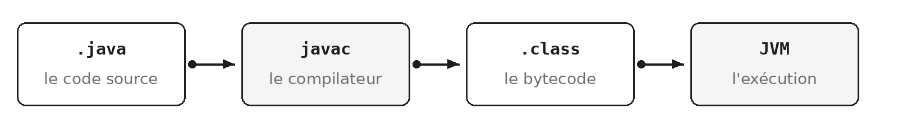
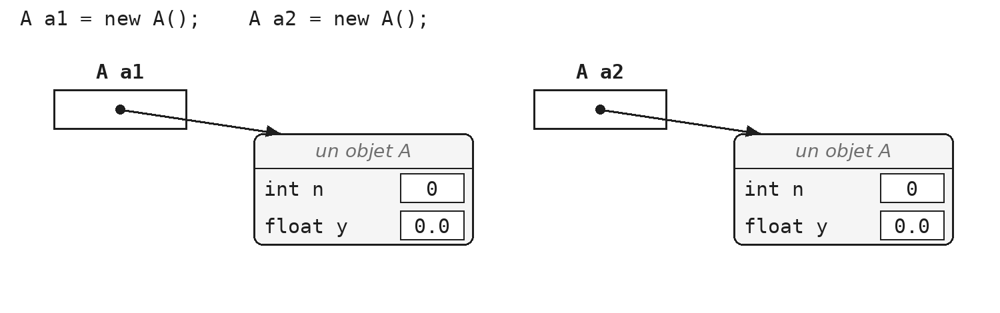
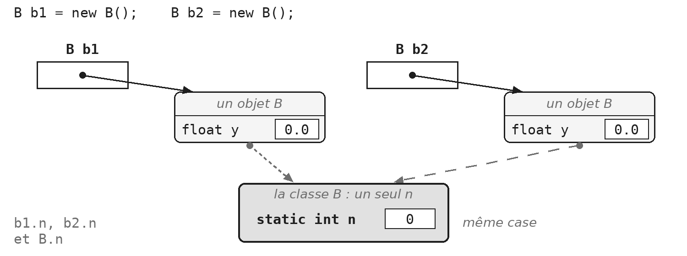
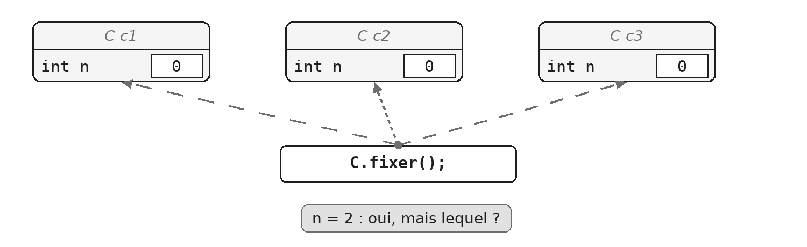
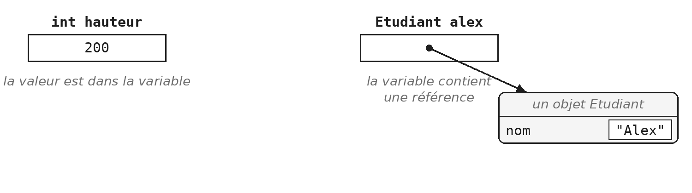
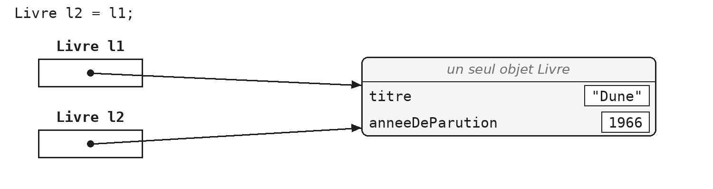

Vous connaissez déjà la programmation orientée objet en C#. Java en est très proche : la plupart de ce que vous savez se transpose directement. Ce module fait l'inventaire des différences, puis reprend les notions de base telles que Java les écrit : la classe et l'objet, l'encapsulation, les membres de classe, la lecture au clavier, et ce que contient vraiment une variable.

C'est le module fondateur du cours : tous les suivants s'appuient sur lui.

> **À la fin de ce module, vous saurez**
> - écrire une classe Java, avec ses champs, son constructeur et sa méthode `toString` ;
> - protéger l'état d'un objet, et juger quels accesseurs il mérite ;
> - distinguer ce qui appartient à la classe (`static`) de ce qui appartient à l'objet ;
> - lire au clavier avec `Scanner`, et trouver seul ce qu'offre une classe du JDK dans sa Javadoc ;
> - expliquer ce que contient une variable d'objet, et ce qu'une méthode reçoit en paramètre ;
> - séparer le calcul du dialogue, pour rendre le calcul testable.

## 1. De C# à Java

### Le même programme, dans les deux langages

Les deux programmes suivants font exactement la même chose.

::: cote-a-cote
```java
// C#
namespace ProgOO
{
    class Personne
    {
        public string Nom;
        public string Prenom;
        public int AnneeNaissance;
        public int Age;

        public void CalculAge(int Annee)
        {
            Age = Annee - AnneeNaissance;
        }

        public void Afficher()
        {
            Console.WriteLine(Prenom + " "
            + Nom + " (" + Age + " ans)");
        }
    }

    class Program
    {
        static void Main(string[] args) {
            /* ... */
        }
    }
}
```

```java
// Java
package progoo;

class Personne {
    public String nom;
    public String prenom;
    public int anneeNaissance;
    public int age;

    public void calculAge(int annee) {
        age = annee - anneeNaissance;
    }

    public void afficher() {
        System.out.println(prenom + " "
        + nom + " (" + age + " ans)");
    }
}

public class Program {
    public static void main(String[] args) {
        /* ... */
    }
}
```
:::

Cinq différences les séparent :

| En C# | En Java |
|---|---|
| `namespace ProgOO` | `package progoo;` : un package correspond aussi à un dossier sur le disque |
| `Nom`, `CalculAge` | `nom`, `calculAge` : la majuscule initiale est réservée aux classes, énumérations et interfaces |
| plusieurs classes publiques par fichier | au plus une classe `public` par fichier, qui lui donne son nom : ici, `Program.java` |
| `Console.WriteLine` | `System.out.println` : les classes du framework ne sont pas les mêmes |
| `Main` peut rester privée | `main` doit être `public static` |

La classe `Personne`, déclarée sans modificateur, n'est visible que dans son package : c'est ce qui lui permet de partager le fichier `Program.java` avec une classe `public`.

### N'importe quelle classe peut être exécutable

En Java, une classe devient exécutable dès qu'elle contient une méthode de signature exacte :

```java
public static void main(String[] args)
```

IntelliJ affiche alors une flèche verte dans la marge, à côté de la classe (voir `IDE.16` du guide IntelliJ). Pour essayer un ensemble de classes, écrivez plutôt une classe `Programme` séparée, qui les utilise : vos classes métier restent ainsi débarrassées de tout code d'essai. Le module `JUN` présentera une manière bien plus fiable de vérifier qu'une classe fonctionne : les classes de test.

Une précision si vous installez un JDK récent chez vous : depuis Java 25, `main` peut s'écrire plus simplement (sans `public`, sans `static`, et même sans paramètre). Le cours et l'examen utilisent Java 21, où la signature `public static void main(String[] args)` reste la seule valide.

### Du code source au programme

Le code que vous écrivez n'est pas exécuté tel quel.



Le compilateur `javac` traduit le code source en *bytecode*, rangé dans des fichiers `.class`, et c'est ce bytecode que la machine virtuelle Java (la JVM) exécute, sur n'importe quel système. Le mémento technique détaille ces trois états (`TEC-CMP.1`) et explique pourquoi un même `.class` tourne partout (`TEC-CMP.2`).

> **À retenir**
> - `namespace` devient `package`.
> - Une majuscule pour les types, une minuscule pour tout le reste.
> - Un fichier `.java` contient au plus une classe `public`, qui lui donne son nom.
> - `Console.WriteLine` devient `System.out.println`.
> - `main` doit être `public static`.

## 2. Classe et objet

### Les quatre principes de la POO

La programmation orientée objet repose sur quatre principes :

| Principe | En une phrase | Où dans le cours |
|---|---|---|
| Encapsulation | l'objet protège son état | ce module, voir POO §3 |
| Abstraction | ne modéliser que ce qui compte pour le problème | partout |
| Héritage | une classe reprend et étend une autre | module `ABS` |
| Polymorphisme | traiter uniformément des objets différents | modules `ABS` et `ITF` |

L'encapsulation regroupe dans une même classe les données et les méthodes qui les manipulent, et cache les détails internes : on agit sur un objet par ses méthodes, pas en touchant directement à ses champs.

L'abstraction consiste à ne retenir, d'un objet du monde réel, que les caractéristiques utiles au problème : une personne n'a pas la même forme dans un logiciel de paie et dans un logiciel médical.

### Une classe, des objets

Une classe est un moule : elle décrit des champs et des méthodes, mais ne fait rien par elle-même. Un objet est un exemplaire construit à partir de ce moule, par `new`.

```java
public class Livre {
    public String titre;
    public String auteur;
    public int anneeDeParution;
}
```

```java
Livre dune = new Livre();
dune.titre = "Dune";
```

Chaque appel à `new` fabrique un nouvel objet, avec ses propres valeurs de champs. La variable à laquelle on assigne cet objet avec `=` ne le contient pas : elle permet de le retrouver (voir POO §6). Deux livres créés par deux `new` sont deux objets distincts, même s'ils portent le même titre.

> **Démonstration** - `Demo_POO` : construire une classe, puis l'encapsuler
> La démonstration part d'une classe vide et lui ajoute des champs publics. Elle montre qu'un champ public accepte n'importe quelle valeur, même absurde, sans que rien ne proteste. C'est le problème que POO §3 résout.

### Le constructeur

Le constructeur est la méthode appelée par `new`. Il porte le nom exact de la classe, ne déclare aucun type de retour (pas même `void`), et met l'objet dans un état correct dès sa création.

```java
public class Livre {
    private String titre;
    private int anneeDeParution;

    public Livre(String titre, int anneeDeParution) {
        this.titre = titre;
        this.anneeDeParution = anneeDeParution;
    }
}
```

```java
Livre dune = new Livre("Dune", 1965);
Livre vide = new Livre();   // refuse : ce constructeur n'existe plus
```

Une classe qui ne déclare aucun constructeur en reçoit un d'office, le constructeur *par défaut* : il ne prend aucun paramètre et laisse chaque champ à sa valeur par défaut (0 pour un nombre, `false` pour un booléen, `null` pour un objet). Ce constructeur disparaît dès que vous écrivez le vôtre : dans l'exemple, `new Livre()` ne compile plus.

IntelliJ peut générer un constructeur à partir des champs (voir `IDE.12`). Le mot-clé `private`, que vous connaissez depuis C#, est expliqué en POO §3.

### Le mot-clé `this`

Dans une méthode ou un constructeur, `this` désigne l'objet sur lequel on travaille. On s'en sert surtout quand un paramètre porte le même nom qu'un champ : le nom seul désigne alors le paramètre, qui masque le champ, et `this.titre` désigne le champ.

```java
public Livre(String titre, int anneeDeParution) {
    this.titre = titre;   // le champ recoit le parametre
    titre = titre;        // le parametre recoit... lui-meme
}
```

> **Attention**
> L'oubli de `this` est une erreur silencieuse. `titre = titre;` est parfaitement valide : le paramètre est affecté à lui-même, et le champ reste à `null`. Le compilateur ne dit rien ; IntelliJ, en revanche, souligne la ligne (voir `IDE.15`).

### Un champ `final`

Certaines données ne doivent jamais changer une fois l'objet créé : le titre d'un livre, le pseudo d'un joueur. Déclarer le champ `final` confie cette règle au compilateur : le champ reçoit sa valeur exactement une fois, au plus tard à la fin du constructeur, et toute affectation ultérieure est refusée.

```java
public class Livre {
    private final String titre;

    public Livre(String titre) {
        this.titre = titre;
    }

    public void renommer(String nouveauTitre) {
        titre = nouveauTitre;
        // refuse : cannot assign a value to final variable titre
    }
}
```

L'immuabilité n'est plus une affaire de vigilance : elle est vérifiée par le compilateur. Un champ `final` ne s'écrit pas en majuscules pour autant : les majuscules sont réservées aux constantes, à la fois `static` et `final` (voir POO §4).

### La méthode `toString`

Tout objet sait se transformer en texte, grâce à sa méthode `toString()`. Celle qu'on reçoit par défaut n'est pas très utile : elle retourne le nom de la classe suivi d'un `@` et d'un numéro, par exemple `Livre@1b6d3586`. On la redéfinit donc presque toujours :

```java
@Override
public String toString() {
    return titre + " (" + anneeDeParution + ")";
}
```

```java
System.out.println(dune);         // Dune (1965)
String texte = "Lu : " + dune;    // Lu : Dune (1965)
```

`toString()` est rarement appelée explicitement : `System.out.println(dune)` l'appelle pour vous, et la concaténation d'une chaîne et d'un objet aussi. L'annotation `@Override` indique au compilateur qu'on remplace une méthode existante, celle que toute classe reçoit de la classe `Object` ; le module `ABS` explique ce mécanisme d'héritage.

> **Exercices** - `POO.1` Une première classe, puis `G.1` Le joueur et `G.2` La partie (fil rouge GameHub)
> Pour choisir vos noms, lisez les règles `CC-NOM.1` (le nom communique l'intention) et `CC-NOM.5` (des noms pour les choses, des verbes pour les actions) du mémento Clean Code.

## 3. Encapsulation

Un objet dont les champs sont publics ne contrôle pas son propre état. Cette section montre comment reprendre ce contrôle, et pourquoi il ne suffit pas de générer des accesseurs pour y parvenir.

### Le problème d'un champ `public`

Avec un champ `public`, n'importe quel code peut modifier l'objet sans passer par lui :

```java
Livre dune = new Livre("Dune", 1965);
dune.anneeDeParution = -3000;   // champ public : accepte sans broncher
```

Le programme compile, s'exécute, et produit des résultats faux ou incohérents sans que rien ne le signale.

### Fermer les champs, ouvrir des accesseurs

Encapsuler une classe, c'est rendre ses champs `private` et n'y donner accès que par des méthodes, les *accesseurs*, qui jouent le rôle des propriétés de C# :

- le **getter** lit la valeur : `getTitre()` ;
- le **setter** la modifie : `setTitre(String)` ;
- pour un booléen, le getter commence par `is` : `isDisponible()`.

```java
public class Livre {
    private String titre;

    public String getTitre() {
        return titre;
    }

    public void setTitre(String titre) {
        this.titre = titre;
    }
}
```

IntelliJ sait générer les accesseurs (voir `IDE.12`).

### Ce que le détour permet

Un getter et un setter qui se contentent de lire et d'écrire le champ ne protègent rien : ils ne font que déplacer l'accès. Leur intérêt apparaît quand on y place une règle (règle qui dépend du contexte dans lequel évoluent nos objets), ce qu'un champ public ne permettra jamais :

```java
public void setAnneeDeParution(int annee) {
    if (annee < 0) {
        throw new IllegalArgumentException("Annee invalide : " + annee);
    }
    this.anneeDeParution = annee;
}
```

Ici, le setter refuse une année négative, et l'objet ne peut plus se retrouver dans un état absurde. Le refus prend la forme d'une exception, que le module `EXC` étudie en détail : retenez pour l'instant que `throw` interrompt la méthode et signale l'erreur à l'appelant. `IllegalArgumentException` est une exception dite *non contrôlée* : le compilateur n'exige pas qu'on l'attrape, et le code appelant reste débarrassé de tout `try`/`catch`.

### Un accesseur n'est pas une obligation

Le générateur d'IntelliJ produit en un clic un getter et un setter pour chaque champ. C'est commode, mais le résultat ne vaut guère mieux que des champs publics : n'importe qui peut encore tout lire et tout modifier.

Posez-vous la question pour chaque champ. Doit-il être lu de l'extérieur ? Doit-il être modifié, et selon quelle règle ? Chaque accesseur doit avoir une raison d'être, et un champ `final` n'a par définition aucun setter. La règle `CC-OBJ.2` du mémento Clean Code développe ce point.

### La donnée qui n'existe pas

L'âge d'un livre change chaque année, alors que son année de parution ne change jamais. Stocker l'âge dans un champ, c'est accepter qu'il devienne faux au premier janvier suivant, sans que rien ne le mette à jour.

Ce qu'on peut calculer n'a pas à être stocké : une méthode le calcule à la demande, à partir de ce qui est stable.

```java
public int getAge() {
    return LocalDate.now().getYear() - anneeDeParution;
}
```

Vu de l'extérieur, `getAge()` ressemble à un getter ordinaire ; aucun champ ne se cache pourtant derrière. `LocalDate.now().getYear()` donne l'année en cours : les classes de dates font l'objet du module `TMP`.

> **Exercices** - `POO.2` La même classe, encapsulée, puis `POO.3` L'âge n'est pas une donnée à stocker
> La section `IDE.12` du guide IntelliJ montre comment générer accesseurs et constructeurs, et ce qu'il faut éviter quand le squelette les déclare déjà.

## 4. Membres de classe : `static`

Jusqu'ici, chaque champ appartenait à un objet : chaque livre a son titre. Certaines informations n'appartiennent pourtant à aucun objet en particulier. Le mot-clé `static` les rattache à la classe elle-même.

### Champs d'objet et champ de classe

Sans `static`, chaque objet reçoit ses propres exemplaires des champs. Soit la classe `A` suivante :

```java
class A { int n; float y; }
```

Une fois cette classe définie, `a1.n` et `a2.n` sont deux cases mémoire distinctes : modifier l'une ne change rien à l'autre.



Déclaré `static`, un champ n'existe plus qu'une fois, pour toute la classe. Prenons maintenant la classe `B` :

```java
class B { static int n; float y; }
```

Ici, `b1.n` et `b2.n` désignent la même case : ce que l'un y écrit, l'autre le lit. Le champ `y`, lui, reste propre à chaque objet.



Puisqu'un champ statique appartient à la classe, on le désigne de préférence par le nom de la classe : `B.n` dit clairement qu'il s'agit d'un champ partagé, là où `b1.n` laisse croire qu'il appartient à `b1`. À l'intérieur de la classe `B`, le nom `n` suffit. Un champ statique peut aussi être `private` : il reste alors accessible de l'extérieur par des méthodes, comme n'importe quel champ encapsulé.

> **Démonstration** - `Demo_STA` : ce qui appartient à la classe, ce qui appartient à l'objet
> La démonstration numérote des voitures, d'abord à la main puis grâce à un compteur partagé. Le débogueur montre ensuite que chaque voiture a son propre numéro, alors que le compteur n'existe qu'une fois (voir `IDE.19`).

### Un compteur d'instances

Un champ statique peut compter les objets créés. Qu'affiche ce programme ?

```java
class Ticket {
    private static int crees = 0;

    public Ticket() {
        crees++;
        System.out.println("Ticket " + crees + " cree");
    }
}
```

```java
public class Programme {
    public static void main(String[] args) {
        Ticket a;
        System.out.println("main 1");
        a = new Ticket();
        System.out.println("main 2");
        Ticket b;
        System.out.println("main 3");
        b = new Ticket();
        Ticket c = new Ticket();
        System.out.println("main 4");
    }
}
```

Le compteur `crees` est partagé par tous les tickets : chaque constructeur l'incrémente, et tous voient la même valeur. Le programme affiche, dans l'ordre : `main 1`, `Ticket 1 cree`, `main 2`, `main 3`, `Ticket 2 cree`, `Ticket 3 cree`, `main 4`.

Remarquez que la déclaration `Ticket a;` ne crée aucun objet : seul `new` appelle le constructeur. Remarquez aussi que ce compteur ne diminue jamais : Java ne prévient pas un objet de sa disparition (voir `TEC-EXE.4` du mémento technique).

### Méthodes de classe

Une méthode `static` ne travaille sur aucun objet particulier : on l'appelle sur la classe.

```java
double racine = Math.sqrt(16);
int annee = LocalDate.now().getYear();
```

`Math.sqrt(16)` ne demande pas de créer un objet `Math` ; la classe `Math` ne permet d'ailleurs pas d'en créer. Vous en utilisez depuis le début : `main` est une méthode de classe. Java accepte qu'on appelle une méthode statique à travers une variable d'objet, mais l'écriture laisse croire que la méthode dépend de cet objet : c'est trompeur, et IntelliJ le signale par un avertissement.

### Une méthode statique n'a pas de `this`

C'est l'erreur la plus fréquente du module. Une méthode statique ne peut utiliser ni les champs ni les méthodes non statiques de sa classe. Voici un contre-exemple qui peut vous faire comprendre pourquoi :

```java
class C {
    int n = 0;

    public static void fixer() {
        n = 2;   // refuse : non-static variable n cannot be
                 //          referenced from a static context
    }
}
```



La méthode `fixer()` est appelée sur la classe, pas sur un objet : s'il était possible de l'appeler, elle n'aurait aucun moyen de savoir de quel `n` on parle, puisqu'il en existe un par objet. Le même raisonnement interdit `this`, qui n'a rien à désigner. C'est aussi ce qui explique que `main` soit statique : il s'exécute avant qu'aucun objet n'existe.

### Les constantes

`static` et `final` répondent à deux questions différentes. `static` : la valeur est-elle propre à chaque objet, ou partagée par toute la classe ? `final` : peut-elle changer après avoir été fixée ? Les deux réponses se combinent, ce qui donne quatre sortes de champs :

| | Peut changer | Ne change plus (`final`) |
|---|---|---|
| **Propre à chaque objet** | `private int anneeDeParution;` : l'année d'un livre, qu'un setter peut corriger | `private final String titre;` : le titre d'un livre, initialisé une fois pour toutes par le constructeur |
| **Partagé par la classe (`static`)** | `private static int crees;` : un compteur d'instances | `public static final double TVA = 0.21;` : une constante |

Une constante a donc besoin des deux mots ; un compteur d'instances n'a besoin que de `static`, et un champ immuable d'objet que de `final`.

```java
public class Facture {
    public static final double TVA = 0.21;
    public static final int JOURS_DE_PAIEMENT = 30;
}
```

```java
double prix = 100 * (1 + Facture.TVA);
```

Par convention, une constante s'écrit en majuscules, avec des soulignés entre les mots. Nommer une valeur plutôt que l'écrire en dur rend le code lisible et évite de la répéter : c'est la règle `CC-NOM.7` du mémento Clean Code.

### À quoi servent les méthodes de classe

Elles servent dans trois situations :

- **répondre sur l'ensemble des objets** plutôt que sur l'un d'eux : combien d'objets ont été créés ?
- **offrir un service sans enregistrer d'état** : `Math.sqrt`, `Integer.parseInt` ;
- **fabriquer des objets** : `LocalDate.now()`, `LocalDate.of(...)` retournent une date sans qu'on ait écrit `new`. Ces méthodes s'appellent des *fabriques* (et ces méthodes-là contiennent bien un `new`, puisqu'un nouvel objet est créé).

### Les fabriques

Un point du plan peut se décrire par ses coordonnées ou par une distance et un angle : dans les deux cas, deux nombres réels. Deux constructeurs `Point(double, double)` ne peuvent pas coexister, puisqu'ils auraient la même signature. Deux méthodes statiques, elles, se distinguent par leur nom, et ce nom dit en plus comment lire les paramètres.

```java
public class Point {
    private final double x;
    private final double y;

    private Point(double x, double y) {
        this.x = x;
        this.y = y;
    }

    public static Point cartesien(double x, double y) {
        return new Point(x, y);
    }

    public static Point polaire(double rayon, double angle) {
        double x = rayon * Math.cos(angle);
        double y = rayon * Math.sin(angle);
        return new Point(x, y);
    }
}
```

```java
Point a = Point.cartesien(3, 4);
Point b = Point.polaire(5, 0.93);
```

Remarquez le constructeur `private` qui oblige tout le code extérieur à passer par les fabriques : personne ne peut plus écrire `new Point(3, 4)` en se demandant ce que représentent les deux nombres.

> **Exercices** - `STA.1` Une constante et un compteur d'instances, puis `STA.2` Un constructeur privé et des fabriques
> `STA.1` demande d'observer les champs dans le débogueur : la section `IDE.19` du guide IntelliJ explique comment poser un point d'arrêt et lire le panneau Variables.

## 5. Entrée de données au clavier

Un programme qui dialogue avec son utilisateur doit pouvoir lire ce qu'il tape. Cette section présente la classe `Scanner`, et profite de l'occasion pour apprendre à lire la documentation d'une classe du JDK.

### La classe `Scanner`

La classe `Scanner`, du package `java.util`, lit ce que l'utilisateur tape dans la console. On la construit une seule fois, sur `System.in`, puis on appelle ses méthodes autant de fois que nécessaire :

```java
Scanner clavier = new Scanner(System.in);
String nom = clavier.nextLine();
int age = clavier.nextInt();
```

Ouvrir plusieurs `Scanner` sur la même entrée provoque des comportements difficiles à comprendre : un seul suffit pour tout le programme.

### La Javadoc

Pour savoir ce qu'offre une classe du JDK, on consulte sa Javadoc. Chaque page présente la classe, puis l'inventaire de ses constructeurs et de ses méthodes. Pour chaque méthode, elle indique les paramètres attendus, la valeur retournée et les exceptions possibles.

Inutile d'ouvrir un navigateur : IntelliJ affiche cette documentation au survol d'un nom, ou avec `Ctrl+Q` / `F1` (voir `IDE.14`). La version en ligne, pour Java 21, se trouve à l'adresse `docs.oracle.com/en/java/javase/21/docs/api/`.

Pour `Scanner`, la documentation indique le package, `java.util`, puis le principe : l'entrée est découpée en *jetons*, séparés par défaut par des espaces ou des passages à la ligne, et chaque jeton peut être converti dans le type voulu grâce aux différentes méthodes `next`. Pour ce cours, quelques méthodes suffisent :

| Méthode | Ce qu'elle lit |
|---|---|
| `nextLine()` | le reste de la ligne courante, sans le passage à la ligne final |
| `next()` | le mot suivant |
| `nextInt()` | le jeton suivant, converti en `int` ; `InputMismatchException` si ce n'est pas un entier |
| `nextDouble()` | le jeton suivant, converti en `double` |

La documentation de `nextInt()` signale aussi la variante `nextInt(radix)`, qui interprète le nombre dans la base indiquée.

### Un piège : `nextInt` suivi de `nextLine`

```java
System.out.print("Annee : ");
int annee = clavier.nextInt();       // lit 1965, laisse la fin de ligne
System.out.print("Titre : ");
String titre = clavier.nextLine();   // retourne "" sans attendre
```

Quand l'utilisateur tape 1965 puis Entrée, `nextInt()` consomme les chiffres mais laisse le passage à la ligne dans le tampon. Le `nextLine()` suivant le trouve immédiatement et retourne une chaîne vide : pour l'utilisateur, la question du titre a été sautée.

On peut ordonner les questions pour éviter qu'un `nextLine()` suive un `nextInt()`, ou consommer la fin de ligne par un `nextLine()` supplémentaire. L'exercice `POO.5` vous demandera de chercher une manière de ne jamais tomber dans le piège.

> **Exercices** - `POO.4` Saisie au clavier (première partie seulement), puis `G.3` Le point d'entrée (fil rouge GameHub)
> La seconde partie de `POO.4` vient après POO §6.

## 6. Primitifs et références

Une variable Java ne contient pas la même chose selon son type. Cette différence explique plusieurs comportements surprenants, dont celui que l'exercice `POO.4` vous fait constater.

### Ce que contient une variable

Java compte huit types primitifs : `byte`, `short`, `int`, `long`, `float`, `double`, `char` et `boolean`. Une variable de l'un de ces types contient directement sa valeur.

Une variable d'objet, elle, ne contient pas l'objet. Elle contient une *référence*, c'est-à-dire le moyen de retrouver l'objet, qui vit ailleurs en mémoire. Le mémento technique décrit où vivent l'un et l'autre (`TEC-EXE.1` à `TEC-EXE.3`).



### Deux noms, un seul objet

L'affectation copie toujours le contenu de la variable. Pour un `int`, ce contenu est le nombre ; pour un objet, c'est la référence.

```java
int a = 5;
int b = a;
b = 7;                                       // a vaut toujours 5

Livre l1 = new Livre("Dune", 1965);
Livre l2 = l1;                               // l2 designe le MEME objet
l2.setAnneeDeParution(1966);
System.out.println(l1.getAnneeDeParution()); // 1966
```

Après `l2 = l1`, les deux variables désignent le même livre, et une modification faite par l'une se voit par l'autre.



Le débogueur rend ce partage visible : il affiche à côté de chaque objet un numéro, et deux variables qui portent le même numéro désignent le même objet.

> **Exercices** - `POO.4` Saisie au clavier, seconde partie
> Observez, puis expliquez par écrit ce que vous constatez, avant de lire la suite.

### Ce que vous avez observé

Java passe toujours les arguments **par valeur** : une méthode reçoit une copie de ses arguments.

```java
static void modifier(int n, Livre livre) {
    n = 99;                           // change la copie
    livre.setAnneeDeParution(2000);   // change l'objet partage
    livre = new Livre("Autre", 1);    // la copie designe un autre objet
}
```

- Pour un `int`, la méthode reçoit une copie du nombre : modifier le paramètre ne change rien chez l'appelant.
- Pour un objet, elle reçoit une copie de la référence, qui désigne le même objet que la variable de l'appelant : ce qu'on fait à l'objet à travers elle se voit de partout.
- Ce n'est pas pour autant un passage par référence : la troisième ligne fait désigner un autre objet à la copie, et la variable de l'appelant n'en est pas affectée. À la sortie de la méthode ci-dessus, le paramètre disparaît : plus rien ne désigne le livre « Autre », et le ramasse-miettes pourra récupérer sa place (voir `TEC-EXE.4` du mémento technique).

`TEC-EXE.3` reprend ce raisonnement dans le mémento technique.

## 7. Les wrappers

Chaque type primitif a une classe jumelle, qui l'enveloppe et lui ajoute des méthodes utiles. Ces classes sont l'occasion de retrouver les membres statiques de POO §4.

### Un objet pour chaque type primitif

À chacun des huit types primitifs correspond une classe du package `java.lang`, appelée *wrapper* ou classe enveloppe. Le nom reprend celui du type avec une majuscule, sauf pour `int` et `char` :

| Type primitif | Wrapper |
|---|---|
| `byte` | `Byte` |
| `short` | `Short` |
| `int` | `Integer` |
| `long` | `Long` |
| `float` | `Float` |
| `double` | `Double` |
| `char` | `Character` |
| `boolean` | `Boolean` |

### Ce qu'offrent les wrappers

Les wrappers offrent surtout des membres statiques, qu'on appelle donc sur la classe :

```java
int n = Integer.parseInt("42");             // une conversion
int plusGrand = Integer.MAX_VALUE;          // une constante
boolean chiffre = Character.isDigit('7');   // un test

Integer boite = 5;     // autoboxing
int valeur = boite;    // unboxing
```

Java convertit automatiquement un primitif en wrapper et inversement : c'est l'*autoboxing* et l'*unboxing*. Cela permet d'écrire `Integer boite = 5;` sans conversion explicite.

Méfiez-vous de `Character.isSpace`, que vous croiserez dans d'anciens exemples : elle est dépréciée depuis Java 1.1 au profit de `Character.isWhitespace`. Elle ne reconnaît que cinq caractères ASCII (l'espace, la tabulation, le passage à la ligne, le saut de page et le retour chariot), là où `isWhitespace` suit la définition Unicode des blancs. Les espaces insécables n'en font pas partie : TMP §4 montre où ce détail peut piéger un test.

### Séparer le calcul du dialogue

Un calcul écrit directement dans le `main`, mêlé aux lectures et aux affichages, ne peut être vérifié qu'à la main. Placé dans une méthode qui reçoit ses données en paramètres et retourne un résultat, il peut être appelé et vérifié automatiquement, avec autant de valeurs qu'on veut.

```java
public class Disque {
    public static double aire(double rayon) {
        return Math.PI * rayon * rayon;
    }

    public static void main(String[] args) {
        Scanner clavier = new Scanner(System.in);
        System.out.print("Rayon : ");
        double rayon = clavier.nextDouble();
        System.out.println("Aire : " + aire(rayon));
    }
}
```

La méthode `aire` calcule et retourne un résultat : elle ne lit ni n'affiche rien. Le `main` dialogue avec l'utilisateur : il ne calcule rien. Le calcul devient testable.

> **À retenir**
> Cette séparation est une règle du cours à partir de maintenant. Le mémento Clean Code la formule en `CC-MET.8` : une méthode agit ou répond, jamais les deux.

> **Exercices** - `POO.5` Changement de base, et logique testable
> L'exercice demande de lire la Javadoc de `Integer.parseInt(String, int)` : la section `IDE.14` du guide montre comment l'afficher sans quitter IntelliJ.

## Ce qu'il faut retenir

- Une classe décrit, `new` construit, le constructeur initialise.
- `this` désigne l'objet en cours ; `final` fige un champ.
- Des champs `private`, et des accesseurs seulement s'ils se justifient.
- `static` : ce qui appartient à la classe, pas à l'objet.
- Une variable d'objet contient une référence ; les arguments sont toujours passés par valeur.
- Le calcul dans une méthode, le dialogue dans le `main`.

Ce module a posé les bases sur lesquelles reposent tous les suivants : des classes qui protègent leur état, des membres de classe quand une information n'appartient à aucun objet, et une distinction nette entre ce que contient une variable primitive et ce que contient une variable d'objet. La séparation entre calcul et dialogue sera appliquée dans tous les exercices à venir.
