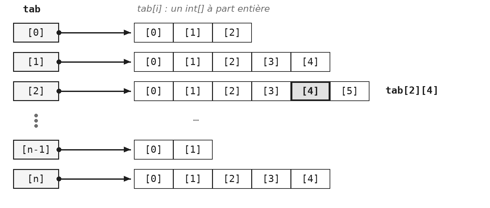
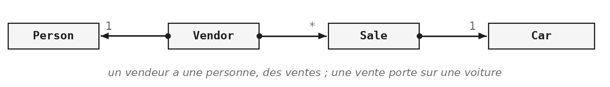

Vous avez déjà manipulé des tableaux, en C# et au cours d'introduction à la programmation. Ce module ne les réapprend pas : il s'arrête sur ce qui surprend encore, en particulier le fait qu'un tableau soit une référence, puis sur les deux façons de le parcourir. Il présente ensuite l'opérateur ternaire, et termine sur des objets qui collaborent et se rangent dans un tableau.

> **À la fin de ce module, vous saurez**
> - déclarer un tableau, et expliquer pourquoi sa taille ne change plus ;
> - prévoir ce que devient un tableau passé à une méthode ;
> - choisir entre la boucle indexée et la boucle for-each ;
> - construire et parcourir un tableau de tableaux, même quand ses lignes ont des longueurs différentes ;
> - employer l'opérateur ternaire là où il aide, et y renoncer là où il nuit ;
> - faire collaborer plusieurs classes, dont l'une range des objets dans un tableau.

## 1. Un tableau, c'est une taille fixe

### Déclarer un tableau

Un tableau se déclare de deux façons : avec `new` et une taille, ou avec la liste de ses valeurs entre accolades.

```java
int[]    nombres = new int[5];            // 5 cases, toutes a 0
String[] mots    = { "Hello", "world" };  // 2 cases, deja remplies
```

Dans le premier cas, le tableau naît rempli de valeurs par défaut : des zéros pour des `int`, `null` pour des objets. Dans les deux cas, sa taille est fixée une fois pour toutes, au moment de sa création. C'est la limite du tableau, et c'est aussi ce qui le rend simple et rapide. Quand cette limite devient gênante, il faut une collection, qui grandit selon les besoins : c'est le sujet du module `COL`.

> **Démonstration** - `Demo_TAB` : cinq pièges, et pourquoi ils existent
> La démonstration ouvre le module, avant toute théorie. Elle ne présente pas les tableaux : elle tombe dans leurs pièges, un par un, et regarde ce que le langage répond. Le point à retenir tient en une phrase : un tableau n'est pas une valeur, c'est une référence. Quatre des cinq pièges en découlent.

### Ce que la démonstration a montré

- **Un tableau de `int` naît à zéro, un tableau d'objets à `null`.** Accéder à une case `null` comme si elle contenait un objet lève une `NullPointerException`.
- **`System.out.println(tableau)` affiche une adresse, pas des valeurs.** Pour voir le contenu, il faut `Arrays.toString(tableau)`, de la classe `java.util.Arrays`.
- **`tableau.length` est un champ, `texte.length()` une méthode.** Il n'y a rien à comprendre : c'est une incohérence du langage, pas une règle. Autant le savoir plutôt que de chercher une justification.
- **Passer un tableau à une méthode, c'est passer son adresse.** C'est le point le plus important.

Une méthode qui reçoit un tableau ne reçoit pas une copie : elle reçoit l'adresse du vôtre, comme pour tout objet (voir `POO §6`). Elle peut donc le modifier sans rien retourner, et la modification se voit chez l'appelant. Pour travailler sur une vraie copie, il faut la demander, avec `Arrays.copyOf`. Le mémento technique décrit où vivent le tableau et la variable qui le désigne (`TEC-EXE.2` et `TEC-EXE.3`).

### Un tableau de tableaux

Un tableau à deux dimensions n'existe pas vraiment en Java : c'est un tableau dont chaque case contient un autre tableau.

```java
int[][] matrice = new int[3][3];   // un tableau DE TABLEAUX

matrice[1]                         // la deuxieme ligne, un int[]
matrice[1][2]                      // la troisieme case de cette ligne
```

Retenez la distinction entre les deux dernières lignes. `matrice[1]` n'est pas un nombre : c'est un tableau, qu'on peut passer à une méthode, mesurer avec `length` ou parcourir. `matrice[1][2]` est un nombre. Cette lecture explique aussi qu'il y ait deux `length` différents : `matrice.length` compte les lignes, `matrice[1].length` compte les cases de la deuxième ligne.

Elle a une conséquence que `TAB §3` exploite : rien n'oblige les lignes à avoir toutes la même longueur.

## 2. Parcourir un tableau

Deux formes de boucle permettent de parcourir un tableau, et chaque parcours demande de choisir entre les deux.

### La boucle indexée

La boucle `for` classique fait avancer un compteur, qui sert d'indice. Comme elle dispose de l'indice, elle peut écrire dans le tableau :

```java
for (int i = 0; i < tab.length; i++) {
    tab[i] = tab[i] * 2;
}
```

Notez la condition : `i < tab.length`, avec un inférieur strict, parce que les indices vont de zéro à `length - 1`. Un inférieur ou égal provoque une `ArrayIndexOutOfBoundsException`, et c'est probablement l'erreur la plus fréquente de toute la programmation quand on utilise des tableaux.

### La boucle for-each

La boucle for-each se lit « pour chaque entier `v` contenu dans `tab` » :

```java
for (int v : tab) {
    System.out.println(v);
}
```

Elle n'expose pas l'indice, ce qui la rend plus courte, plus lisible, et supprime d'un coup le risque de sortir du tableau. En contrepartie, `v` est une copie de la valeur de la case : lui affecter quelque chose ne modifie pas le tableau. C'est une restriction, pas un défaut, et l'exercice `TAB.2` vous fera essayer pour le constater.

### Laquelle choisir

| Vous voulez | La boucle |
|---|---|
| lire seulement | for-each |
| écrire dans le tableau | boucle indexée |
| connaître la position de chaque élément | boucle indexée |

Dans le doute, prenez la for-each : c'est celle qui se relit le mieux. La règle tient en une ligne : prenez la boucle qui montre le moins de choses. Si l'indice ne sert à rien, ne l'écrivez pas.

### Deux boucles imbriquées

Pour remplir une matrice, la boucle extérieure parcourt les lignes, et la boucle intérieure les cases de chaque ligne :

```java
int valeur = 1;
for (int ligne = 0; ligne < n; ligne++) {
    for (int col = 0; col < n; col++) {
        matrice[ligne][col] = valeur;
        valeur = valeur + 1;
    }
}
```

Le compteur `valeur` doit survivre au passage d'une ligne à l'autre : il se déclare donc avant la première boucle. Déclaré à l'intérieur d'une boucle, il serait remis à sa valeur initiale à chaque tour. Avant d'écrire deux boucles imbriquées, regardez la portée de chaque variable.

> **Exercices** - `TAB.1` Une matrice carrée
> Deux méthodes statiques : `carree` construit la matrice, `enTexte` la met en forme. Aucune des deux n'affiche : c'est la séparation entre le calcul et le dialogue, posée au module `POO`. Le format d'`enTexte` est imposé au caractère près, parce que le test le vérifie.

## 3. Des lignes de tailles différentes

Un tableau de tableaux n'a aucune raison d'être rectangulaire : chaque case de gauche contient un tableau, de la longueur qu'on veut.



La colonne de gauche est le tableau `tab` : ses cases ne contiennent pas des nombres, mais chacune une référence vers un autre tableau, représentée par la flèche. Chaque ligne est donc un `int[]` complet, avec sa propre longueur : `tab[0].length` vaut 3, `tab[2].length` vaut 6. Un tableau « rectangulaire » n'est que le cas particulier où ces longueurs sont égales.

Pour lire `tab[2][4]`, on suit d'abord la flèche de la case `[2]`, puis on prend la case `[4]` du tableau d'arrivée.

### Déclarer les lignes une par une

Pour un tableau dont les lignes ont des longueurs différentes, la seconde paire de crochets reste vide : on annonce le nombre de lignes, pas leur longueur. Chaque ligne est ensuite créée à sa taille.

```java
int[][] triangle = new int[n][];

for (int i = 0; i < n; i++) {
    triangle[i] = new int[i + 1];
}
```

Entre la déclaration et la création d'une ligne, cette ligne vaut `null`. Y accéder donne une `NullPointerException`, et non un tableau vide.

Le parcours d'un tel tableau ne peut plus supposer une largeur constante. Deux boucles for-each imbriquées s'en sortent naturellement : la première parcourt des `int[]`, la seconde des `int`, et chaque ligne annonce sa propre longueur.

> **Exercices** - `TAB.2` Le triangle de Pascal
> Chaque nombre est la somme des deux qui le surplombent, les bords valent 1, et la ligne d'indice `i` contient `i + 1` nombres. L'affichage se fait avec deux boucles for-each imbriquées. Vous pourriez aussi utiliser des boucles indexées, mais c'est inutile pour afficher un contenu (une action qui ne fait que lire les valeurs contenues dans le tableau).

## 4. L'opérateur ternaire

Un opérateur fait en une expression ce qu'un `if` demande en cinq lignes. Cette section montre où il aide, et où il commence à nuire.

### La syntaxe

```java
// condition ? valeurSiVrai : valeurSiFaux
```

::: cote-a-cote
```java
// avec un if
public int max(int a, int b) {
    if (a > b) {
        return a;
    } else {
        return b;
    }
}
```
```java
// avec l'operateur ternaire
public int max(int a, int b) {
    return a > b ? a : b;
}
```
:::

Le point d'interrogation sépare la condition des deux valeurs, et les deux-points séparent les valeurs entre elles. Lisez-le comme une question : « `a` est-il plus grand que `b` ? Si oui `a`, sinon `b`. » *Ternaire* signifie simplement « à trois opérandes » : c'est le seul opérateur de Java dans ce cas, d'où son nom.

### Ce qu'un `if` ne permet pas

Le ternaire retourne une valeur, le `if` ne retourne rien. C'est la différence essentielle, et la seule bonne raison d'employer le ternaire.

```java
int plusGrand = a > b ? a : b;      // possible
int plusGrand = if (a > b) a; ...   // n'existe pas
```

Un `if` est une instruction : il fait quelque chose. Le ternaire est une expression : il vaut quelque chose. On peut donc l'écrire partout où une valeur est attendue, à droite d'un `return` ou d'une affectation, ce qu'un `if` ne permet pas. Employer un ternaire uniquement pour raccourcir un `if` qui ne retourne rien, c'est en revanche le détourner de son usage.

### Un booléen se retourne tel quel

Une écriture revient souvent dans les copies d'examen :

::: cote-a-cote
```java
// trop verbeux
if (a > b) {
    return true;
} else {
    return false;
}
```
```java
// direct
return a > b;
```
:::

Une comparaison comme `a > b` vaut déjà `true` ou `false` : c'est un booléen, au même titre qu'une variable `boolean`. Le `if` de gauche ne fait que recopier ce booléen, en cinq lignes. Le ternaire n'arrange rien : `return a > b ? true : false;` est la même redondance, en une ligne. Face à l'un comme à l'autre, `return a > b;` dit la même chose, plus directement.

Le code de gauche fonctionne, mais il montre qu'on n'a pas vu qu'une comparaison est une valeur : à l'examen, c'est une faute de style (`CC-MET.9`).

### Où s'arrête l'intérêt

Le ternaire s'imbrique : `a ? x : (b ? y : z)`. Rien ne l'interdit, et le compilateur ne protestera jamais. La question n'est pas ce que le langage autorise, mais ce qu'un collègue pourra relire dans six mois. L'exercice vous demande d'en écrire un à trois niveaux : faites-le vraiment, relisez-le, et décidez vous-même si vous le garderiez. C'est une décision d'écriture, pas une règle ; le mémento Clean Code se contente de demander des méthodes courtes et lisibles (`CC-MET.2`).

> **Exercices** - `TAB.3` L'opérateur ternaire
> Un petit jeu de dés, fourni et fonctionnel à deux méthodes près. Chacune tient en une seule instruction avec un ternaire. Attention au sens de la comparaison : selon la façon dont vous l'écrivez, l'égalité tombe du côté du premier ou du second joueur, et le test le vérifie. Remarquez aussi que ces deux méthodes ne lancent aucun dé : elles reçoivent les résultats en paramètres. C'est ce qui les rend prévisibles, et donc testables. Vous retrouverez cette idée au module `JUN`.

## 5. Des objets qui se connaissent

Jusqu'ici, les exercices manipulaient une classe à la fois. Le dernier en fait collaborer quatre, et range des objets dans un tableau.

### Un objet peut en contenir un autre

Un champ peut avoir pour type une classe, comme il peut être un `int` : vous en écrivez depuis le module `POO`. Ce qui change ici, c'est le nombre de classes qui collaborent.



Le vendeur est modélisé comme un rôle que joue une personne : un `Vendor` possède une `Person`, sous la forme d'un champ. Il enregistre des ventes (`Sale`), et chaque vente porte sur une voiture (`Car`).

Dans la solution, le champ `personne` est `final` : un vendeur ne change pas de personne. Le tableau des ventes l'est aussi, et pourtant ses cases se remplissent au fil des ventes. `final` fige la référence, pas l'objet désigné : le champ désignera toujours le même tableau, mais rien n'empêche de modifier ce tableau (voir `POO §2` et `POO §6`).

On aurait pu, tout aussi légitimement, écrire qu'un vendeur *est* une personne, ce qui se traduit par de l'héritage, que vous connaissez par le C#. Ce n'est pas faux : c'est un autre modèle. Celui de l'exercice a un avantage : la même personne pourrait jouer d'autres rôles, être cliente par exemple, sans changer de classe. Le module `ABS` compare les deux approches sur cet exemple.

### Ne pas stocker ce qui se déduit

Le prix catalogue et la réduction suffisent à retrouver le prix réel d'une vente. En faire un troisième champ créerait une donnée redondante : le jour où la réduction change, plus rien ne garantit que le prix réel suive. C'est exactement le problème du champ `age` rencontré en `POO.3` (voir `POO §3`), et la règle vaut bien au-delà des voitures : ce qui se déduit ne se stocke pas, il se calcule.

### Un tableau de taille fixe dans un objet

C'est ici que la taille fixe, annoncée en ouverture du module, devient une contrainte concrète. Le vendeur range ses ventes dans un tableau dimensionné à la construction. Il faut donc :

- décider d'un maximum, puisque le tableau ne grandira pas ;
- retenir soi-même combien de cases sont occupées ;
- refuser une vente quand le tableau est plein : `enregistrer` retourne alors `false` ;
- parcourir les ventes jusqu'au nombre enregistré, et non jusqu'à `ventes.length`.

Cette dernière règle mérite d'être essayée plutôt que lue : parcourir jusqu'à `ventes.length` passe aussi sur les cases vides, qui valent `null`. Écrivez d'abord cette version-là, et regardez ce qui se passe.

> **Exercices** - `TAB.4` Des objets qui se connaissent
> Quatre classes, dont trois à écrire entièrement, et un format de texte vérifié au caractère près. Deux questions du fascicule touchent au mémento Clean Code : `Sale` a besoin de la marque et du modèle de la voiture ; vaut-il mieux qu'elle lise ses champs, ou qu'elle les lui demande (`CC-OBJ.1`) ? Et faut-il un accesseur qui retourne le tableau de ventes, sachant ce que l'appelant pourrait alors en faire (`CC-OBJ.2`) ?

## Ce qu'il faut retenir

- Un tableau a une taille fixe, décidée au `new`.
- Un tableau est une référence : le passer à une méthode, c'est passer son adresse.
- `matrice[1]` est une ligne, `matrice[1][2]` est un nombre.
- La for-each pour lire, la boucle indexée pour écrire.
- Le ternaire retourne une valeur ; un `if`, non.
- Ce qui se déduit ne se stocke pas.

La deuxième règle est celle qui coûte le plus cher quand on l'oublie : une méthode qui modifie le tableau qu'elle reçoit le modifie aussi pour l'appelant.
